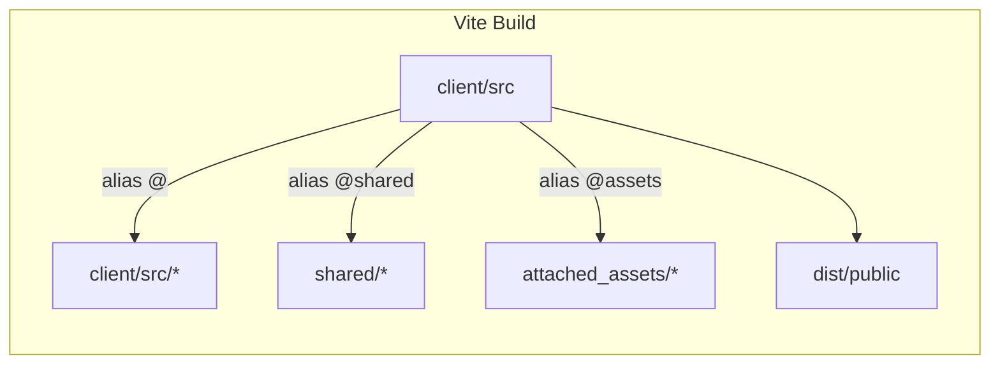

# Client Functional Documentation (V3)

This document describes the client-side architecture, primary flows, and integration points for the Quest to Uranus web client.

- **Tech stack:** React 18, TypeScript, Vite, wouter, TanStack Query, TailwindCSS, shadcn/ui, Socket.IO
- **Root:** `client/` (Vite root). Build output: `dist/public` (served by the server bundle)
- **Shared types with server:** `shared/schema.ts`

## Overview

The client is a single-page React application that:
- Renders routes with wouter (`Switch`/`Route`)
- Fetches data via TanStack Query using a centralized `apiRequest` wrapper with CSRF + credentials
- Receives realtime updates using Socket.IO to refresh game state and image generation results
- Provides DevTools for content administration gated by an admin token stored in browser localStorage
- Supports device-specific layouts (mobile, compact desktop, full desktop) with responsive UI

## Entry Points

- **HTML shell and font assets:** `client/index.html`
- **App mount:** `client/src/main.tsx`
- **App composition (providers + router):** `client/src/App.tsx`

```mermaid
flowchart LR
  index[client/index.html] --> main[client/src/main.tsx]
  main --> app[client/src/App.tsx]
  app --> qcp[QueryClientProvider]
  app --> ttp[TooltipProvider]
  app --> router[Switch/Route (wouter)]
  app --> toaster[Toaster]
```

## Routing

Routes are defined in `client/src/App.tsx` using wouter:
- `/` → Loading gate and asset prefetch: `client/src/pages/LoadingPage.tsx`
- `/welcome` → Onboarding, username, preferences: `client/src/pages/WelcomePage.tsx`
- `/menu` → Main menu: `client/src/pages/MainMenuPage.tsx`
- `/help` → Help content: `client/src/pages/HelpPage.tsx`
- `/interview/:gameId` → Pre-flight Q&A: `client/src/pages/InterviewPage.tsx`
- `/game/:gameId` → Game UI, device-specific shells: `client/src/pages/GamePage.tsx`
  - Mobile: `MobileGamePage.tsx`
  - Desktop (compact): `CompactDesktopGamePage.tsx`
  - Desktop (full): `DesktopGamePage.tsx` (via `?view=full` query param)
- `/dev-tools` → Admin tools hub: `client/src/pages/DevToolsPage.tsx`
- `/dev-tools/cache` → Image cache manager (legacy route): `client/src/pages/CacheManagementPage.tsx`
- Fallback → `client/src/pages/not-found.tsx`

```mermaid
flowchart TD
  A[/ /] -->|saved username?| B[/ /menu]
  A -->|no username| C[/ /welcome]
  C -->|create/auth user| D[Preferences]
  D -->|save| B[/ /menu]
  B --> E[/ /interview/:gameId]
  E --> F[/ /game/:gameId]
  F -->|?view=full| F1[Full Desktop View]
  F -->|default| F2[Compact Desktop/Mobile]
  B --> G[/ /help]
  B --> H[/ /dev-tools]
  H --> I[Multiple Tabs]
```

## Core State and Hooks

### Query Client and API Wrapper
**File:** `client/src/lib/queryClient.ts`

Provides:
- `apiRequest(method, url, data)` with JSON headers, credentials, CSRF handling
- Admin token helpers (persisted in `localStorage`), and cross-tab change events
- Default QueryClient opts: no retries, infinite stale, no refocus refetch
- Global error handling for 401 (redirects to `/welcome`) and CSRF token refresh on 403
- `REFERENCE_DATA_QUERY_OPTIONS` constant for reference data that should never refetch
- `buildUrlFromQueryKey` function that converts array query keys to URLs with query params

### Game Logic Hook
**File:** `client/src/hooks/useGameLogic.ts`

Central hook for game state management:
- Fetches game state, items, themes, styles, system defaults
- Performs actions (`POST /api/game/action`), update settings, equip items
- Generates images (`POST /api/generate-image`)
- Wires up Socket.IO events to invalidate queries
- Manages UI state (settings dialogs, custom actions, image display)
- Handles optimistic updates for equipment mutations
- Computes `isIntroReady` to determine when intro turn is complete

### User Settings Hook
**File:** `client/src/hooks/useUserSettings.ts`

Dedicated hooks for user preferences:
- `useUserSettings()`: Fetches user preferences from `/api/user/preferences`
- `useUpdateUserSettings()`: Mutation hook that updates preferences and invalidates cache
- Handles theme, style, and image model preferences

### Loading State Hooks
- `client/src/hooks/useAppLoading.ts`: Global loading state management
- `client/src/hooks/useGameContentLoading.ts`: Game-specific loading states

### Device Detection
**File:** `client/src/hooks/use-mobile.tsx`

- `useIsMobile()`: Returns boolean (or undefined during initial detection)
- Used by `GamePage` to route to appropriate layout component

### Utility Hooks
- `client/src/hooks/useDebounce.ts`: Debounce values for search/input
- `client/src/hooks/use-toast.ts`: Toast notification hook (shadcn/ui)

## Data Access & Query Keys

The client follows segmented array query keys aligned with the underlying routes. See:
- **Implementation:** `client/src/lib/queryClient.ts`
- **Guidelines:** `docs_master/current/QUERY_KEY_GUIDELINES.md`

### Patterns

**Reads:**
```typescript
useQuery({ queryKey: ['api', 'reference', 'image-models'] })
```

**With query params:**
```typescript
useQuery({ 
  queryKey: ['api', 'cache', 'images', { templateName: 'hero', page: 2 }] 
})
```

**Writes:**
```typescript
await apiRequest('POST', '/api/game/action', payload);
queryClient.invalidateQueries({ queryKey: ['api', 'game', gameId] });
```

**Reference data (never refetch):**
```typescript
useQuery({
  queryKey: ['api', 'reference', 'story-themes'],
  ...REFERENCE_DATA_QUERY_OPTIONS,
})
```

### Standard Key Patterns

| Concern | Example key | Notes |
| --- | --- | --- |
| Read-only public APIs | `['api', 'reference', 'image-models']` | Mirrors `/api/reference/image-models` |
| Admin endpoints | `['api', 'admin', 'mod-visual-styles']` | Stick to lowercase segments |
| Entity with parameter | `['api', 'game', gameId]` | Dynamic values become separate segments |
| Optional query string | `['api', 'user', 'search', { pattern }]` | Omit the object if no params |
| Pipeline lab context | `['admin', 'pipeline', 'context', gameId, turnNumber]` | Admin-only endpoints |

## API Client, Auth, and CSRF

### CSRF Protection
- All state-changing requests (`POST`, `PUT`, `PATCH`, `DELETE`) attach `X-CSRF-Token` from `/api/csrf-token`
- Token is cached after first fetch and reused until 403 (then reset)
- `credentials: 'include'` used consistently to leverage server-side sessions

### Admin Authentication
- Admin DevTools require `Authorization: Bearer <token>` header
- Token is stored under `uranus-admin-token` in `localStorage`
- Cross-tab synchronization via `CustomEvent` and `StorageEvent` listeners
- `subscribeToAdminAuthTokenChanges()` hook for components that need to react to token changes

### Error Handling
- **401 errors:** Automatically clear admin token and redirect to `/welcome` (unless already there)
- **403 errors with CSRF terms:** Reset CSRF token cache and retry
- Global error handlers in `QueryCache` and `MutationCache` catch 401s from queries/mutations

**Files:**
- `client/src/lib/queryClient.ts` (CSRF, token storage, eventing, queryFn)

## Realtime (Socket.IO)

**File:** `client/src/lib/socket.ts`

- Socket initialized with auto-connect disabled
- Dev URL: uses `window.location.origin` (supports localhost, IP addresses)
- Production: uses empty string for same-origin connection
- Singleton pattern: `getSocket()` returns the same instance, `connectSocket()` ensures connection

### Game Subscriptions
**Wired in:** `client/src/hooks/useGameLogic.ts`

- `joinGame(gameId)`: Join the game room on mount
- `turnComplete`: Invalidates `['api', 'game', gameId]` and shows toast
- `imageReady`: Invalidates and refetches `['api', 'game', gameId]` immediately, shows success toast
- `imageFailed`: Shows error toast with retry option
- `leaveGame(gameId)`: Cleanup on unmount

### Debug Logging
- `llmLog`: Optional console logging when `CONSOLE_LLM_LOG=true` (server-side setting)
- Logs include function name, prompt, response, metadata, execution time, game context

## Primary Flows

### Loading Gate (`/`)
- Preloads splash videos, then routes based on `quest-to-uranus-username` in `localStorage`
- **Files:** `client/src/pages/LoadingPage.tsx`

### Welcome & Preferences (`/welcome`)
- **Modes:** New user (create), Existing user (search+select)
- **New:** `PUT /api/user` to create user + session, then preferences
- **Existing:** Search `/api/user/search?pattern=...`, then `PUT /api/user` to re-establish session
- **Preferences:** Saved via `PATCH /api/user/preferences` (theme, style, image model)
- **Files:** `client/src/pages/WelcomePage.tsx`

### Main Menu (`/menu`)
- Lists games for current user, start new, delete
- **Start:** `POST /api/game/start` → route to `/game/:id`
- **Delete:** `DELETE /api/game/:id`
- Settings dialog for preferences with referenced catalogs
- **Files:** `client/src/pages/MainMenuPage.tsx`, `client/src/components/UserSettingsDialog.tsx`

### Interview (`/interview/:gameId`)
- Questions: `/api/interview-questions/active`
- Save responses: `PATCH /api/games/:id/interview-responses`
- Optional AI assistance: `POST /api/interview/generate-answer`
- **File:** `client/src/pages/InterviewPage.tsx`

### Game (`/game/:gameId`)
- **Device routing:** `GamePage` detects device and routes to `MobileGamePage`, `CompactDesktopGamePage`, or `DesktopGamePage` (with `?view=full`)
- **Logic centralization:** All mutations and state managed in `useGameLogic` hook
- **Turn actions:** `POST /api/game/action` (may return a job to await; realtime updates via socket)
- **Image generation:** `POST /api/generate-image`; image status via socket
- **Equipment:** `PATCH /api/games/:id/equipped-items` (optimistic updates)
- **Settings:** `PATCH /api/games/:id/settings` (absurdity level)
- **User preferences:** `PATCH /api/user/preferences` (theme, style, image model)
- **Files:** 
  - `client/src/pages/GamePage.tsx` (router)
  - `client/src/pages/MobileGamePage.tsx`
  - `client/src/pages/DesktopGamePage.tsx`
  - `client/src/pages/CompactDesktopGamePage.tsx`
  - `client/src/hooks/useGameLogic.ts`
  - `client/src/components/TurnCard.tsx`

### DevTools (`/dev-tools`)
- **Gated by admin token:** Uses admin APIs under `/api/admin/*`
- **Tabs:**
  - **Prompts:** Manage narrative prompts (`PromptsTab`)
  - **Events:** Manage game events (`EventsTab`)
  - **Items:** Manage items catalog (`ItemsTab`)
  - **NPCs:** Manage NPCs catalog (`NpcsTab`)
  - **Image Prompts:** Manage image generation prompts (`ImagePromptsTab`)
  - **Image Models:** Configure image model providers (`DevToolsImageModels`)
  - **PCE:** Prompt Composition Engine management (`PceTab`)
    - Feature flag toggle
    - Story themes catalog (CRUD)
    - Visual styles catalog (CRUD)
  - **PCE Tester:** Test meta prompts with custom context (`PcePromptTesterTab`)
  - **Pipeline Lab:** Diagnostics for PCE V2 pipeline (`PipelineLabTab`)
    - Context modes: game, fixture, custom scenario
    - Stage timeline and workbench
    - Variable resolution and prompt preview
    - End-to-end runner
    - Request monitor
  - **Interview:** Manage interview questions (`InterviewTab`)
  - **Reference:** Manage reference releases (`ReferenceTab`)
  - **LLM Logs:** View LLM interaction logs (`LogsTab`)
  - **Image Cache:** Manage image cache (legacy route, also in Cache tab)
  - **Settings:** System settings (`SettingsTab`)
- **Files:** 
  - `client/src/pages/DevToolsPage.tsx`
  - `client/src/pages/devtools/*.tsx`
  - `client/src/components/DevToolsImageModels.tsx`

### Image Cache Manager (`/dev-tools/cache`)
- **Legacy route:** Also available as "Cache" tab in DevTools
- Stats: `/api/cache/stats`
- List: `/api/cache/images` (with query params)
- Clear: `/api/cache/clear`
- Delete: `/api/cache/images/:id`
- **Files:** 
  - `client/src/pages/CacheManagementPage.tsx` (legacy)
  - `client/src/pages/devtools/CacheTab.tsx` (current)

## DevTools Special Features

### Pipeline Lab
**File:** `client/src/pages/devtools/PipelineLabTab.tsx`  
**Hook:** `client/src/hooks/usePipelineLab.ts`

Advanced diagnostics interface for the PCE V2 pipeline:

- **Context Modes:**
  - **Game:** Load context from existing game and turn
  - **Fixture:** Load from pre-configured test fixtures
  - **Custom:** Build scenario from scratch with Scenario Builder

- **Components:**
  - `ContextBar`: Mode selector, game/fixture picker, custom context builder
  - `ResolvedInputsAccordion`: Shows resolved template variables
  - `StageTimeline`: Visual pipeline stage status (master → narrative → image → actions)
  - `StageWorkbench`: Stage-specific prompt preview, variables, overrides, execution
  - `TurnSnapshot`: Complete turn state preview
  - `EndToEndRunner`: Run full pipeline with optional overrides
  - `RequestMonitor`: Real-time HTTP/LLM request logs
  - `ScenarioBuilder`: Custom scenario creation dialog

- **API Endpoints:**
  - `GET /api/admin/pipeline/context` - Load context
  - `POST /api/admin/pipeline/context/custom` - Create custom context
  - `GET /api/admin/pipeline/fixtures` - List fixtures
  - `GET /api/admin/pipeline/template-variables` - Get resolved variables
  - `POST /api/admin/pipeline/run-stage` - Execute single stage
  - `POST /api/admin/pipeline/run-all` - Execute full pipeline
  - `GET /api/admin/pipeline/logs` - Get request logs
  - `GET /api/admin/pipeline/variables` - Get stage variables
  - `GET /api/admin/pipeline/stage-result` - Get cached stage result
  - `GET /api/admin/pipeline/resolved-prompt` - Get resolved prompt

### PCE Tester
**File:** `client/src/pages/devtools/PcePromptTesterTab.tsx`  
**Hook:** `client/src/hooks/usePceCatalogs.ts`

Test interface for Prompt Composition Engine:
- Select theme, style, image model from catalogs
- Configure narrative context (13 fields)
- Build and preview meta prompts
- Live LLM testing
- Multiple preview tabs (meta prompt, example, instructions, response)

## UI Components & Styling

### Component Library
- **Shadcn/ui primitives:** `client/src/components/ui/*`
  - Button, Card, Dialog, Input, Label, Select, Tabs, Toast, Tooltip, etc.
- **Custom components:**
  - `ActionChip`: Action button with icon
  - `NPCCard`: NPC display card
  - `TurnCard`: Turn narrative display with actions
  - `UserSettingsDialog`: Preferences dialog
  - `DevToolsImageModels`: Image model configuration
  - And many more in `client/src/components/*`

### Visual Effects
- **CRT Background:** `client/src/components/CRTBackground.tsx` (optional retro effect)

### Loading Components
- `client/src/components/loading/*`: Various loading states and spinners

### Global Styles
- **File:** `client/src/index.css`
- **Tailwind config:** `tailwind.config.ts` (scoped to `client/` paths)
- Uses CSS variables for theming (light/dark mode support via shadcn/ui)

## Build & Aliases (Vite)

**Config:** `vite.config.ts`

- **Root:** `client/`, output: `dist/public`
- **Aliases:**
  - `@` → `client/src`
  - `@shared` → `shared`
  - `@assets` → `attached_assets`

- **Manual chunks** for vendor splitting:
  - `vendor-react`: React and scheduler
  - `vendor-react-query`: TanStack Query
  - `vendor-motion`: Framer Motion
  - `vendor`: Other dependencies



## Local Storage Keys

- `quest-to-uranus-username` → Username convenience for routing (non-auth)
- `uranus-admin-token` → Admin token for DevTools (auth header)

## Security Considerations

- All mutating requests include `X-CSRF-Token` and `credentials: 'include'`
- Admin endpoints require `Authorization: Bearer <token>` (set via DevTools page or localStorage)
- On 401, client clears admin token and redirects to `/welcome`
- On CSRF 403, token cache resets and request can be retried
- Cross-tab token synchronization via events

## Error Handling Patterns

### Query Errors
- Global `QueryCache.onError` catches 401s and redirects
- Component-level error boundaries (when needed)

### Mutation Errors
- Global `MutationCache.onError` catches 401s and redirects
- Component-level `onError` callbacks for user-facing toasts

### Socket Errors
- Socket.IO automatically handles reconnection
- Component-level error handlers for `imageFailed` events

## Testing & Troubleshooting

### Best Practices
- Prefer `apiRequest` instead of direct `fetch` to ensure CSRF + credentials
- Verify query keys follow string-path convention (see `QUERY_KEY_GUIDELINES.md`)
- Socket events should always invalidate related queries (`['api', 'game', gameId]`)
- Use `REFERENCE_DATA_QUERY_OPTIONS` for reference data that should never refetch

### Common Issues

**Socket not connecting:**
- Check Socket.IO server is running
- Verify `window.location.origin` in dev mode
- Check browser console for connection errors

**401 redirects:**
- Session expired on server
- Check server logs for session validation failures
- Verify cookies are being sent (`credentials: 'include'`)

**CSRF token errors:**
- Token cache may be stale; 403 with CSRF terms resets cache
- Ensure `/api/csrf-token` endpoint is accessible

**Query not refetching:**
- Check query key matches invalidation key exactly
- Verify `enabled` option isn't blocking the query
- Check `staleTime` isn't set to `Infinity` (unless intended)

## File Index (Pointers)

### Core Application
- **App shell:** `client/src/App.tsx`
- **Entrypoint:** `client/src/main.tsx`
- **API/Query:** `client/src/lib/queryClient.ts`
- **Sockets:** `client/src/lib/socket.ts`

### Hooks
- **Game logic:** `client/src/hooks/useGameLogic.ts`
- **User settings:** `client/src/hooks/useUserSettings.ts`
- **Pipeline lab:** `client/src/hooks/usePipelineLab.ts`
- **PCE catalogs:** `client/src/hooks/usePceCatalogs.ts`
- **Device detection:** `client/src/hooks/use-mobile.tsx`
- **Loading:** `client/src/hooks/useAppLoading.ts`, `useGameContentLoading.ts`
- **Utilities:** `client/src/hooks/useDebounce.ts`, `use-toast.ts`

### Pages
- **Game:** `client/src/pages/GamePage.tsx` (router)
- **Game layouts:** `MobileGamePage.tsx`, `DesktopGamePage.tsx`, `CompactDesktopGamePage.tsx`
- **DevTools:** `client/src/pages/DevToolsPage.tsx`
- **DevTools tabs:** `client/src/pages/devtools/*.tsx`
- **Other pages:** `client/src/pages/*.tsx`

### Components
- **UI primitives:** `client/src/components/ui/*`
- **Custom:** `client/src/components/*`

### Shared Types
- **Schema:** `shared/schema.ts`

---

## Authoritative References

For deeper details, consult:
- **Query Key Guidelines:** `docs_master/current/QUERY_KEY_GUIDELINES.md`
- **Server routes & modules:** `docs_master/current/MODULE_ROUTES.md`, `docs_master/current/MODULE_SERVER_ENTRY.md`
- **AI integration:** `docs_master/current/MODULE_AI_SERVICE.md`
- **System overview:** `docs_master/current/SYSTEM_OVERVIEW.md`
- **Agent responsibilities:** `AGENTS.md`
- **PCE Pipeline Lab:** `docs_master/current/DEVTOOLS_PCE_PIPELINE_LAB.md`

