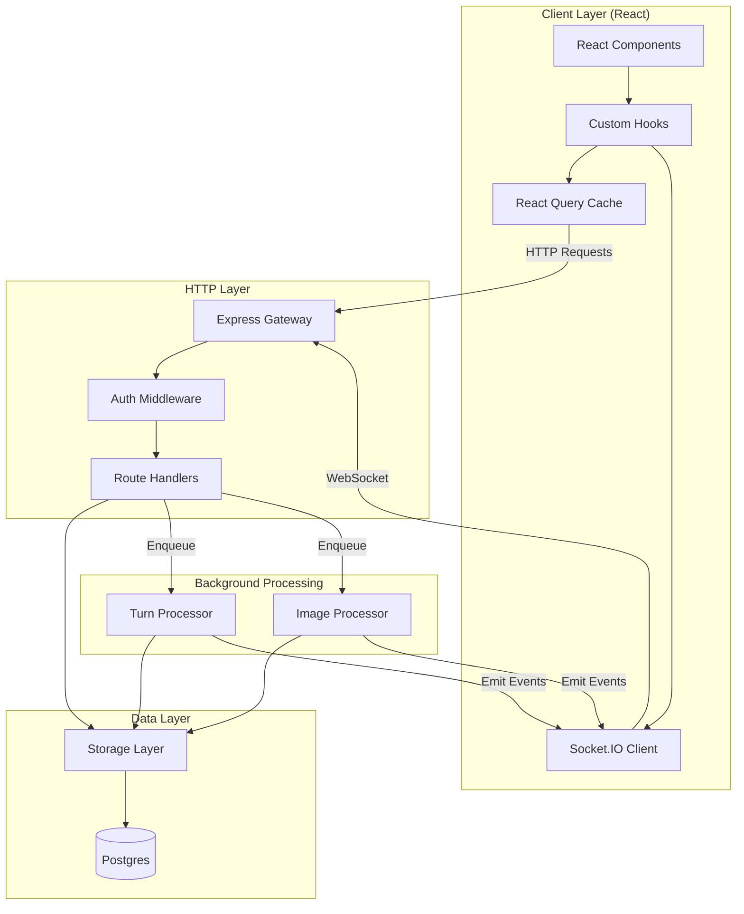
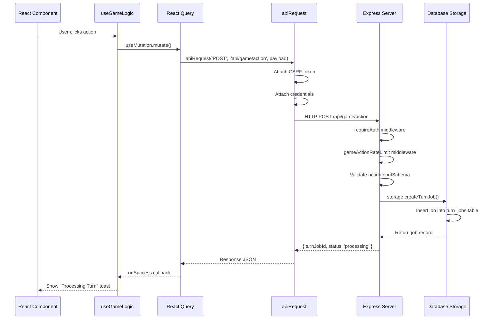
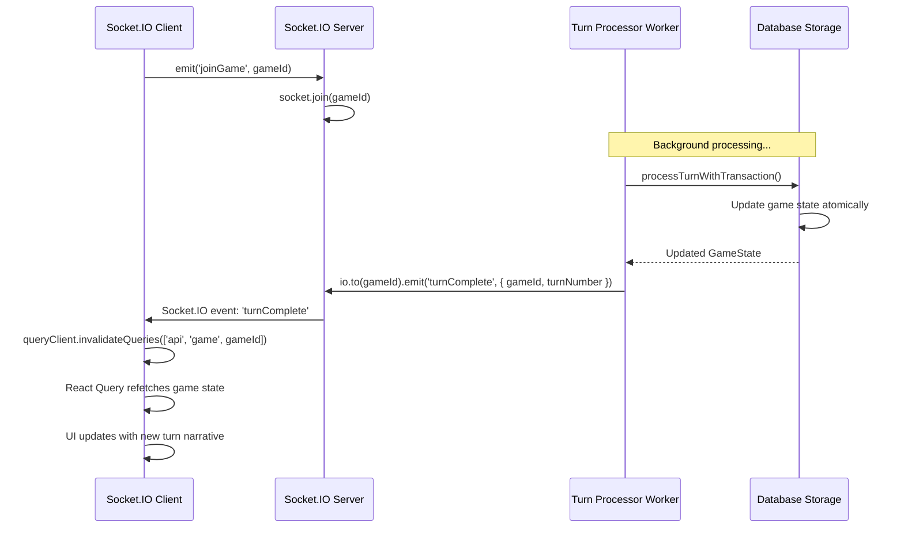
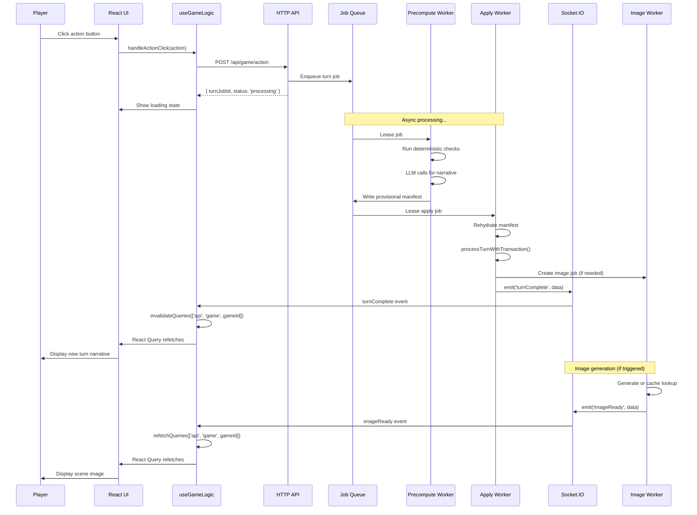
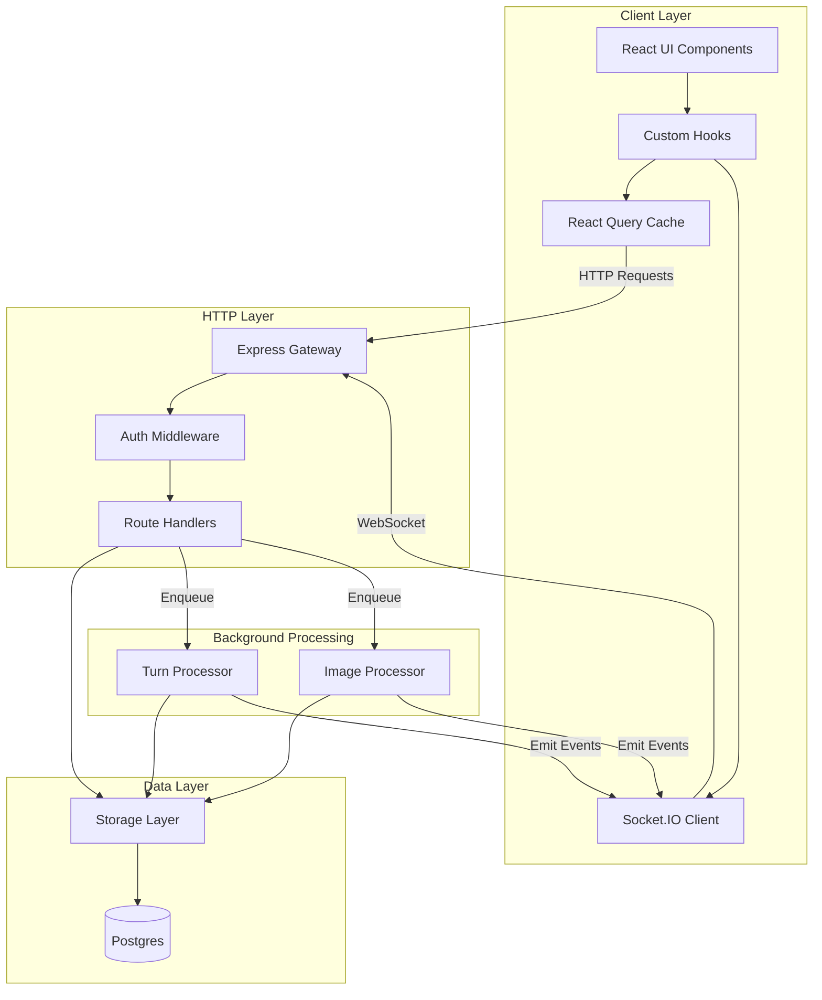
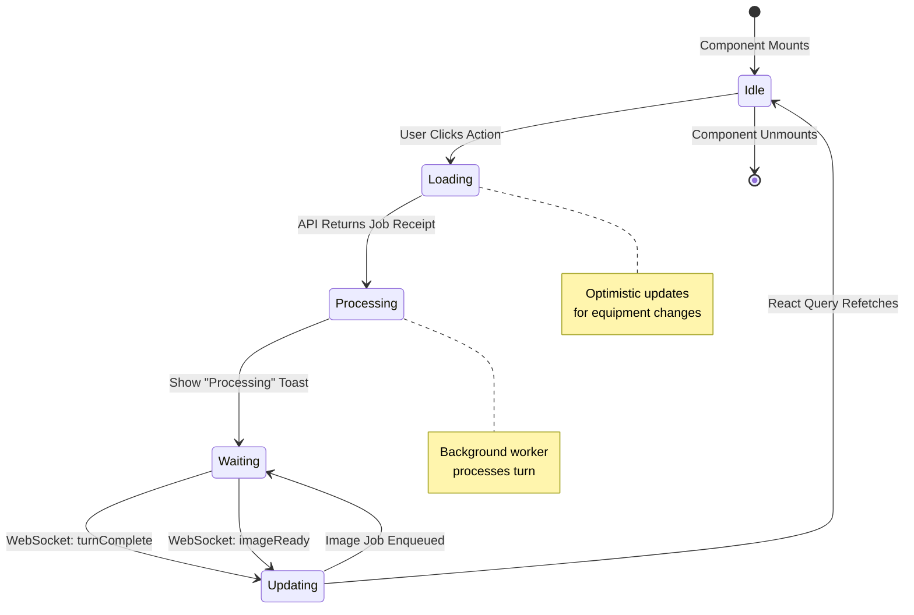
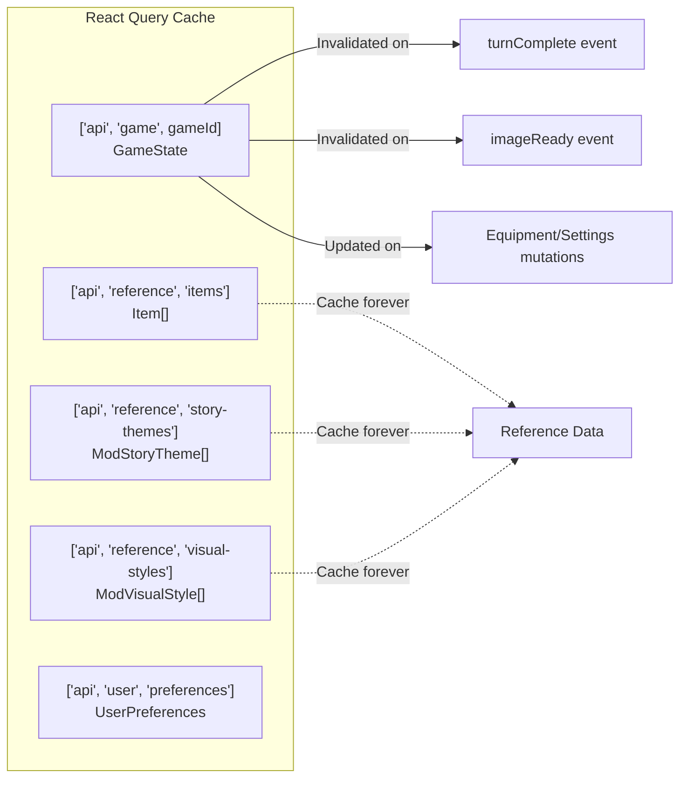

# Client-Game Interaction Architecture

**Target Audience:** Architects and game mechanics specialists

**Purpose:** This document provides a comprehensive technical guide to understanding how the Quest to Uranus client interacts with the game server, including communication patterns, state management, real-time updates, and the complete lifecycle of player actions.

---

## Context & Overview

### What It Is

The Quest to Uranus client is a React-based single-page application that serves as the player interface for a narrative-driven management game. The client operates as a **stateless presentation layer** that communicates with a backend server through two primary channels:

1. **HTTP/REST API**: Synchronous request-response for game state queries, mutations, and administrative operations
2. **WebSocket (Socket.IO)**: Real-time push notifications for asynchronous turn processing and image generation completion

### Why It Exists

The client-server architecture enables:
- **Decoupled processing**: Turn execution and image generation happen asynchronously in background workers
- **Security**: All game logic validation and state mutations occur server-side with proper authentication and authorization
- **Scalability**: Multiple workers can process turns concurrently while clients receive notifications via WebSocket
- **Real-time feedback**: Players receive immediate updates when their actions complete without polling

### Purpose Within the System

The client is the **Player Client Agent** as defined in the system architecture. It:
- Presents the game UI and manages optimistic UI state
- Reacts to server pushes via Socket.IO
- Coordinates page-specific logic while guarding against duplicate submissions
- Falls back to `/welcome` when sessions expire

---

## Technical Details

### Architecture Overview



### Components and Structure

#### 1. Core Client Modules

**Entry Points:**
- `client/src/main.tsx`: Application bootstrap and React root mount
- `client/src/App.tsx`: Provider composition (QueryClient, TooltipProvider, Toaster) and routing configuration

**State Management:**
- `client/src/lib/queryClient.ts`: Centralized API client with CSRF handling, admin token management, and React Query configuration
- `client/src/hooks/useGameLogic.ts`: Primary game state hook that orchestrates all game interactions
- `client/src/hooks/useUserSettings.ts`: User preference management

**Real-time Communication:**
- `client/src/lib/socket.ts`: Socket.IO singleton client with connection management

**Routing:**
- `client/src/pages/GamePage.tsx`: Device-aware router that selects mobile/desktop layouts
- `client/src/pages/MobileGamePage.tsx`: Mobile-optimized game interface
- `client/src/pages/DesktopGamePage.tsx`: Desktop game interface

#### 2. Server-Side Integration Points

**Gateway & Security Agent** (`server/index.ts`):
- Terminates HTTP connections
- Enforces security controls (Helmet CSP, CSRF, rate limiting)
- Exposes system health endpoints

**Game Orchestrator Agent** (`server/routes.ts`):
- Validates input and routes requests to downstream agents
- Bootstraps background services (turn workers, image workers)
- Manages Socket.IO namespace for client communication

**Turn Processor Agent** (`server/orchestrator/workers/turnPrecomputeWorker.ts`, `turnApplyWorker.ts`):
- Executes queued player actions
- Emits `turnComplete` events over Socket.IO

**Image Processor Agent** (`server/orchestrator/workers/imageWorker.ts`):
- Resolves scene art via cache-first generation
- Emits `imageReady` or `imageFailed` events

**Data Persistence Agent** (`server/storage.ts`):
- Translates domain models to Postgres
- Guarantees transactional safety via `processTurnWithTransaction`

### Technologies, Tools, and Frameworks

**Frontend Stack:**
- **React 18**: UI framework with functional components and hooks
- **TypeScript**: Type safety across client, server, and shared code
- **Vite 5**: Build tooling and dev server
- **React Query (TanStack Query) 5**: Server state management with caching, background refetching, and optimistic updates
- **Socket.IO Client 4**: WebSocket abstraction for real-time communication
- **Wouter**: Lightweight routing library
- **Tailwind CSS 3**: Utility-first styling
- **Radix UI**: Accessible component primitives
- **Zod**: Schema validation (shared with server)

**Backend Integration:**
- **Express 4**: HTTP server framework
- **Socket.IO Server 4**: WebSocket server
- **Postgres 15+**: Relational database
- **connect-pg-simple**: Session storage

**Shared Types:**
- `shared/schema.ts`: TypeScript interfaces and Zod schemas shared between client and server

### Relationships and Interactions

#### HTTP Request Flow



#### WebSocket Event Flow



#### Complete Turn Action Lifecycle



### Configurations and Parameters

#### Query Client Configuration

Located in `client/src/lib/queryClient.ts`:

```typescript
export const queryClient = new QueryClient({
  defaultOptions: {
    queries: {
      queryFn: getQueryFn({ on401: "throw" }),
      refetchInterval: false,        // Never poll automatically
      refetchOnWindowFocus: false,    // Don't refetch on tab focus
      staleTime: Infinity,            // Data never considered stale
      retry: false,                   // No automatic retries
    },
    mutations: {
      retry: false,
    },
  },
});
```

**Rationale:**
- `staleTime: Infinity` prevents unnecessary refetches since the server pushes updates via WebSocket
- `refetchInterval: false` avoids polling overhead
- `retry: false` prevents cascading failures and lets the UI handle errors explicitly

#### Socket.IO Configuration

Located in `client/src/lib/socket.ts`:

```typescript
const url = import.meta.env.DEV 
  ? (typeof window !== 'undefined' ? window.location.origin : 'http://localhost:5001')
  : '';
socket = io(url, {
  autoConnect: false  // Connection initiated explicitly
});
```

**Rationale:**
- Development mode uses `window.location.origin` to support localhost, IP addresses, and custom ports
- Production uses empty string for same-origin connection
- `autoConnect: false` allows explicit connection control per game context

#### Reference Data Query Options

```typescript
export const REFERENCE_DATA_QUERY_OPTIONS = {
  staleTime: Infinity,
  gcTime: Infinity,           // Keep in cache forever
  refetchOnMount: false,
  refetchOnWindowFocus: false,
  refetchOnReconnect: false,
  refetchInterval: false,
} as const;
```

**Rationale:**
- Reference data (items, themes, styles) changes infrequently and is published via admin endpoints
- Cache persists indefinitely to reduce API calls
- Only refetches when explicitly invalidated (e.g., after reference publication)

---

## Practical Guidance

### Step-by-Step: Player Action Flow

#### 1. User Initiates Action

**Component:** `DesktopGamePage.tsx` or `MobileGamePage.tsx`

```typescript
const handleActionClick = (action: string) => {
  if (!gameId || actionMutation.isPending) return;
  
  // Clear UI state
  setShowPreviousTurns(false);
  setCustomAction('');
  setGeneratedImage(null);
  
  // Trigger mutation
  actionMutation.mutate({ action });
};
```

**Key Points:**
- Checks `actionMutation.isPending` to prevent duplicate submissions
- Clears transient UI state immediately for responsive feel
- Delegates to `useGameLogic` hook for business logic

#### 2. Hook Processes Action

**Component:** `useGameLogic.ts`

```typescript
const actionMutation = useMutation({
  mutationFn: async ({ action, customText }: { action: string; customText?: string }) => {
    const response = await apiRequest('POST', '/api/game/action', {
      gameId,
      action,
      customText
    });
    return await response.json();
  },
  onSuccess: (data: any) => {
    if (data?.status === 'processing') {
      toast({
        title: "Processing Turn",
        description: "Stand by for results...",
      });
    }
  },
  onError: () => {
    toast({
      title: "Error",
      description: "Failed to process action",
      variant: "destructive"
    });
  }
});
```

**Key Points:**
- Uses `apiRequest` wrapper to ensure CSRF tokens and credentials are included
- Server returns `{ turnJobId, status: 'processing' }` immediately
- Shows toast notification to inform user that processing has started
- No optimistic update here; waits for WebSocket event

#### 3. Server Enqueues Job

**Component:** `server/routes.ts`

```typescript
app.post("/api/game/action", requireAuth, gameActionRateLimit, async (req, res) => {
  const validated = actionInputSchema.parse(req.body);
  
  // Verify game ownership
  const existingState = await storage.getGameState(validated.gameId);
  if (existingState.username !== username) {
    return res.status(403).json({ error: "Access denied" });
  }
  
  // Enqueue turn job
  const job = await storage.createTurnJob({
    gameId: validated.gameId,
    actionPayload: validated,
    status: 'pending'
  }, traceId, requestId);

  res.json({ turnJobId: job.id, status: 'processing' });
});
```

**Key Points:**
- Validates action input with Zod schema
- Verifies game ownership to prevent unauthorized actions
- Enqueues job in database; processing happens asynchronously
- Returns immediately with job receipt

#### 4. Background Worker Processes Turn

**Component:** `server/orchestrator/workers/turnApplyWorker.ts`

```typescript
private async processJob(job: TurnJob) {
  // Precompute phase (deterministic checks, LLM calls)
  const turnContent = await generateTurnContent(...);
  const nextActions = await generateActions(...);
  
  // Apply phase (transactional state update)
  const updatedState = await storage.processTurnWithTransaction(
    job.gameId, 
    async (state) => {
      const newState = await processTurnLogic(state, action, {
        turnContent,
        actions: nextActions,
        // ... other precomputed data
      });
      return newState;
    }
  );
  
  // Emit WebSocket event
  this.io.to(job.gameId).emit('turnComplete', { 
    gameId: job.gameId, 
    turnNumber: updatedState.turnNumber 
  });
}
```

**Key Points:**
- Two-phase processing: precompute (outside transaction) and apply (inside transaction)
- Transactional update ensures atomic state changes
- WebSocket event notifies all clients in the game room

#### 5. Client Receives WebSocket Event

**Component:** `useGameLogic.ts`

```typescript
useEffect(() => {
  if (!gameId) return;
  
  const socket = connectSocket();
  socket.emit('joinGame', gameId);
  
  socket.on('turnComplete', (data: { gameId: string; turnNumber: number }) => {
    // Invalidate React Query cache
    queryClient.invalidateQueries({ queryKey: ['api', 'game', gameId] });
    
    // Show notification
    toast({
      title: "Next Turn Ready",
      description: `Turn ${data.turnNumber} narrative is ready`,
    });
  });
  
  return () => {
    socket.emit('leaveGame', gameId);
    socket.off('turnComplete');
  };
}, [gameId, toast]);
```

**Key Points:**
- Socket connection established when component mounts with a game
- Joins game-specific room to receive targeted events
- Invalidates React Query cache, triggering automatic refetch
- Cleans up listeners and leaves room on unmount

#### 6. React Query Refetches Game State

**Component:** `useGameLogic.ts`

```typescript
const { data: gameState, isLoading } = useQuery<GameState>({
  queryKey: ['api', 'game', gameId],
  enabled: !!gameId,
  refetchInterval: false
});
```

**Key Points:**
- Query automatically refetches when cache is invalidated
- Updated game state includes new turn narrative and actions
- UI components re-render with fresh data

### Code Examples and Usage Patterns

#### Optimistic Equipment Updates

```typescript
const updateEquipmentMutation = useMutation<
  GameState,
  Error,
  string[],
  { previousState?: GameState }
>({
  mutationFn: async (nextItems: string[]) => {
    const response = await apiRequest(
      'PATCH',
      `/api/games/${gameId}/equipped-items`,
      { equippedItems: nextItems }
    );
    return (await response.json()) as GameState;
  },
  onMutate: async (nextItems) => {
    // Cancel outgoing queries
    await queryClient.cancelQueries({ queryKey: ['api', 'game', gameId] });
    
    // Snapshot previous state
    const previousState = queryClient.getQueryData<GameState>(['api', 'game', gameId]);
    
    // Optimistically update cache
    if (previousState) {
      queryClient.setQueryData(['api', 'game', gameId], {
        ...previousState,
        equippedItems: nextItems
      });
    }
    
    return { previousState };
  },
  onError: (error, _nextItems, context) => {
    // Rollback on error
    if (context?.previousState && gameId) {
      queryClient.setQueryData(['api', 'game', gameId], context.previousState);
    }
    toast({
      title: "Failed to update equipment",
      description: error.message,
      variant: "destructive"
    });
  },
  onSuccess: (updatedState) => {
    // Confirm server response
    queryClient.setQueryData(['api', 'game', gameId], updatedState);
  }
});
```

**Key Points:**
- `onMutate` runs before the request, updating UI immediately
- `onError` rolls back to previous state if request fails
- `onSuccess` confirms server response (may differ from optimistic update)

#### Image Generation with WebSocket Updates

```typescript
// Trigger image generation
generateImageMutation.mutate({ gameId, turnNumber });

// WebSocket handler (already set up in useGameLogic)
socket.on('imageReady', (data: {
  jobId: string;
  gameId: string;
  turnNumber: number;
  imageUrl: string;
  imageTemplate: string;
}) => {
  // Verify event is for our game
  if (data.gameId !== gameId) return;
  
  // Force immediate refetch (don't wait for background refetch)
  queryClient.refetchQueries({ 
    queryKey: ['api', 'game', gameId],
    type: 'active'
  });
  
  // Also invalidate to mark as stale
  queryClient.invalidateQueries({ queryKey: ['api', 'game', gameId] });
  
  toast({
    title: "Scene Visualized",
    description: `Turn ${data.turnNumber} image is ready`,
  });
});
```

**Key Points:**
- Uses `refetchQueries` for immediate refetch (not just invalidation)
- Validates `gameId` to ensure event is for current game
- Shows toast notification for user feedback

### Best Practices and Guidelines

#### 1. Always Use `apiRequest` for HTTP Calls

**✅ Good:**
```typescript
const response = await apiRequest('POST', '/api/game/action', payload);
```

**❌ Bad:**
```typescript
const response = await fetch('/api/game/action', {
  method: 'POST',
  body: JSON.stringify(payload)
});
```

**Rationale:** `apiRequest` automatically:
- Attaches CSRF tokens for state-changing requests
- Includes `credentials: 'include'` for session cookies
- Handles 401/403 errors with appropriate redirects/token refresh

#### 2. Follow Query Key Conventions

**✅ Good:**
```typescript
queryKey: ['api', 'game', gameId]
queryKey: ['api', 'reference', 'items']
queryKey: ['api', 'user', 'search', { pattern: searchQuery }]
```

**❌ Bad:**
```typescript
queryKey: ['game', gameId]  // Missing 'api' prefix
queryKey: `/api/game/${gameId}`  // String instead of array
```

**Rationale:** Array keys enable:
- Precise cache invalidation with partial key matching
- Consistent URL building via `buildUrlFromQueryKey`
- Type-safe query key management

#### 3. Invalidate Related Queries on Mutations

**✅ Good:**
```typescript
onSuccess: (data) => {
  queryClient.invalidateQueries({ queryKey: ['api', 'game', gameId] });
}
```

**❌ Bad:**
```typescript
onSuccess: (data) => {
  // Missing invalidation - cache may be stale
}
```

**Rationale:** Ensures UI reflects server state after mutations complete.

#### 4. Use WebSocket Events for Async Updates

**✅ Good:**
```typescript
socket.on('turnComplete', (data) => {
  queryClient.invalidateQueries({ queryKey: ['api', 'game', gameId] });
});
```

**❌ Bad:**
```typescript
// Polling every 2 seconds
useEffect(() => {
  const interval = setInterval(() => {
    queryClient.refetchQueries({ queryKey: ['api', 'game', gameId] });
  }, 2000);
  return () => clearInterval(interval);
}, [gameId]);
```

**Rationale:** WebSocket events are more efficient and provide immediate updates.

#### 5. Handle Loading States Explicitly

**✅ Good:**
```typescript
const { data: gameState, isLoading } = useQuery({ ... });
if (isLoading) return <LoadingSpinner />;
```

**❌ Bad:**
```typescript
const { data: gameState } = useQuery({ ... });
// Accessing gameState.turns without checking if data exists
```

**Rationale:** Prevents runtime errors and provides better UX.

### Common Patterns and Conventions

#### Query Key Segmentation

All query keys follow the pattern: `['api', ...routeSegments, optionalParams]`

**Examples:**
- `['api', 'game', gameId]` → `GET /api/game/:id`
- `['api', 'reference', 'items']` → `GET /api/reference/items`
- `['api', 'user', 'search', { pattern: 'john' }]` → `GET /api/user/search?pattern=john`

#### Mutation Response Handling

**Pattern 1: Immediate Response (Job Receipt)**
```typescript
// Server returns job ID immediately
res.json({ turnJobId: job.id, status: 'processing' });

// Client shows loading, waits for WebSocket event
onSuccess: (data) => {
  if (data?.status === 'processing') {
    toast({ title: "Processing Turn" });
  }
}
```

**Pattern 2: Optimistic Update with Rollback**
```typescript
onMutate: async (newData) => {
  const previous = queryClient.getQueryData(key);
  queryClient.setQueryData(key, optimisticUpdate);
  return { previous };
},
onError: (err, vars, context) => {
  queryClient.setQueryData(key, context.previous);
}
```

**Pattern 3: Server Returns Updated State**
```typescript
// Server returns full updated state
res.json(updatedState);

// Client updates cache directly
onSuccess: (updatedState) => {
  queryClient.setQueryData(['api', 'game', gameId], updatedState);
}
```

#### WebSocket Room Management

**Join on Mount:**
```typescript
useEffect(() => {
  if (!gameId) return;
  const socket = connectSocket();
  socket.emit('joinGame', gameId);
  return () => socket.emit('leaveGame', gameId);
}, [gameId]);
```

**Event Listeners:**
```typescript
socket.on('turnComplete', handler);
socket.on('imageReady', handler);
socket.on('imageFailed', handler);

// Cleanup
return () => {
  socket.off('turnComplete');
  socket.off('imageReady');
  socket.off('imageFailed');
};
```

---

## Troubleshooting & Support

### Common Issues and Solutions

#### Issue: Socket Not Connecting

**Symptoms:**
- No WebSocket events received
- Console shows connection errors
- Turn completions don't trigger UI updates

**Diagnosis:**
1. Check browser console for Socket.IO connection errors
2. Verify server Socket.IO server is running
3. Check CORS configuration in development mode

**Solution:**
```typescript
// Verify socket URL in development
const url = import.meta.env.DEV 
  ? window.location.origin  // Should match server origin
  : '';

// Check connection status
socket.on('connect', () => console.log('Socket connected'));
socket.on('disconnect', () => console.log('Socket disconnected'));
socket.on('connect_error', (err) => console.error('Connection error:', err));
```

#### Issue: 401 Unauthorized Redirects

**Symptoms:**
- User redirected to `/welcome` unexpectedly
- API requests return 401
- Session appears expired

**Diagnosis:**
1. Check server logs for session validation failures
2. Verify cookies are being sent (`credentials: 'include'`)
3. Check if session expired on server

**Solution:**
```typescript
// Verify credentials are included
const res = await fetch(url, {
  credentials: "include",  // Required for cookies
  headers: { ... }
});

// Check session status
// Server should return 401 if session invalid
// Client automatically redirects to /welcome
```

**Prevention:**
- Ensure all requests use `apiRequest` wrapper
- Verify `credentials: 'include'` is set
- Check server session expiration settings

#### Issue: CSRF Token Errors (403)

**Symptoms:**
- POST/PUT/PATCH requests return 403
- Error message mentions CSRF token

**Diagnosis:**
1. Check if CSRF token is being fetched
2. Verify token is included in request headers
3. Check server CSRF middleware configuration

**Solution:**
```typescript
// CSRF token is automatically fetched and attached by apiRequest
// If 403 occurs, token cache is reset automatically

// Manual token refresh if needed
csrfToken = null;
tokenPromise = null;
const token = await getCSRFToken();
```

**Prevention:**
- Always use `apiRequest` for state-changing requests
- Don't manually manage CSRF tokens
- Ensure `/api/csrf-token` endpoint is accessible

#### Issue: Query Not Refetching After WebSocket Event

**Symptoms:**
- WebSocket event received (console log shows)
- UI doesn't update with new data
- Query cache shows stale data

**Diagnosis:**
1. Check query key matches invalidation key exactly
2. Verify `enabled` option isn't blocking the query
3. Check if `staleTime` is set to `Infinity` (intended for reference data)

**Solution:**
```typescript
// Verify query key matches exactly
socket.on('turnComplete', (data) => {
  // ✅ Correct - matches query key
  queryClient.invalidateQueries({ queryKey: ['api', 'game', gameId] });
  
  // ❌ Wrong - key mismatch
  // queryClient.invalidateQueries({ queryKey: ['api', 'game', data.gameId] });
});

// For immediate refetch (not just invalidation)
queryClient.refetchQueries({ 
  queryKey: ['api', 'game', gameId],
  type: 'active'
});
```

#### Issue: Duplicate Action Submissions

**Symptoms:**
- Multiple turn jobs created for single action
- UI shows duplicate loading states

**Diagnosis:**
1. Check if `actionMutation.isPending` is being checked
2. Verify button is disabled during mutation
3. Check for race conditions in event handlers

**Solution:**
```typescript
// ✅ Check pending state before mutation
const handleActionClick = (action: string) => {
  if (!gameId || actionMutation.isPending) return;  // Prevent duplicates
  actionMutation.mutate({ action });
};

// ✅ Disable button during mutation
<button 
  disabled={actionMutation.isPending}
  onClick={() => handleActionClick(action)}
>
  {actionMutation.isPending ? 'Processing...' : 'Take Action'}
</button>
```

### Error Messages and Their Meanings

#### "401: Unauthorized"

**Meaning:** Session expired or invalid

**Client Behavior:**
- Clears admin token from localStorage
- Redirects to `/welcome` (unless already there)
- Clears username from localStorage

**Resolution:**
- User must re-authenticate
- Check server session expiration settings

#### "403: Access denied" or "CSRF token mismatch"

**Meaning:** CSRF validation failed

**Client Behavior:**
- Resets CSRF token cache
- Request can be retried (client should retry automatically)

**Resolution:**
- Verify `/api/csrf-token` endpoint is accessible
- Check CSRF middleware configuration
- Ensure `credentials: 'include'` is set

#### "404: Game not found"

**Meaning:** Game ID doesn't exist or user doesn't have access

**Client Behavior:**
- Shows error toast
- May redirect to menu if game is primary context

**Resolution:**
- Verify game ID is correct
- Check game ownership in database
- Verify user authentication

#### "400: Game is already complete"

**Meaning:** Attempted to take action on completed game

**Client Behavior:**
- Shows error toast
- Mutation fails

**Resolution:**
- Check `gameState.isComplete` before allowing actions
- Provide UI to start new game

### Debugging Tips and Strategies

#### 1. Enable Socket.IO Debug Logging

```typescript
// In browser console
localStorage.setItem('debug', 'socket.io-client:*');
// Refresh page to see detailed Socket.IO logs
```

#### 2. Monitor React Query Cache

```typescript
// In browser console
import { queryClient } from '@/lib/queryClient';
console.log(queryClient.getQueryCache().getAll());
console.log(queryClient.getQueryData(['api', 'game', gameId]));
```

#### 3. Trace WebSocket Events

```typescript
// Add to useGameLogic hook
socket.on('turnComplete', (data) => {
  console.log('[WebSocket] turnComplete:', data);
  // ... rest of handler
});

socket.on('imageReady', (data) => {
  console.log('[WebSocket] imageReady:', data);
  // ... rest of handler
});
```

#### 4. Verify API Request Headers

```typescript
// Add logging to apiRequest (temporary)
export async function apiRequest(method: string, url: string, data?: unknown) {
  const headers = { ... };
  console.log('[API Request]', { method, url, headers });
  // ... rest of function
}
```

#### 5. Check Query Key Consistency

```typescript
// Verify all uses of a query key match exactly
const QUERY_KEY = ['api', 'game', gameId] as const;

useQuery({ queryKey: QUERY_KEY, ... });
queryClient.invalidateQueries({ queryKey: QUERY_KEY });
queryClient.setQueryData(QUERY_KEY, data);
```

#### 6. Monitor Network Tab

- Check HTTP requests include `X-CSRF-Token` header
- Verify WebSocket connection shows "101 Switching Protocols"
- Check response status codes match expected values

---

## Standards & Processes

### Quality Requirements and Criteria

#### Type Safety

**Requirement:** All client-server interactions must use shared TypeScript types from `shared/schema.ts`.

**Validation:**
- TypeScript compilation must pass with strict mode
- No `any` types in API request/response handling
- Zod schemas validate at runtime on server

**Example:**
```typescript
import type { GameState, ActionInput } from '@shared/schema';

const { data: gameState } = useQuery<GameState>({
  queryKey: ['api', 'game', gameId]
});

const actionMutation = useMutation({
  mutationFn: async (input: ActionInput) => {
    const response = await apiRequest('POST', '/api/game/action', input);
    return await response.json();
  }
});
```

#### Error Handling

**Requirement:** All errors must be handled gracefully with user feedback.

**Criteria:**
- Network errors show toast notifications
- 401 errors redirect to `/welcome`
- 403 errors reset CSRF token and allow retry
- Mutation errors roll back optimistic updates

**Example:**
```typescript
const mutation = useMutation({
  mutationFn: async (data) => {
    const response = await apiRequest('POST', '/api/endpoint', data);
    if (!response.ok) throw new Error('Request failed');
    return response.json();
  },
  onError: (error) => {
    toast({
      title: "Error",
      description: error.message,
      variant: "destructive"
    });
  }
});
```

#### Performance

**Requirement:** Client must feel responsive with minimal perceived latency.

**Criteria:**
- Optimistic updates for immediate UI feedback
- WebSocket events trigger immediate cache invalidation
- No unnecessary refetches (use `staleTime: Infinity` for static data)
- Debounce user input for search operations

**Metrics:**
- Time to first action response: < 100ms (optimistic update)
- Time to turn completion notification: < 5s (server processing)
- Image generation notification: < 30s (AI generation)

### Security Considerations

#### CSRF Protection

**Implementation:**
- All state-changing requests (`POST`, `PUT`, `PATCH`, `DELETE`) include `X-CSRF-Token` header
- Token fetched from `/api/csrf-token` and cached client-side
- Token refreshed automatically on 403 errors

**Validation:**
- Server middleware validates token on every state-changing request
- Invalid tokens trigger 403 response and client-side token refresh

#### Session Management

**Implementation:**
- All requests include `credentials: 'include'` for cookie-based sessions
- Server validates session on protected routes via `requireAuth` middleware
- Expired sessions trigger 401 response and client redirect to `/welcome`

**Best Practices:**
- Never store sensitive data in localStorage (only admin token for DevTools)
- Clear localStorage on logout/401 errors
- Use secure, httpOnly cookies for session storage (server-side)

#### Admin Authentication

**Implementation:**
- Admin token stored in `localStorage` under `uranus-admin-token`
- Token included in `Authorization: Bearer <token>` header for admin requests
- Token cleared on 401 errors

**Validation:**
- Server `requireAdmin` middleware validates token
- Invalid tokens trigger 401 response

### Performance Implications

#### Query Caching Strategy

**Reference Data:**
- Cache indefinitely (`staleTime: Infinity`, `gcTime: Infinity`)
- Only invalidated when explicitly published via admin endpoints
- Reduces API calls for static catalogs (items, themes, styles)

**Game State:**
- Never considered stale (`staleTime: Infinity`)
- Invalidated only on WebSocket events or explicit mutations
- Refetched immediately when invalidated (not background)

**Rationale:**
- Server pushes updates via WebSocket, so polling is unnecessary
- Reduces network traffic and server load
- Ensures UI always reflects latest server state after events

#### WebSocket Connection Management

**Singleton Pattern:**
- Single Socket.IO client instance shared across components
- Connection established once and reused
- Reduces connection overhead

**Room Management:**
- Join game room when component mounts
- Leave room when component unmounts
- Prevents receiving events for inactive games

**Reconnection:**
- Socket.IO automatically handles reconnection
- Client doesn't need manual reconnection logic
- Events resume after reconnection

#### Optimistic Updates

**When to Use:**
- Equipment changes (immediate UI feedback)
- Settings updates (user expects instant feedback)

**When Not to Use:**
- Turn actions (wait for server processing to ensure correctness)
- Image generation (async operation, no immediate state change)

**Trade-offs:**
- Improves perceived performance
- Requires rollback logic on errors
- May show inconsistent state if server response differs

### Testing and Validation Approaches

#### Unit Testing

**Scope:**
- Custom hooks (`useGameLogic`, `useUserSettings`)
- Utility functions (`apiRequest`, `buildUrlFromQueryKey`)
- Component logic (action handlers, form validation)

**Tools:**
- Vitest for test runner
- React Testing Library for component tests
- Happy DOM for browser environment simulation

**Example:**
```typescript
import { renderHook, waitFor } from '@testing-library/react';
import { useGameLogic } from '@/hooks/useGameLogic';

test('useGameLogic invalidates cache on turnComplete', async () => {
  const { result } = renderHook(() => useGameLogic());
  
  // Simulate WebSocket event
  socket.emit('turnComplete', { gameId: 'test', turnNumber: 1 });
  
  await waitFor(() => {
    expect(queryClient.getQueryData(['api', 'game', 'test'])).toBeUndefined();
  });
});
```

#### Integration Testing

**Scope:**
- Full action flow (click → API call → WebSocket event → UI update)
- Authentication flow (login → session → protected route)
- Error handling (network errors, 401, 403)

**Tools:**
- Playwright or Cypress for end-to-end tests
- Mock Socket.IO server for WebSocket events
- Mock API server for HTTP requests

#### Manual Testing Checklist

**Turn Action Flow:**
- [ ] Click action button
- [ ] Loading state appears
- [ ] "Processing Turn" toast shows
- [ ] WebSocket `turnComplete` event received
- [ ] Game state refetches automatically
- [ ] New turn narrative displays
- [ ] Actions update correctly

**Image Generation:**
- [ ] Trigger image generation
- [ ] Loading state appears
- [ ] WebSocket `imageReady` event received
- [ ] Game state refetches with image URL
- [ ] Image displays in UI

**Error Handling:**
- [ ] Network error shows toast
- [ ] 401 redirects to `/welcome`
- [ ] 403 resets CSRF token and allows retry
- [ ] Optimistic update rolls back on error

**Equipment Updates:**
- [ ] Toggle item (optimistic update)
- [ ] UI updates immediately
- [ ] Server confirms update
- [ ] Error rolls back optimistic update

---

## Visual Aids

### Architecture Diagram



### Turn Action Sequence Diagram


### State Flow Diagram



### Query Cache Structure



---

## Cross-References

### Related Documentation

**System Architecture:**
- [`SYSTEM_OVERVIEW.md`](./SYSTEM_OVERVIEW.md): High-level system architecture and component relationships
- [`AGENTS.md`](./AGENTS.md): Runtime agent responsibilities and communication patterns

**Server-Side Implementation:**
- [`MODULE_ROUTES.md`](./MODULE_ROUTES.md): Server route definitions and handlers
- [`MODULE_STORAGE.md`](./MODULE_STORAGE.md): Database storage layer and transaction management
- [`GAME_EXECUTION_FLOW.md`](./GAME_EXECUTION_FLOW.md): Turn processing logic and game mechanics

**Client-Side Implementation:**
- [`CLIENT_FUNCTIONAL_DOCUMENTATION_V3.md`](./CLIENT_FUNCTIONAL_DOCUMENTATION_V3.md): Comprehensive client architecture and component documentation
- [`QUERY_KEY_GUIDELINES.md`](./QUERY_KEY_GUIDELINES.md): Query key conventions and patterns

**Background Processing:**
- [`SPEC_JOB_ORCHESTRATOR_AND_MANIFEST.md`](./SPEC_JOB_ORCHESTRATOR_AND_MANIFEST.md): Job orchestrator architecture and manifest system
- [`ORCHESTRATOR_IMPLEMENTATION_PLAYBOOK.md`](./ORCHESTRATOR_IMPLEMENTATION_PLAYBOOK.md): Orchestrator implementation details

**Image System:**
- [`IMAGE_SYSTEM_ARCHITECTURE.md`](./IMAGE_SYSTEM_ARCHITECTURE.md): Image generation pipeline and caching strategy

### Code Dependencies

**Client Dependencies:**
- `client/src/lib/queryClient.ts` → `shared/schema.ts` (type definitions)
- `client/src/hooks/useGameLogic.ts` → `client/src/lib/queryClient.ts`, `client/src/lib/socket.ts`
- `client/src/pages/GamePage.tsx` → `client/src/hooks/useGameLogic.ts`

**Server Dependencies:**
- `server/routes.ts` → `server/storage.ts`, `server/gameLogic.ts`
- `server/orchestrator/workers/turnApplyWorker.ts` → `server/storage.ts`, `server/gameLogic.ts`
- `server/orchestrator/workers/imageWorker.ts` → `server/storage.ts`, `server/aiService.ts`

**Shared Dependencies:**
- `shared/schema.ts`: Type definitions and Zod schemas used by both client and server

### Key Integration Points

1. **HTTP API Surface:**
   - Game lifecycle: `POST /api/game/start`, `GET /api/game/:id`, `POST /api/game/action`
   - Equipment: `PATCH /api/games/:id/equipped-items`
   - Settings: `PATCH /api/games/:id/settings`
   - Image generation: `POST /api/generate-image`

2. **WebSocket Events:**
   - `joinGame(gameId)`: Client joins game room
   - `turnComplete`: Turn processing complete
   - `imageReady`: Image generation complete
   - `imageFailed`: Image generation failed

3. **Query Key Patterns:**
   - Game state: `['api', 'game', gameId]`
   - Reference data: `['api', 'reference', ...]`
   - User preferences: `['api', 'user', 'preferences']`

---

## Summary

This document provides a comprehensive guide to understanding how the Quest to Uranus client interacts with the game server. Key takeaways:

1. **Dual Communication Channels**: HTTP for synchronous operations, WebSocket for async notifications
2. **Stateless Client**: Client maintains minimal state; server is source of truth
3. **Optimistic Updates**: Used selectively for immediate UI feedback (equipment, settings)
4. **WebSocket-Driven Updates**: Turn completions and image generation trigger cache invalidation
5. **Type Safety**: Shared TypeScript types ensure client-server contract consistency
6. **Security**: CSRF protection, session management, and admin authentication

For implementation details, refer to the code files and related documentation listed in the cross-references section.

