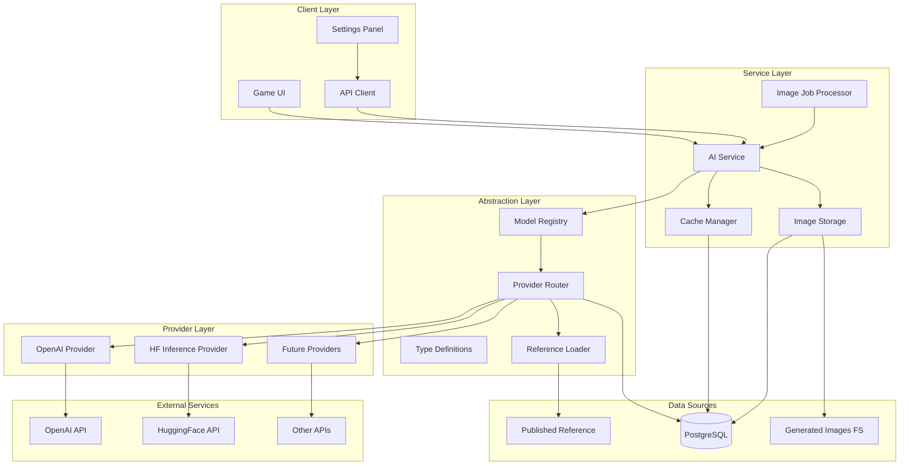

# Multi-Model Image Generation Architecture V2

## Overview

This document details the architecture and engineering approach for supporting multiple image generation models in Uranus Dungeon Guide. The system provides a flexible, provider-abstracted image generation service that supports various AI models from different providers while maintaining consistent interfaces, caching, and configuration management.

**Version:** 2.0  
**Last Updated:** Based on code analysis as of current implementation  
**Status:** Production

## Table of Contents

1. [Architecture Overview](#architecture-overview)
2. [Core Components](#core-components)
3. [Provider Abstraction Layer](#provider-abstraction-layer)
4. [Model Registry System](#model-registry-system)
5. [Configuration Management](#configuration-management)
6. [Caching Strategy](#caching-strategy)
7. [API Design](#api-design)
8. [Error Handling & Fallbacks](#error-handling--fallbacks)
9. [Performance Considerations](#performance-considerations)
10. [Adding New Models](#adding-new-models)
11. [Testing Strategy](#testing-strategy)
12. [Monitoring & Observability](#monitoring--observability)

## Architecture Overview

The multi-model image generation system follows a layered architecture that separates concerns and enables easy extension:



### Key Design Principles

1. **Provider Abstraction**: Models are abstracted behind a common interface (`ImageGenerator`)
2. **Configuration-Driven**: Model selection and settings are configurable via database and reference data
3. **Reference-First Resolution**: Model configuration primarily sourced from published reference data
4. **Multi-Level Caching**: Exact match cache and similarity-based cache reduce API calls and costs
5. **Type Safety**: Strong typing throughout the system with TypeScript
6. **Extensibility**: Easy addition of new providers and models without code changes
7. **Async Processing**: Background job queue for non-blocking image generation

### Request Flow

1. **Client Request**: User action triggers image generation request
2. **Job Creation**: Image job created in database with status `pending`
3. **Job Processor**: Background processor polls for pending jobs
4. **Cache Check**: System checks for exact cache match (prompt + variables hash)
5. **Similarity Check**: If no exact match, checks for similar scenes (threshold: 0.85)
6. **Model Resolution**: Resolves model key via reference → database → error
7. **Provider Selection**: Selects appropriate provider based on resolved model
8. **Generation**: Calls provider API to generate image
9. **Storage**: Saves image to filesystem and metadata to database
10. **Notification**: WebSocket notification sent to client when ready

## Core Components

### 1. Type System (`server/image/types.ts`)

The foundation of the multi-model system is a robust type system that defines contracts between components:

```1:30:server/image/types.ts
export type ImageSize = "1024x1024" | "1536x1024" | "1024x1536";

import type { InferenceProviderOrPolicy } from "@huggingface/inference";

export interface ImageRequest {
  prompt: string;
  size: ImageSize;
  quality: "low" | "medium" | "high" | "auto";
  background: "auto" | "transparent" | "opaque";
  moderation: "auto" | "low";
  inferenceProvider: "openai" | "huggingface";
  modelName: string;
  hfProvider?: InferenceProviderOrPolicy; // HuggingFace provider: "fal-ai", "inference-endpoints", "serverless", etc.
}

export interface ImageResponse {
  imageUrl?: string;
  imageBase64?: string;
}

export interface ImageGenerator {
  generate(req: ImageRequest): Promise<ImageResponse>;
}

export interface ModelPreset {
  inferenceProvider: "openai" | "huggingface";
  modelName: string;
  hfProvider?: InferenceProviderOrPolicy; // Optional HuggingFace provider for huggingface
}
```

### 2. Provider Registry (`server/image/registry.ts`)

Central registry that maps provider identifiers to implementations. Providers are instantiated once and reused:

```1:12:server/image/registry.ts
import { ImageGenerator } from "./types";
import { OpenAIImageGenerator } from "./providers/openai";
import { HuggingFaceImageGenerator } from "./providers/huggingface";
import type { ModelPreset } from "./types";

const openai = new OpenAIImageGenerator();
const hf = new HuggingFaceImageGenerator();

export const GENERATORS: Record<string, ImageGenerator> = {
  openai,
  huggingface: hf,
};
```

**Note:** The `MODEL_PRESETS` in this file are illustrative only. The authoritative source of truth for model configurations is:
1. Published reference data (primary)
2. Database `image_models` table (fallback)
3. Error if not found (no static preset fallback despite code existing)

### 3. Model Resolution (`server/image/index.ts`)

Routes requests to appropriate providers based on model key. Model resolution follows this priority:

```12:43:server/image/index.ts
async function resolveModelPreset(modelKey: string): Promise<ModelPresetResolved> {
  try {
    const { getCurrentReference } = await import("../reference/referenceLoader.js");
    const ref = await getCurrentReference();
    const row = (ref.data.image_models as any[]).find(m => (m.model_key === modelKey) || (m.modelKey === modelKey));
    if (row && (row.active ?? 1) === 1) {
      const hfProvider = row.hf_provider ?? row.hfProvider ?? undefined;
      return {
        inferenceProvider: row.provider as any,
        modelName: row.model_name ?? row.modelName,
        hfProvider: (hfProvider ?? undefined) as InferenceProviderOrPolicy | undefined,
      };
    }
  } catch (_) {}

  // DB fallback
  try {
    const { storage } = await import("../storage.js");
    const fromDb = await storage.getImageModelByKey?.(modelKey);
    if (fromDb && fromDb.active === 1) {
      const hfProvider = fromDb.hfProvider ?? undefined;
      return {
        inferenceProvider: fromDb.provider as any,
        modelName: fromDb.modelName,
        hfProvider: (hfProvider ?? undefined) as InferenceProviderOrPolicy | undefined,
      };
    }
  } catch (_) {}

  // No fallback - throw error if model not found
  throw new Error(`Image model key "${modelKey}" not found in reference or database`);
}
```

**Resolution Priority:**
1. **Published Reference Data**: Checks `ref.data.image_models` array
2. **Database Fallback**: Checks `image_models` table via `storage.getImageModelByKey()`
3. **Error**: Throws error if model not found (no static preset fallback)

### 4. Provider Router (`server/image/index.ts`)

Main entry point for generating images with a model key:

```45:62:server/image/index.ts
export async function generateWithModelKey(
  modelKey: string,
  req: Omit<ImageRequest, "inferenceProvider" | "modelName" | "hfProvider">
): Promise<ImageResponse> {
  const preset = await resolveModelPreset(modelKey);
  const generator = GENERATORS[preset.inferenceProvider];
  
  if (!generator) {
    throw new Error(`No generator found for provider: ${preset.inferenceProvider}`);
  }

  return await generator.generate({ 
    ...req, 
    inferenceProvider: preset.inferenceProvider, 
    modelName: preset.modelName,
    hfProvider: preset.hfProvider
  });
}
```

## Provider Abstraction Layer

### Provider Interface

All providers implement the `ImageGenerator` interface, ensuring consistent behavior:

```21:23:server/image/types.ts
export interface ImageGenerator {
  generate(req: ImageRequest): Promise<ImageResponse>;
}
```

### OpenAI Provider (`server/image/providers/openai.ts`)

Handles OpenAI image generation using the OpenAI SDK:

```1:30:server/image/providers/openai.ts
import { ImageGenerator, ImageRequest, ImageResponse } from "../types";
import OpenAI from "openai";

const openaiImages = new OpenAI({ apiKey: process.env.OPENAI_API_KEY });

export class OpenAIImageGenerator implements ImageGenerator {
  async generate(req: ImageRequest): Promise<ImageResponse> {
    if (!req.modelName) {
      throw new Error("modelName is required for OpenAI image generation");
    }
    const response = await openaiImages.images.generate({
      model: req.modelName,
      prompt: req.prompt,
      n: 1,
      size: req.size,
      quality: req.quality,
      background: req.background,
      moderation: req.moderation,
    });

    const imageData = response.data?.[0];
    if (!imageData) throw new Error("No image data returned from OpenAI");

    if (imageData.b64_json) {
      return { imageUrl: `data:image/png;base64,${imageData.b64_json}`, imageBase64: imageData.b64_json };
    }
    if (imageData.url) return { imageUrl: imageData.url };
    throw new Error("Unsupported OpenAI image response format");
  }
}
```

**Features:**
- Supports base64 JSON and URL responses
- Validates modelName is provided
- Uses OpenAI SDK for API calls

### HuggingFace Provider (`server/image/providers/huggingface.ts`)

Handles HuggingFace Inference API using `InferenceClient` with optional provider selection:

```1:71:server/image/providers/huggingface.ts
import { ImageGenerator, ImageRequest, ImageResponse } from "../types";
import { InferenceClient } from "@huggingface/inference";

function parseSize(size: string): { width: number; height: number } {
  const [w, h] = size.split("x").map((v) => parseInt(v, 10));
  return { width: w, height: h };
}

export class HuggingFaceImageGenerator implements ImageGenerator {
  async generate(req: ImageRequest): Promise<ImageResponse> {
    const token = process.env.HF_TOKEN;
    if (!token) throw new Error("HF_TOKEN not set");

    const { width, height } = parseSize(req.size);

    // Create client with direct token passing
    const hf = new InferenceClient(token);
    
    try {
      const provider = req.hfProvider ?? "fal-ai";
      const result = await hf.textToImage({
        provider,
        model: req.modelName,
        inputs: req.prompt,
        parameters: { 
          width, 
          height,
          num_inference_steps: 5  // Add inference steps parameter
        },
      });

      // result is a Blob; convert to Buffer
      try {
        // Try to treat as Blob first
        const arrayBuffer = await (result as any).arrayBuffer();
        const buf = Buffer.from(arrayBuffer);
        const imageBase64 = buf.toString("base64");
        return { imageBase64, imageUrl: `data:image/png;base64,${imageBase64}` };
      } catch (blobError) {
        // If that fails, try as string
        if (typeof result === 'string') {
          return { imageBase64: result, imageUrl: `data:image/png;base64,${result}` };
        } else {
          throw new Error('Unexpected result type from HuggingFace textToImage');
        }
      }
    } catch (e: any) {
      const msg = String(e?.message || e);
      
      // Handle specific error types
      if (msg.includes("404") || msg.toLowerCase().includes("not found")) {
        throw new Error(`HF Inference error 404: Not Found (model: ${req.modelName}${req.hfProvider ? `, provider: ${req.hfProvider}` : ''})`);
      }
      
      if (msg.includes("429") || msg.toLowerCase().includes("too many requests") || msg.toLowerCase().includes("rate limit")) {
        throw new Error(`HF Inference rate limit exceeded. Please try again later. (model: ${req.modelName})`);
      }
      
      if (msg.includes("401") || msg.toLowerCase().includes("unauthorized")) {
        throw new Error(`HF Inference authentication failed. Please check your HF_TOKEN. (model: ${req.modelName})`);
      }
      
      if (msg.includes("500") || msg.toLowerCase().includes("internal server error")) {
        throw new Error(`HF Inference server error. The model may be temporarily unavailable. (model: ${req.modelName})`);
      }
      
      // Generic error handling
      throw new Error(`HF Inference error: ${msg} (model: ${req.modelName})`);
    }
  }
}
```

**Features:**
- Supports multiple HF providers (`fal-ai`, `inference-endpoints`, `serverless`, `auto`)
- Defaults to `fal-ai` if no provider specified
- Handles Blob and string response types
- Comprehensive error handling with specific error messages
- Uses fixed `num_inference_steps: 5` for faster generation

## Model Registry System

### Model Configuration Sources

The system uses a hierarchical model configuration approach:

#### 1. Published Reference Data (Primary Source)

Models are primarily configured in published reference releases. The reference loader (`server/reference/referenceLoader.ts`) loads `image_models` from published JSON files:

```70:70:server/reference/referenceLoader.ts
        image_models: data.image_models || [],
```

Reference data structure (as loaded from JSON):
- `model_key`: Unique identifier (e.g., `"flux-schnell"`)
- `provider`: Provider type (`"openai"` or `"huggingface"`)
- `model_name`: Provider-specific model identifier
- `hf_provider`: Optional HuggingFace provider (`"fal-ai"`, `"auto"`, etc.)
- `active`: Active status (`1` = active, `0` = inactive)
- `display_name`: Human-readable name
- `description`: Model description
- `sort_order`: Display order
- Additional metadata fields

#### 2. Database Table (Fallback)

If model not found in reference, system falls back to `image_models` database table:

```124:146:shared/schema.ts
export const imageModels = pgTable("image_models", {
  id: text("id").primaryKey().notNull().default(sql`gen_random_uuid()`),
  modelKey: text("model_key").notNull().unique(),
  provider: text("provider").notNull(),
  modelName: text("model_name").notNull(),
  hfProvider: text("hf_provider"),
  active: integer("active").notNull().default(1),
  displayName: text("display_name").notNull(),
  description: text("description"),
  sortOrder: integer("sort_order").notNull().default(0),
  defaultSize: text("default_size"),
  defaultQuality: text("default_quality"),
  defaultBackground: text("default_background"),
  defaultModeration: text("default_moderation"),
  allowedSizes: jsonb("allowed_sizes"),
  capabilities: jsonb("capabilities"),
  providerParams: jsonb("provider_params"),
  isDefault: boolean("is_default").notNull().default(false),
  createdAt: timestamp("created_at").defaultNow(),
  updatedAt: timestamp("updated_at").defaultNow(),
  triggerWords: varchar("trigger_words", { length: 500 }),
  class: text("class"),
});
```

**Key Database Fields:**
- `model_key`: Unique identifier (matches reference)
- `provider`: Provider type
- `model_name`: Model identifier
- `hf_provider`: Optional HuggingFace provider
- `active`: Active status (`1` = active, `0` = inactive)
- `is_default`: Default model flag
- `sort_order`: Display/selection order
- `capabilities`: JSONB field for model-specific capabilities
- `provider_params`: JSONB field for provider-specific parameters

### Model Selection Strategy

Model selection follows this priority order (implemented in `server/aiService.ts`):

```1486:1491:server/aiService.ts
    const modelKey = (userPreferences.imageModelKey 
      ?? (await storage.getDefaultImageModel())?.modelKey 
      ?? 'gpt-image-1-mini').trim();
    if (!modelKey) {
      throw new Error("No image model key specified and no default model found in database");
    }
```

**Selection Priority:**
1. **User Preference**: `userPreferences.imageModelKey` (from `users.imageModelKey`)
2. **Default Model**: Database default model (`image_models.is_default = true`)
3. **Hardcoded Fallback**: `'gpt-image-1-mini'` (only used if no default in DB)
4. **Error**: If no model key resolved

### Model Management APIs

#### Public API (`/api/reference/image-models`)

Returns active models from published reference:

```1:20:server/routes/imageModelsReference.ts
import express from "express";
import { getCurrentReference } from "../reference/referenceLoader";

export const imageModelsReference = express.Router();

imageModelsReference.get("/", async (_req, res) => {
  try {
    const ref = await getCurrentReference();
    const list = (ref.data.image_models as any[])
      .filter(m => (m.active ?? 1) === 1)
      .sort((a, b) => (a.sort_order ?? a.sortOrder ?? 0) - (b.sort_order ?? b.sortOrder ?? 0));
    res.json(list);
  } catch (error) {
    console.error("Error fetching published image models:", error);
    res.status(500).json({ error: "Failed to fetch image models" });
  }
});
```

#### Admin API (`/api/admin/image-models`)

Full CRUD operations for model management:

```1:56:server/routes/imageModelsAdmin.ts
import express from "express";
import { requireAdmin } from "../middleware/adminAuth";
import { storage } from "../storage";

export const imageModelsAdmin = express.Router();

imageModelsAdmin.use(requireAdmin);

imageModelsAdmin.get("/", async (_req, res) => {
  try {
    const rows = await storage.listImageModels();
    res.json(rows);
  } catch (e) {
    console.error("Error listing image models:", e);
    res.status(500).json({ error: "Failed to list image models", details: e instanceof Error ? e.message : String(e) });
  }
});

imageModelsAdmin.post("/", async (req, res) => {
  try {
    const row = await storage.upsertImageModel(req.body);
    res.json(row);
  } catch (e) {
    res.status(500).json({ error: "Failed to upsert image model" });
  }
});

imageModelsAdmin.put("/:modelKey", async (req, res) => {
  try {
    const modelKey = req.params.modelKey;
    const row = await storage.upsertImageModel({ ...req.body, modelKey });
    res.json(row);
  } catch (e) {
    res.status(500).json({ error: "Failed to update image model" });
  }
});

imageModelsAdmin.delete("/:modelKey", async (req, res) => {
  try {
    await storage.deactivateImageModel(req.params.modelKey);
    res.json({ success: true });
  } catch (e) {
    res.status(500).json({ error: "Failed to deactivate image model" });
  }
});

imageModelsAdmin.put("/reorder", async (req, res) => {
  try {
    const order = req.body as { modelKey: string; sortOrder: number }[];
    await storage.reorderImageModels(order);
    res.json({ success: true });
  } catch (e) {
    res.status(500).json({ error: "Failed to reorder image models" });
  }
});
```

**Admin Endpoints:**
- `GET /api/admin/image-models`: List all models (active and inactive)
- `POST /api/admin/image-models`: Create/update model (upsert by `modelKey`)
- `PUT /api/admin/image-models/:modelKey`: Update specific model
- `DELETE /api/admin/image-models/:modelKey`: Deactivate model (soft delete)
- `PUT /api/admin/image-models/reorder`: Reorder models by `sortOrder`

## Configuration Management

### Settings Hierarchy

The system supports multiple levels of configuration with the following priority order:

1. **User-Level Preference** (`users.imageModelKey`):
   - Highest priority
   - Stored in `users` table
   - Applies to all games for that user
   - Can be set via user settings API

2. **Global Default Model** (`image_models.is_default = true`):
   - Database-driven default
   - Set via admin API
   - Used when user has no preference

3. **Global Settings** (Reference data `settings`):
   - `image_background_setting`: Global background preference (`auto`, `transparent`, `opaque`)
   - `image_moderation_setting`: Global moderation level (`auto`, `low`)
   - Loaded from published reference data

4. **Template-Level Settings** (`image_prompts`):
   - `size`: Template-specific image size (`1024x1024`, `1536x1024`, `1024x1536`)
   - `quality`: Template-specific quality setting (`low`, `medium`, `high`, `auto`)
   - Loaded from reference data

### Model Resolution Flow

```
User Request
    ↓
Get userPreferences.imageModelKey
    ↓
If not set → Get default model from DB (is_default = true)
    ↓
If not found → Fallback to 'gpt-image-1-mini'
    ↓
Resolve model preset:
    1. Check published reference (ref.data.image_models)
    2. Check database (image_models table)
    3. Throw error if not found
    ↓
Get provider from GENERATORS registry
    ↓
Call provider.generate()
```

### Configuration Storage

#### Users Table
- `imageModelKey`: Per-user model preference (nullable)

#### Image Models Table
- `is_default`: Boolean flag for default model
- `sort_order`: Display/selection order
- `defaultSize`, `defaultQuality`, etc.: Model-specific defaults (currently unused)

#### Reference Data
- `settings.image_background_setting`: Global background preference
- `settings.image_moderation_setting`: Global moderation preference
- `image_models[]`: Published model configurations

## Caching Strategy

### Multi-Level Caching System

The system employs a sophisticated multi-level caching strategy to minimize API calls and costs:

#### 1. Exact Match Cache

**Cache Key Generation:**
- `promptHash`: SHA256 hash of the final prompt text
- `variablesHash`: SHA256 hash of sorted variables object

```55:64:server/cacheUtils.ts
export function generatePromptHash(prompt: string): string {
  return createHash('sha256').update(prompt).digest('hex');
}

export function generateVariablesHash(variables: Record<string, any>): string {
  // Sort keys to ensure consistent hashing
  const sortedEntries = Object.entries(variables).sort(([a], [b]) => a.localeCompare(b));
  const serialized = JSON.stringify(sortedEntries);
  return createHash('sha256').update(serialized).digest('hex');
}
```

**Cache Lookup:**
- Query `generated_images` table by `prompt_hash` and `variables_hash`
- Exact match returns cached image immediately
- Updates `last_accessed_at` timestamp

#### 2. Similarity-Based Cache

**Scene Fingerprint:**
When exact match not found, system generates a scene fingerprint:

```80:109:server/cacheUtils.ts
export function generateSceneFingerprint(
  templateName: string,
  gameState: GameState,
  variables: Record<string, any>,
  settings: ImageSettings,
  templateSceneTypes: string[] = [],
  templateTags: string[] = []
): SceneFingerprint {
  const statsRecord = Object.fromEntries(
    Object.entries(gameState.stats).map(([key, value]) => [key, Number(value)])
  ) as Record<string, number>;

  return {
    templateName,
    sceneTypes: templateSceneTypes,
    tags: templateTags,
    narrativeContext: {
      segment: gameState.segment,
      day: gameState.day,
      absurdity: gameState.absurdity,
      narrative: variables.CURRENT_NARRATIVE || ''
    },
    gameState: {
      stats: statsRecord,
      npcs: gameState.npcs.map(npc => npc.name),
      equippedItems: gameState.equippedItems
    },
    visualSettings: settings
  };
}
```

**Similarity Calculation:**
System calculates similarity scores across multiple dimensions:

```167:209:server/cacheUtils.ts
export function calculateSceneSimilarity(
  fingerprint1: SceneFingerprint,
  fingerprint2: SceneFingerprint
): SceneSimilarity {
  const exactMatch = fingerprint1.templateName === fingerprint2.templateName &&
    JSON.stringify(fingerprint1.narrativeContext) === JSON.stringify(fingerprint2.narrativeContext) &&
    JSON.stringify(fingerprint1.gameState) === JSON.stringify(fingerprint2.gameState) &&
    JSON.stringify(fingerprint1.visualSettings) === JSON.stringify(fingerprint2.visualSettings);

  const templateMatch = fingerprint1.templateName === fingerprint2.templateName;

  const narrativeSimilarity = calculateTextSimilarity(
    fingerprint1.narrativeContext.narrative,
    fingerprint2.narrativeContext.narrative
  );

  const contextSimilarity = calculateObjectSimilarity(
    fingerprint1.gameState,
    fingerprint2.gameState
  );

  const visualSimilarity = calculateObjectSimilarity(
    fingerprint1.visualSettings,
    fingerprint2.visualSettings
  );

  // Weighted average with narrative being most important
  const overallSimilarity = (
    narrativeSimilarity * 0.4 +
    contextSimilarity * 0.3 +
    visualSimilarity * 0.2 +
    (templateMatch ? 0.1 : 0)
  );

  return {
    exactMatch,
    templateMatch,
    narrativeSimilarity,
    contextSimilarity,
    visualSimilarity,
    overallSimilarity
  };
}
```

**Similarity Threshold:**
- Default threshold: `0.85` (85% similarity)
- Only matches above threshold are considered
- Returns best match sorted by `overallSimilarity`

**Cache Flow:**
1. Check exact match (prompt + variables hash)
2. If not found, query all images for same template
3. Generate scene fingerprint for current request
4. Calculate similarity with all candidate images
5. Filter matches above threshold (0.85)
6. Return best match if found
7. Generate new image if no match

### Cache Storage

#### Database (`generated_images` table)

Stores metadata and references to file system:

- `prompt_hash`: SHA256 hash of prompt
- `variables_hash`: SHA256 hash of variables
- `file_path`: Path to image file on filesystem
- `file_size`: Size in bytes
- `scene_fingerprint`: JSONB scene fingerprint for similarity matching
- `metadata`: JSONB containing prompt, model, settings, etc.
- `last_accessed_at`: Timestamp for LRU eviction

#### File System (`generated_images/` directory)

- Actual PNG files stored on disk
- Filename format: `{templateName}_{promptHash8}_{uuid8}.png`
- Example: `general_scene_0d09b13a_7609d097.png`

#### Cache Access Pattern

```typescript
// 1. Exact match check
const cachedImage = await storage.getGeneratedImageByHash(promptHash, variablesHash);
if (cachedImage) {
  await storage.updateImageAccess(cachedImage.id);
  return loadImageFromFile(cachedImage.filePath);
}

// 2. Similarity check
const templateImages = await storage.getGeneratedImagesByTemplate(templateName);
const similarScenes = findSimilarScenes(sceneFingerprint, candidateFingerprints, 0.85);
if (similarScenes.length > 0) {
  const bestMatch = templateImages.find(/* match */);
  await storage.updateImageAccess(bestMatch.id);
  return loadImageFromFile(bestMatch.filePath);
}

// 3. Generate new
const result = await generateWithModelKey(modelKey, request);
await saveImageToFile(result.imageBase64, metadata);
await storage.createGeneratedImage(/* ... */);
```

## API Design

### Core Generation Functions

#### `generateImage()` (`server/aiService.ts`)

Main image generation function with full caching support:

```typescript
export async function generateImage(
  templateName: string,
  gameState: GameState,
  userPreferences: { theme?: string; style?: string; imageModelKey?: string },
  options: ImageGenerationOptions = {}
): Promise<ImageGenerationResult | null>
```

**Execution Flow:**
1. Build image prompt context (template + variables)
2. Generate cache keys (prompt hash, variables hash, scene fingerprint)
3. Check exact cache match
4. Check similarity cache (if no exact match)
5. Resolve model key (user preference → default → fallback)
6. Call `generateWithModelKey()` to generate image
7. Save to filesystem and database
8. Log LLM call with metadata
9. Return image URL and metadata

#### `checkImageCache()` (`server/aiService.ts`)

Cache-only check without generation:

```typescript
export async function checkImageCache(
  templateName: string,
  gameState: GameState,
  userPreferences: { theme?: string; style?: string; imageModelKey?: string },
  options: ImageGenerationOptions = {}
): Promise<ImageGenerationResult | null>
```

**Returns:**
- Cached image if exact or similar match found
- `null` if no cache hit

#### `testGenerateImage()` (`server/aiService.ts`)

Test generation with custom variables (admin/testing):

```typescript
export async function testGenerateImage(
  templateName: string,
  customVariables: Record<string, string>
): Promise<{ 
  imageUrl: string; 
  promptUsed: string; 
  debugInfo: {
    model: string;
    size: string;
    quality: string;
    background: string;
    moderation: string;
    generationTime: number;
    variables: Record<string, string>;
  }
} | null>
```

### HTTP Endpoints

#### Image Generation

- **POST** `/api/generate-image`
  - Body: `{ templateName: string, gameId: string }`
  - Creates image job, returns immediately
  - Image generated async via job processor

- **POST** `/api/test-generate-image`
  - Body: `{ templateName: string, variables: Record<string, string> }`
  - Admin-only, generates immediately (synchronous)
  - Returns image URL and debug info

#### Cache Management

- **GET** `/api/cache/images`
  - Query params: `templateName`, `gameId`, `limit`, `offset`
  - Returns cached image metadata

- **GET** `/api/cache/images/:id`
  - Returns specific cached image metadata

- **DELETE** `/api/cache/images/:id`
  - Deletes cached image (file + database record)

- **DELETE** `/api/cache/images`
  - Bulk delete with filters (query params)

#### Model Management

- **GET** `/api/reference/image-models`
  - Returns active models from published reference
  - Public endpoint

- **GET** `/api/admin/image-models`
  - Returns all models (admin only)

- **POST** `/api/admin/image-models`
  - Create/update model (upsert by modelKey, admin only)

- **PUT** `/api/admin/image-models/:modelKey`
  - Update specific model (admin only)

- **DELETE** `/api/admin/image-models/:modelKey`
  - Deactivate model (admin only)

- **PUT** `/api/admin/image-models/reorder`
  - Reorder models by sortOrder (admin only)

### WebSocket Events

Image job processor emits WebSocket events:

- **`imageReady`**: Emitted when image generation completes
  ```typescript
  {
    jobId: string;
    gameId: string;
    turnNumber: number;
    imageUrl: string;
    imageTemplate: string;
    promptSource: 'pce' | 'template';
  }
  ```

- **`imageFailed`**: Emitted when image generation fails
  ```typescript
  {
    jobId: string;
    gameId: string;
    turnNumber: number;
    error: string;
  }
  ```

## Error Handling & Fallbacks

### Error Hierarchy

1. **Provider Errors**: API failures, rate limits, model unavailable
2. **Validation Errors**: Invalid parameters, missing credentials
3. **Resolution Errors**: Model key not found in reference or database
4. **System Errors**: Network issues, storage failures

### Provider Error Handling

#### OpenAI Provider
- Validates `modelName` is provided
- Handles missing image data
- Supports both base64 and URL response formats
- Throws descriptive errors for unsupported formats

#### HuggingFace Provider
Comprehensive error handling with specific messages:

```47:68:server/image/providers/huggingface.ts
    } catch (e: any) {
      const msg = String(e?.message || e);
      
      // Handle specific error types
      if (msg.includes("404") || msg.toLowerCase().includes("not found")) {
        throw new Error(`HF Inference error 404: Not Found (model: ${req.modelName}${req.hfProvider ? `, provider: ${req.hfProvider}` : ''})`);
      }
      
      if (msg.includes("429") || msg.toLowerCase().includes("too many requests") || msg.toLowerCase().includes("rate limit")) {
        throw new Error(`HF Inference rate limit exceeded. Please try again later. (model: ${req.modelName})`);
      }
      
      if (msg.includes("401") || msg.toLowerCase().includes("unauthorized")) {
        throw new Error(`HF Inference authentication failed. Please check your HF_TOKEN. (model: ${req.modelName})`);
      }
      
      if (msg.includes("500") || msg.toLowerCase().includes("internal server error")) {
        throw new Error(`HF Inference server error. The model may be temporarily unavailable. (model: ${req.modelName})`);
      }
      
      // Generic error handling
      throw new Error(`HF Inference error: ${msg} (model: ${req.modelName})`);
    }
```

**Error Types Handled:**
- **404**: Model not found
- **429**: Rate limit exceeded
- **401**: Authentication failed
- **500**: Server error
- **Generic**: All other errors

### Model Resolution Fallbacks

Model resolution follows strict priority with error on failure:

```12:43:server/image/index.ts
async function resolveModelPreset(modelKey: string): Promise<ModelPresetResolved> {
  try {
    const { getCurrentReference } = await import("../reference/referenceLoader.js");
    const ref = await getCurrentReference();
    const row = (ref.data.image_models as any[]).find(m => (m.model_key === modelKey) || (m.modelKey === modelKey));
    if (row && (row.active ?? 1) === 1) {
      const hfProvider = row.hf_provider ?? row.hfProvider ?? undefined;
      return {
        inferenceProvider: row.provider as any,
        modelName: row.model_name ?? row.modelName,
        hfProvider: (hfProvider ?? undefined) as InferenceProviderOrPolicy | undefined,
      };
    }
  } catch (_) {}

  // DB fallback
  try {
    const { storage } = await import("../storage.js");
    const fromDb = await storage.getImageModelByKey?.(modelKey);
    if (fromDb && fromDb.active === 1) {
      const hfProvider = fromDb.hfProvider ?? undefined;
      return {
        inferenceProvider: fromDb.provider as any,
        modelName: fromDb.modelName,
        hfProvider: (hfProvider ?? undefined) as InferenceProviderOrPolicy | undefined,
      };
    }
  } catch (_) {}

  // No fallback - throw error if model not found
  throw new Error(`Image model key "${modelKey}" not found in reference or database`);
}
```

**Fallback Strategy:**
1. Try reference data
2. Try database
3. **Throw error** (no automatic fallback to static presets)

### Generation Error Recovery

Image generation errors are handled gracefully:

1. **Job Status**: Failed jobs marked with `status: 'failed'` and error message
2. **Client Notification**: WebSocket `imageFailed` event sent to client
3. **Error Logging**: LLM call logged with error details
4. **No Automatic Retry**: System does not automatically retry failed generations
5. **No Cross-Provider Fallback**: System does not automatically try alternative providers

### Storage Error Handling

Image storage errors are handled gracefully:

```1545:1547:server/aiService.ts
    } catch (cacheError) {
      console.warn('Failed to cache generated image:', cacheError);
    }
```

- Storage failures logged as warnings
- Image generation continues even if caching fails
- User still receives image URL (data URL if file save fails)

## Performance Considerations

### Optimization Strategies

#### 1. Async Processing

Image generation uses a background job queue to avoid blocking game turns:

```34:50:server/imageJobProcessor.ts
  private async processPendingJobs() {
    if (this.processing) return;
    
    this.processing = true;
    try {
      const pendingJobs = await storage.getPendingImageJobs(5);
      queueDepthImage.set(pendingJobs.length);
      
      for (const job of pendingJobs) {
        await this.processJob(job);
      }
    } catch (error) {
      console.error('Error processing image jobs:', error);
    } finally {
      this.processing = false;
    }
  }
```

**Benefits:**
- Non-blocking turn processing
- Can process multiple jobs concurrently (batch size: 5)
- Metrics tracking for queue depth

#### 2. Multi-Level Caching

- **Exact Match**: Fast O(1) lookup by hash
- **Similarity Match**: Template-scoped search reduces candidate set
- **Access Tracking**: `last_accessed_at` enables LRU eviction

#### 3. File System Storage

- Images stored as files, not in database
- Filenames include hash for deduplication
- Direct file serving via static routes

#### 4. Reference Caching

Reference data cached in memory:

```24:33:server/reference/referenceLoader.ts
let cache: ReferenceData | null = null;

/**
 * Gets the current active reference data with TTL caching
 */
export async function getCurrentReference(): Promise<ReferenceData> {
  // Check if cache exists (no TTL check)
  if (cache) {
    return cache;
  }
```

- Single load per process
- No TTL (manual cache clear only)
- Reduces file I/O for model resolution

### Performance Metrics

System tracks key metrics via Prometheus:

- `imageJobDuration`: Histogram of generation times
- `imageJobsCompleted`: Counter of completed jobs
- `imageJobsFailed`: Counter of failed jobs
- `queueDepthImage`: Gauge of pending jobs
- `imageCacheHits`: Counter of cache hits
- `imageCacheMisses`: Counter of cache misses

### Scaling Considerations

#### Horizontal Scaling

- Multiple worker processes can process jobs concurrently
- Job status prevents duplicate processing
- Database acts as coordination point

#### Load Balancing

- Static image files can be served via CDN
- Database can be replicated for read scaling
- Job processing can be distributed across workers

#### Resource Management

- File system storage requires disk space management
- Database indexes optimize cache lookups:
  - `idx_generated_images_template` on `template_name`
  - Unique index on `(prompt_hash, variables_hash)`
- Memory usage optimized by reference caching

## Adding New Models

### Prerequisites

- API credentials for the model provider
- Understanding of model capabilities and API
- Access to provider documentation

### Step-by-Step Process

#### 1. Choose Provider Strategy

**Option A: Use Existing Provider**
- If model is compatible with OpenAI or HuggingFace APIs
- Add model to reference data or database
- No code changes needed

**Option B: Create New Provider**
- Implement new provider class
- Register in `GENERATORS` registry
- Add provider type to `ImageRequest.inferenceProvider`

#### 2. Add Model Configuration

**Via Admin API:**
```bash
POST /api/admin/image-models
{
  "modelKey": "new-model-key",
  "provider": "openai",
  "modelName": "actual-model-identifier",
  "displayName": "New Model Display Name",
  "description": "Model description",
  "active": 1,
  "sortOrder": 0
}
```

**Via Reference Publishing:**
Add to `image_models.json` in reference release:
```json
{
  "model_key": "new-model-key",
  "provider": "openai",
  "model_name": "actual-model-identifier",
  "display_name": "New Model Display Name",
  "active": 1,
  "sort_order": 0
}
```

#### 3. Implement Provider (if new)

Create `server/image/providers/newprovider.ts`:

```typescript
import { ImageGenerator, ImageRequest, ImageResponse } from "../types";

export class NewProviderImageGenerator implements ImageGenerator {
  async generate(req: ImageRequest): Promise<ImageResponse> {
    // Implement API call
    // Handle errors appropriately
    // Return ImageResponse
  }
}
```

#### 4. Register Provider

Update `server/image/registry.ts`:

```typescript
import { NewProviderImageGenerator } from "./providers/newprovider";

const newProvider = new NewProviderImageGenerator();

export const GENERATORS: Record<string, ImageGenerator> = {
  openai,
  huggingface: hf,
  newprovider: newProvider,  // Add here
};
```

#### 5. Update Type Definitions

Update `server/image/types.ts`:

```typescript
export interface ImageRequest {
  // ... existing fields
  inferenceProvider: "openai" | "huggingface" | "newprovider";  // Add new provider
}
```

#### 6. Add Environment Variables

Update `env.example`:
```bash
NEW_PROVIDER_API_KEY=your_api_key_here
```

#### 7. Test Integration

Test via admin API:
```bash
POST /api/test-generate-image
{
  "templateName": "general_scene",
  "variables": {
    "imageModelKey": "new-model-key",
    "CURRENT_NARRATIVE": "Test scene"
  }
}
```

#### 8. Update Documentation

Add model to relevant documentation:
- This document (model registry section)
- API guide (model options)
- Settings system (default model options)

### Configuration Checklist

- [ ] Model added to reference data or database
- [ ] Provider implemented (if new)
- [ ] Provider registered in `GENERATORS`
- [ ] Type definitions updated
- [ ] Environment variables added
- [ ] Admin API tested
- [ ] Public API returns model
- [ ] Model appears in UI dropdowns
- [ ] Error handling tested
- [ ] Documentation updated

## Testing Strategy

### Unit Tests

Test individual components in isolation:

**Provider Tests:**
```typescript
describe('OpenAIImageGenerator', () => {
  it('should generate image successfully', async () => {
    // Mock OpenAI API response
    // Verify ImageResponse format
  });

  it('should handle API errors', async () => {
    // Mock error responses
    // Verify error messages
  });
});
```

**Cache Utility Tests:**
```typescript
describe('generateSceneFingerprint', () => {
  it('should generate consistent fingerprints', () => {
    // Same input should produce same fingerprint
  });
});

describe('findSimilarScenes', () => {
  it('should find similar scenes above threshold', () => {
    // Test similarity matching
  });
});
```

**Model Resolution Tests:**
```typescript
describe('resolveModelPreset', () => {
  it('should resolve from reference data', async () => {
    // Mock reference data
    // Verify resolution
  });

  it('should fallback to database', async () => {
    // Mock reference miss
    // Verify database fallback
  });

  it('should throw error if not found', async () => {
    // Verify error on missing model
  });
});
```

### Integration Tests

Test complete flows:

**End-to-End Generation:**
```typescript
describe('generateImage', () => {
  it('should use cache on exact match', async () => {
    // Create cached image
    // Generate same image
    // Verify cache hit
  });

  it('should use similarity cache', async () => {
    // Create cached image
    // Generate similar image
    // Verify similarity match
  });

  it('should generate new image on cache miss', async () => {
    // Generate image
    // Verify new generation
    // Verify cache save
  });
});
```

**Job Processing:**
```typescript
describe('ImageJobProcessor', () => {
  it('should process pending jobs', async () => {
    // Create job
    // Process job
    // Verify completion
  });

  it('should handle job failures', async () => {
    // Create job with invalid config
    // Process job
    // Verify failure status
  });
});
```

### Load Tests

Test system under load:

- Concurrent generation requests
- Large cache sizes
- Multiple providers
- High job queue depth
- File system stress

### Test Utilities

Useful test helpers:

```typescript
// Mock provider responses
export function mockProviderResponse(response: ImageResponse) {
  // Mock implementation
}

// Create test game state
export function createTestGameState(): GameState {
  // Test data
}

// Create test user preferences
export function createTestUserPreferences(): UserPreferences {
  // Test data
}
```

## Monitoring & Observability

### Metrics Collection

System tracks key metrics via Prometheus:

#### Generation Metrics
- `imageJobDuration`: Histogram of generation times (seconds)
- `imageJobsCompleted`: Counter of successful generations
- `imageJobsFailed`: Counter of failed generations
- `queueDepthImage`: Gauge of pending jobs

#### Cache Metrics
- `imageCacheHits`: Counter of exact cache hits
- `imageCacheMisses`: Counter of cache misses

#### Provider Metrics
- Tracked via LLM logs (not Prometheus):
  - Model used
  - Generation time
  - Cache strategy
  - Similarity score (if similarity match)

### Logging Strategy

#### Structured Logging

LLM calls logged to `llm_logs` table:

```typescript
await logLlmCall(
  'generateImage',
  finalPrompt,
  imageUrl.substring(0, 100) + '... [generated]',
  { 
    model: modelKey, 
    templateName: effectiveTemplateName,
    variables,
    size: template.size,
    quality: template.quality,
    background: backgroundValue,
    moderation: moderationValue,
    cacheHit: false,
    cacheStrategy: 'none',
    similarityScore: 0
  },
  executionTime,
  gameState.id,
  gameState.turnNumber
);
```

**Log Fields:**
- `functionName`: `'generateImage'`
- `prompt`: Final prompt text (truncated)
- `response`: Image URL or error message
- `metadata`: JSONB with model, settings, cache info
- `executionTime`: Generation time in ms
- `gameId`: Associated game
- `turnNumber`: Associated turn

#### Log Levels

- **INFO**: Normal operations (job processing, cache hits)
- **WARN**: Non-critical errors (cache save failures)
- **ERROR**: Critical errors (provider failures, job failures)

#### Context Preservation

All logs include:
- Game ID
- Turn number
- Model key
- Template name
- Cache status

### Alerting Recommendations

Recommended alert thresholds:

- **High Error Rate**: `imageJobsFailed` rate > 10% of total jobs
- **Slow Generation**: `imageJobDuration` p95 > 30 seconds
- **Queue Depth**: `queueDepthImage` > 50 jobs
- **Cache Miss Rate**: Cache miss rate > 50%
- **Storage Issues**: File system errors or full disk

### Dashboards

Recommended dashboard metrics:

#### Real-Time Status
- Current queue depth
- Jobs in progress
- Recent errors
- Cache hit rate (last hour)

#### Historical Trends
- Generation times over time
- Error rates over time
- Cache effectiveness over time
- Provider usage distribution

#### Provider Comparison
- Average generation time by provider
- Error rates by provider
- Cost per image (if tracked)
- Model popularity

#### Cost Analysis
- Total generations per day
- Generations by model
- Cache savings (estimated)
- API usage costs (if tracked)

---

## Conclusion

The multi-model image generation architecture provides a robust, scalable, and extensible foundation for supporting various AI image generation models. The provider abstraction layer ensures consistent behavior while the reference-first configuration system allows for flexible model management. The sophisticated caching strategy optimizes performance and reduces costs, while comprehensive error handling ensures reliability.

The system is designed to grow with the application's needs, supporting new providers and models with minimal code changes. The monitoring and observability features provide insights into system performance and help optimize resource usage.

This architecture enables Uranus Dungeon Guide to leverage the best available image generation models while maintaining a consistent user experience and system reliability.

