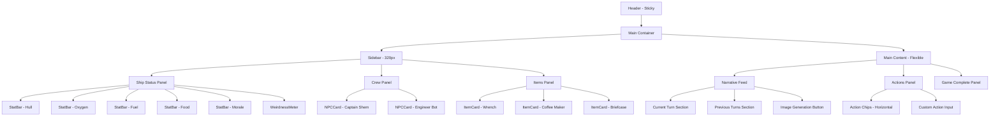
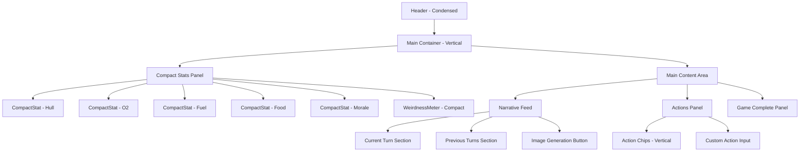

# Game Page Comprehensive Documentation

## Overview

The Game Page system consists of three main components that provide the gameplay interface where players interact with their space adventure. The system features a comprehensive set of components for resource management, crew interaction, item equipment, turn-based narrative, and action selection, with separate optimized layouts for mobile and desktop platforms.

### Component Architecture

- **`GamePage.tsx`** - Router component that detects screen size and renders appropriate layout
- **`MobileGamePage.tsx`** - Mobile-optimized layout with compact stats and touch-friendly interface
- **`DesktopGamePage.tsx`** - Desktop layout with sidebar and full feature set
- **`useGameLogic.ts`** - Shared business logic hook containing all state management and handlers
- **`useAppLoading.ts`** - App-level loading state management hook
- **`useGameContentLoading.ts`** - Game content loading state management hook
- **`GameDialogs.tsx`** - Shared dialog components (Help dialog)
- **`CompactStat.tsx`** - Reusable compact stat component for mobile displays
- **Loading Components** - Specialized loading UI components for different contexts

## Table of Contents

1. [Main Layout Structure](#main-layout-structure)
2. [Component Architecture](#component-architecture)
3. [Component Inventory](#component-inventory)
4. [Wireframes & Visual Layout](#wireframes--visual-layout)
5. [Mobile vs Desktop Differences](#mobile-vs-desktop-differences)
6. [Individual Component Details](#individual-component-details)
7. [State Management](#state-management)
8. [Responsive Design](#responsive-design)
9. [Component Sizing Reference](#component-sizing-reference)
10. [Styling System](#styling-system)
11. [Performance Considerations](#performance-considerations)
12. [Accessibility Features](#accessibility-features)

## Main Layout Structure

The Game Page system uses different layouts optimized for each platform:

### Mobile Layout (`MobileGamePage.tsx`)
- **Header**: Compact navigation with condensed title and icon-only buttons
- **Compact Stats**: Horizontal stat summary at the top of main content
- **Main Content**: Full-width narrative feed and action selection
- **Background**: CRT effect with space background image

### Desktop Layout (`DesktopGamePage.tsx`)
- **Header**: Full navigation with decorative title and labeled buttons
- **Sidebar**: Resource panels (stats, crew, items) with detailed information
- **Main Content**: Narrative feed with fixed height and scrolling
- **Background**: CRT effect with space background image

### Router Component (`GamePage.tsx`)
- **Screen Detection**: Uses `useIsMobile()` hook to determine platform
- **Loading State**: Shows loading spinner while detecting screen size
- **Component Selection**: Renders appropriate layout component based on screen size

## Component Architecture

### Router Component (`GamePage.tsx`)
The main entry point that handles platform detection and component routing.

```tsx
export default function GamePage() {
  const isMobile = useIsMobile();
  
  if (isMobile === undefined) {
    return <LoadingScreen />;
  }
  
  return isMobile ? <MobileGamePage /> : <DesktopGamePage />;
}
```

### Shared Business Logic (`useGameLogic.ts`)
Centralized hook containing all state management, API calls, and event handlers.

**Exports**:
- State values: `gameState`, `items`, `isLoading`, `gameId`, etc.
- Mutations: `actionMutation`, `generateImageMutation`
- Handlers: `handleActionClick`, `handleCustomAction`, `handleBackToMenu`, etc.

### Mobile Component (`MobileGamePage.tsx`)
Mobile-optimized layout with touch-friendly interface.

**Key Features**:
- Uses `useGameLogic` hook for all business logic
- Compact stats panel with `CompactStat` components
- Simplified header with icon-only buttons
- Full-width narrative feed
- Mobile-specific settings dialog

### Desktop Component (`DesktopGamePage.tsx`)
Desktop layout with full feature set and sidebar.

**Key Features**:
- Uses `useGameLogic` hook for all business logic
- Full sidebar with detailed resource panels
- Complete header with all controls including dev tools
- Fixed-height narrative feed with scrolling
- Desktop-specific settings dialog

### Shared Components

#### Help Dialog (`GameDialogs.tsx`)
Shared dialog component used by both mobile and desktop.

```tsx
interface HelpDialogProps {
  open: boolean;
  onOpenChange: (open: boolean) => void;
}
```

#### Compact Stat (`CompactStat.tsx`)
Reusable component for mobile stat display.

```tsx
interface CompactStatProps {
  icon: React.ComponentType<{ className?: string }>;
  value: number;
  max: number;
  label: string;
}
```

## Component Inventory

### 1. Header Components

#### Game Title & Meta Info
- **Location**: Lines 330-336
- **Purpose**: Displays game title and current day/segment
- **Mobile Adaptation**: Condensed title format
- **Data Attributes**: `data-testid="game-title"`, `data-testid="game-meta"`

#### Control Buttons
- **Dev Tools Button** (Desktop only): Links to `/dev` page
- **Help Button**: Opens help dialog with game instructions
- **Back to Menu Button**: Returns to main menu
- **Settings Button**: Opens settings dialog for game parameters

### 2. Sidebar Components (Desktop)

#### Ship Status Panel
- **Location**: Lines 387-397
- **Purpose**: Displays all ship resource statistics
- **Components Used**:
  - `StatBar` (5 instances): Hull, Oxygen, Fuel, Food, Morale
  - `WeirdnessMeter`: Cosmic absurdity tracking
- **Styling**: Cyan border with glow effect
- **Data Attribute**: `data-testid="stats-panel"`

#### Crew Panel
- **Location**: Lines 399-413
- **Purpose**: Shows NPC crew members and their status
- **Components Used**: `NPCCard` for each crew member
- **Styling**: Magenta border with glow effect
- **Data Attribute**: `data-testid="crew-panel"`

#### Items Panel
- **Location**: Lines 415-431
- **Purpose**: Equipment management (3-item limit)
- **Components Used**: `ItemCard` for each available item
- **Styling**: Yellow border with glow effect
- **Data Attribute**: `data-testid="items-panel"`

### 3. Mobile Compact Stats
- **Location**: Lines 435-449
- **Purpose**: Condensed resource display for mobile devices
- **Components Used**: `CompactStat` (5 instances) + `WeirdnessMeter`
- **Layout**: 5-column grid showing Hull, O2, Fuel, Food, Morale
- **Data Attribute**: `data-testid="compact-stats-summary"`

### 4. Main Content Area

#### Narrative Feed
- **Location**: Lines 450-563
- **Purpose**: Displays turn history and current mission status
- **Features**:
  - Image generation button for scene visualization
  - Current turn display with latest narrative
  - Collapsible previous turns section
  - Loading states for action processing
- **Data Attribute**: `data-testid="narrative-feed"`

#### Actions Panel
- **Location**: Lines 565-615
- **Purpose**: Action selection interface
- **Features**:
  - Toggle between suggested actions and custom input
  - Action chips with risk levels (Safe/Risky/Wild)
  - Custom action input with send button
  - Item icon integration for equipped items
- **Data Attribute**: `data-testid="actions-panel"`

#### Game Complete Panel
- **Location**: Lines 617-634
- **Purpose**: End-game state display
- **Features**:
  - Victory/failure message
  - Return to menu button
- **Data Attribute**: `data-testid="game-complete"`

### 5. Dialog Components

#### Help Dialog
- **Location**: Lines 639-686
- **Purpose**: Comprehensive game instructions
- **Features**:
  - Scrollable content with accordion sections
  - Multiple help topics (resources, actions, skills, etc.)
  - Close buttons (both icon and text)
- **Data Attribute**: `data-testid="help-dialog"`

#### Settings Dialog
- **Location**: Lines 688-745
- **Purpose**: Game parameter configuration
- **Features**:
  - Absurdity dial display (currently locked)
  - Image model selection dropdown
  - Save functionality
- **Data Attribute**: `data-testid="settings-dialog"`

## Wireframes & Visual Layout

### Desktop Mode Wireframe

#### Full Desktop Layout (1024px+)
```
┌─────────────────────────────────────────────────────────────────────────────────┐
│ HEADER (Sticky)                                                                 │
│ ┌─────────────────────────────────────────────────────────────────────────────┐ │
│ │ QUEST 4 URANUS █    DAY 3 • DEPARTURE    [DEV] [HELP] [MENU] [SETTINGS]   │ │
│ └─────────────────────────────────────────────────────────────────────────────┘ │
└─────────────────────────────────────────────────────────────────────────────────┘
┌─────────────────────────────────────────────────────────────────────────────────┐
│ SIDEBAR (320px)        │ MAIN CONTENT AREA (Flexible)                         │
│ ┌─────────────────────┐ │ ┌─────────────────────────────────────────────────┐ │
│ │ [ SHIP STATUS ]     │ │ │ [ MISSION VIEWSCREEN ] [VISUALIZE]             │ │
│ │ ┌─────────────────┐ │ │ │ ┌─────────────────────────────────────────────┐ │ │
│ │ │ 🚀 Hull: 85/100 │ │ │ │ │ TURN 3 - Current Mission Status            │ │ │
│ │ │ ████████████░░░ │ │ │ │ │ ┌─────────────────────────────────────────┐ │ │ │
│ │ │ 💨 O2: 92/100   │ │ │ │ │ │ [Scene Image if available]              │ │ │ │
│ │ │ ██████████████░ │ │ │ │ │ │                                       │ │ │ │
│ │ │ ⛽ Fuel: 78/100 │ │ │ │ │ │ Narrative text describing current      │ │ │ │
│ │ │ ██████████░░░░░ │ │ │ │ │ │ situation and what happened...         │ │ │ │
│ │ │ 🍔 Food: 95/100 │ │ │ │ │ │                                       │ │ │ │
│ │ │ ██████████████░ │ │ │ │ │ │ [Skill Check Results]                 │ │ │ │
│ │ │ ❤️ Morale: 88/100│ │ │ │ │ │ [Stat Changes]                        │ │ │ │
│ │ │ ██████████████░ │ │ │ │ └─────────────────────────────────────────┘ │ │ │
│ │ │                 │ │ │ │                                             │ │ │
│ │ │ Weirdness: ●●●○○│ │ │ │ [ PREVIOUS TRANSMISSIONS ] [HIDE (2)]      │ │ │
│ │ │                 │ │ │ │ ┌─────────────────────────────────────────┐ │ │ │
│ │ └─────────────────┘ │ │ │ │ TURN 2 - Previous turn content...      │ │ │ │
│ │                     │ │ │ └─────────────────────────────────────────┘ │ │ │
│ │ [ CREW ]            │ │ │ ┌─────────────────────────────────────────┐ │ │ │
│ │ ┌─────────────────┐ │ │ │ │ TURN 1 - Earlier turn content...       │ │ │ │
│ │ │ Captain Shem    │ │ │ │ └─────────────────────────────────────────┘ │ │ │
│ │ │ Pilot           │ │ │ └─────────────────────────────────────────────┘ │ │ │
│ │ │ [CRUSH] +2/3    │ │ │                                                 │ │ │
│ │ │ ██████░         │ │ │ [ ACTIONS ] [CUSTOM]                           │ │ │
│ │ │ "Great job!"    │ │ │ ┌─────────┐ ┌─────────┐ ┌─────────┐ ┌─────────┐ │ │ │
│ │ └─────────────────┘ │ │ │ [SAFE]  │ │ [RISKY] │ │ [WILD]  │ │ [SAFE]  │ │ │ │
│ │ ┌─────────────────┐ │ │ │ Action 1│ │ Action 2│ │ Action 3│ │ Action 4│ │ │ │
│ │ │ Engineer Bot    │ │ │ │ Summary │ │ Summary │ │ Summary │ │ Summary │ │ │ │
│ │ │ Engineering     │ │ │ └─────────┘ └─────────┘ └─────────┘ └─────────┘ │ │ │
│ │ │ [INDIFFERENT] 0 │ │ │                                                 │ │ │
│ │ │ ███░░░░         │ │ │ [Custom Action Input] [SEND]                   │ │ │
│ │ │ "Beep boop"     │ │ └─────────────────────────────────────────────────┘ │ │
│ │ └─────────────────┘ │                                                     │ │
│ │                     │                                                     │ │
│ │ [ ITEMS (2/3) ]     │                                                     │ │
│ │ ┌─────────────────┐ │                                                     │ │
│ │ │ 🔧 Wrench       │ │                                                     │ │
│ │ │ [EQUIPPED]      │ │                                                     │ │
│ │ │ Fix things      │ │                                                     │ │
│ │ └─────────────────┘ │                                                     │ │
│ │ ┌─────────────────┐ │                                                     │ │
│ │ │ ☕ Coffee Maker  │ │                                                     │ │
│ │ │ [EQUIPPED]      │ │                                                     │ │
│ │ │ Brew coffee     │ │                                                     │ │
│ │ └─────────────────┘ │                                                     │ │
│ │ ┌─────────────────┐ │                                                     │ │
│ │ │ 📋 Briefcase    │ │                                                     │ │
│ │ │ [UNEQUIPPED]    │ │                                                     │ │
│ │ │ Handle forms    │ │                                                     │ │
│ │ └─────────────────┘ │                                                     │ │
│ └─────────────────────┘ │                                                     │
└─────────────────────────┴─────────────────────────────────────────────────────┘
```

### Mobile Mode Wireframe

#### Mobile Layout (320px - 640px)
```
┌─────────────────────────────────────────┐
│ HEADER (Sticky)                         │
│ ┌─────────────────────────────────────┐ │
│ │ QUEST 4 URANUS    DAY 3 • DEPARTURE │ │
│ │ [HELP] [MENU] [SETTINGS]            │ │
│ └─────────────────────────────────────┘ │
└─────────────────────────────────────────┘
┌─────────────────────────────────────────┐
│ COMPACT STATS PANEL                     │
│ ┌─────────────────────────────────────┐ │
│ │ Ship Status                         │ │
│ │ ┌─┐ ┌─┐ ┌─┐ ┌─┐ ┌─┐                │ │
│ │ │🚀│ │💨│ │⛽│ │🍔│ │❤️│                │ │
│ │ │85│ │92│ │78│ │95│ │88│                │ │
│ │ │██│ │██│ │██│ │██│ │██│                │ │
│ │ └─┘ └─┘ └─┘ └─┘ └─┘                │ │
│ │ Weirdness: ●●●○○                    │ │
│ └─────────────────────────────────────┘ │
└─────────────────────────────────────────┘
┌─────────────────────────────────────────┐
│ MAIN CONTENT AREA                       │
│ ┌─────────────────────────────────────┐ │
│ │ [ MISSION VIEWSCREEN ] [VISUALIZE]  │ │
│ │ ┌─────────────────────────────────┐ │ │
│ │ │ TURN 3 - Current Mission Status │ │ │
│ │ │ ┌─────────────────────────────┐ │ │ │
│ │ │ │ [Scene Image if available]  │ │ │ │
│ │ │ │                             │ │ │ │
│ │ │ │ Narrative text describing   │ │ │ │
│ │ │ │ current situation and what  │ │ │ │
│ │ │ │ happened...                 │ │ │ │
│ │ │ │                             │ │ │ │
│ │ │ │ [Skill Check Results]       │ │ │ │
│ │ │ │ [Stat Changes]              │ │ │ │
│ │ │ └─────────────────────────────┘ │ │ │
│ │ │                                 │ │ │
│ │ │ [ PREVIOUS TRANSMISSIONS ]      │ │ │
│ │ │ [HIDE (2)]                      │ │ │
│ │ │ ┌─────────────────────────────┐ │ │ │
│ │ │ │ TURN 2 - Previous content   │ │ │ │
│ │ │ └─────────────────────────────┘ │ │ │
│ │ │ ┌─────────────────────────────┐ │ │ │
│ │ │ │ TURN 1 - Earlier content    │ │ │ │
│ │ │ └─────────────────────────────┘ │ │ │
│ │ └─────────────────────────────────┘ │ │
│ └─────────────────────────────────────┘ │
└─────────────────────────────────────────┘
┌─────────────────────────────────────────┐
│ ACTIONS PANEL                           │
│ ┌─────────────────────────────────────┐ │
│ │ [ ACTIONS ] [CUSTOM]                │ │
│ │ ┌─────────────────────────────────┐ │ │
│ │ │ [SAFE] Action 1                 │ │ │
│ │ │ Summary text here               │ │ │
│ │ └─────────────────────────────────┘ │ │
│ │ ┌─────────────────────────────────┐ │ │
│ │ │ [RISKY] Action 2                │ │ │
│ │ │ Summary text here               │ │ │
│ │ └─────────────────────────────────┘ │ │
│ │ ┌─────────────────────────────────┐ │ │
│ │ │ [WILD] Action 3                 │ │ │
│ │ │ Summary text here               │ │ │
│ │ └─────────────────────────────────┘ │ │
│ │ ┌─────────────────────────────────┐ │ │
│ │ │ [SAFE] Action 4                 │ │ │
│ │ │ Summary text here               │ │ │
│ │ └─────────────────────────────────┘ │ │
│ │                                     │ │
│ │ [Custom Action Input] [SEND]        │ │
│ └─────────────────────────────────────┘ │
└─────────────────────────────────────────┘
```

### Mermaid Diagrams

#### Desktop Layout Structure


#### Mobile Layout Structure


## Mobile vs Desktop Differences

### Component Architecture

The Game Page system now uses separate components for each platform, with shared business logic:

#### Router Component (`GamePage.tsx`)
- **Purpose**: Screen size detection and component routing
- **Logic**: Uses `useIsMobile()` hook to determine platform
- **Rendering**: Conditionally renders `MobileGamePage` or `DesktopGamePage`

#### Mobile Component (`MobileGamePage.tsx`)
- **Purpose**: Mobile-optimized layout with touch-friendly interface
- **Features**: Compact stats, simplified header, full-width content
- **Dependencies**: Uses `useGameLogic` hook for shared state

#### Desktop Component (`DesktopGamePage.tsx`)
- **Purpose**: Desktop layout with sidebar and full feature set
- **Features**: Detailed sidebar, dev tools, expanded controls
- **Dependencies**: Uses `useGameLogic` hook for shared state

### Layout Structure Differences

#### Desktop Layout (`DesktopGamePage.tsx`)
```
┌─────────────────────────────────────────────────────────┐
│ Header (Full width with all controls)                  │
├─────────────┬───────────────────────────────────────────┤
│ Sidebar     │ Main Content Area                        │
│ (320px)     │ (Flexible width)                         │
│ - Stats     │ - Narrative Feed                         │
│ - Crew      │ - Actions Panel                          │
│ - Items     │ - Game Complete                          │
└─────────────┴───────────────────────────────────────────┘
```

#### Mobile Layout (`MobileGamePage.tsx`)
```
┌─────────────────────────────────────────┐
│ Header (Condensed)                      │
├─────────────────────────────────────────┤
│ Compact Stats Panel                     │
├─────────────────────────────────────────┤
│ Main Content Area                       │
│ - Narrative Feed                        │
│ - Actions Panel                         │
│ - Game Complete                         │
└─────────────────────────────────────────┘
```

### Component Visibility

#### Desktop-Only Components (`DesktopGamePage.tsx`)
- **Full Sidebar**: Complete stats, crew, and items panels
- **Dev Tools Button**: Access to development tools
- **Expanded Action Chips**: Larger, more detailed action buttons
- **Desktop Settings Dialog**: Full-featured settings interface

#### Mobile-Only Components (`MobileGamePage.tsx`)
- **Compact Stats Panel**: Condensed resource display using `CompactStat` components
- **Mobile-Optimized Header**: Simplified title and controls
- **Mobile Settings Dialog**: Touch-optimized settings interface

#### Shared Components
- **Help Dialog**: Shared between both platforms via `GameDialogs.tsx`
- **Business Logic**: All state management via `useGameLogic.ts` hook
- **Core UI Components**: StatBar, TurnCard, ActionChip, etc.

### Header Differences

#### Desktop Header (`DesktopGamePage.tsx`)
```tsx
// Full title with decorative characters
<h1 className="text-2xl font-bold text-[#00ffff]">
  █ QUEST 4 URANUS █
</h1>

// All control buttons visible with labels
<div className="flex items-center gap-2">
  <DevToolsButton />  // Desktop only
  <HelpButton />
  <BackToMenuButton />  // With "MENU" label
  <SettingsButton />
</div>
```

#### Mobile Header (`MobileGamePage.tsx`)
```tsx
// Condensed title without decorative characters
<h1 className="text-lg font-bold text-[#00ffff]">
  QUEST 4 URANUS
</h1>

// Icon-only buttons for space efficiency
<div className="flex items-center gap-1.5">
  <HelpButton />  // Icon only
  <BackToMenuButton />  // Icon only
  <SettingsButton />  // Icon only
</div>
```

### Stats Display Differences

#### Desktop Stats Panel (`DesktopGamePage.tsx`)
- **Location**: Left sidebar (320px width)
- **Components**: Full `StatBar` components with detailed information
- **Features**:
  - Individual resource bars with consumption rates
  - Detailed labels and values
  - Color-coded warnings
  - Full `WeirdnessMeter` display

```tsx
<div className="p-6 border-2 border-[#00ffff] bg-[#001a1a]">
  <h2 className="text-lg font-bold text-[#ffaa00]">[ SHIP STATUS ]</h2>
  <StatBar label="Hull" value={hull} max={100} icon="🚀" />
  <StatBar label="Oxygen" value={oxygen} max={100} icon="💨" />
  // ... more detailed stats
</div>
```

#### Mobile Compact Stats (`MobileGamePage.tsx`)
- **Location**: Top of main content area
- **Components**: `CompactStat` components with minimal information
- **Features**:
  - 5-column grid layout
  - Icon + value + mini progress bar
  - Condensed `WeirdnessMeter`
  - Space-efficient design

```tsx
<div className="grid grid-cols-5 gap-2 mb-3">
  <CompactStat icon={Rocket} value={hull} max={100} label="Hull" />
  <CompactStat icon={Wind} value={oxygen} max={100} label="O2" />
  // ... compact stats
</div>
```

### Action Panel Differences

#### Desktop Actions
- **Layout**: Horizontal flex wrap with larger chips
- **Chip Size**: `min-w-60 max-w-72` (240-288px)
- **Spacing**: `gap-3` (12px)
- **Padding**: `p-4` (16px)

```tsx
<div className="flex flex-wrap gap-3">
  {actions.map(action => (
    <ActionChip
      className="min-w-60 sm:max-w-72 p-4"
      // ... props
    />
  ))}
</div>
```

#### Mobile Actions
- **Layout**: Vertical stack with full-width chips
- **Chip Size**: `min-w-full` (100% width)
- **Spacing**: `gap-2` (8px)
- **Padding**: `p-3` (12px)

```tsx
<div className="flex flex-wrap gap-2">
  {actions.map(action => (
    <ActionChip
      className="min-w-full p-3"
      // ... props
    />
  ))}
</div>
```

### Navigation Differences

#### Desktop Navigation
- **Scroll Behavior**: Uses `scrollRef` for controlled scrolling
- **Scroll Target**: Main content area only
- **Scroll Method**: `scrollRef.current.scrollTop = 0`

#### Mobile Navigation
- **Scroll Behavior**: Uses `window.scrollTo` for full page scrolling
- **Scroll Target**: Entire viewport
- **Scroll Method**: `window.scrollTo({ top: 0, behavior: 'smooth' })`

### Responsive Breakpoints

#### CSS Classes Used
- **Mobile**: Base classes (no prefix)
- **Small Mobile**: `sm:` prefix (640px+)
- **Large Desktop**: `lg:` prefix (1024px+)

#### Key Breakpoints
```css
/* Mobile First Approach */
.mobile-class { /* Base mobile styles */ }

@media (min-width: 640px) {
  .sm:desktop-class { /* Small desktop styles */ }
}

@media (min-width: 1024px) {
  .lg:large-desktop-class { /* Large desktop styles */ }
}
```

#### Layout Changes by Breakpoint
- **< 640px**: Mobile layout with compact stats
- **640px - 1024px**: Tablet layout with some desktop features
- **> 1024px**: Full desktop layout with sidebar

### Touch vs Mouse Interactions

#### Mobile Touch Optimizations
- **Button Sizes**: Minimum 44px touch targets
- **Press Feedback**: Visual scale animation on press
- **Swipe Gestures**: Natural scrolling behavior
- **Focus States**: Touch-friendly focus indicators

#### Desktop Mouse Optimizations
- **Hover Effects**: Rich hover animations and shadows
- **Precise Clicks**: Smaller, more precise interaction areas
- **Keyboard Navigation**: Full keyboard accessibility
- **Right-click Support**: Context menus where appropriate

## Individual Component Details

### StatBar Component
- **File**: `client/src/components/StatBar.tsx`
- **Purpose**: Displays resource bars with consumption rates
- **Props**:
  - `label`: Resource name
  - `value`: Current value
  - `max`: Maximum value
  - `icon`: Emoji icon
  - `color`: Bar color class
  - `dailyConsumption`: Daily depletion rate
- **Features**:
  - Color-coded warnings (low/critical)
  - Consumption rate display
  - Smooth transitions

### WeirdnessMeter Component
- **File**: `client/src/components/WeirdnessMeter.tsx`
- **Purpose**: Tracks cosmic absurdity level
- **Props**:
  - `value`: Current weirdness (0-5)
  - `max`: Maximum weirdness (default 5)
- **Features**:
  - Dot-based visual indicator
  - Warning when maxed out
  - Animated dots for active weirdness

### TurnCard Component
- **File**: `client/src/components/TurnCard.tsx`
- **Purpose**: Displays individual turn information
- **Props**:
  - `turnNumber`: Turn identifier
  - `narrative`: Turn story text
  - `checks`: Skill check results
  - `delta`: Stat changes
  - `imageUrl`: Scene visualization
  - `imageTemplate`: Image generation prompt
  - `imageStatus`: Image generation state
- **Features**:
  - Markdown narrative rendering
  - Image display with loading states
  - Skill check visualization
  - Stat change tracking

### ActionChip Component
- **File**: `client/src/components/ActionChip.tsx`
- **Purpose**: Interactive action selection buttons
- **Props**:
  - `action`: Action text
  - `summary`: Action description
  - `risk`: Risk level (Safe/Risky/Wild)
  - `itemIcon`: Optional item icon
  - `onClick`: Click handler
- **Features**:
  - Risk-based color coding
  - Press animation
  - Item icon integration
  - Hover effects

### NPCCard Component
- **File**: `client/src/components/NPCCard.tsx`
- **Purpose**: Crew member information display
- **Props**:
  - `name`: NPC name
  - `role`: Crew position
  - `affinity`: Relationship level (-5 to +5)
  - `status`: Relationship type (Rivalry/Crush/Indifferent)
  - `lastInteraction`: Recent quote
- **Features**:
  - Affinity bar visualization
  - Status-based styling
  - Color-coded affinity levels

### ItemCard Component
- **File**: `client/src/components/ItemCard.tsx`
- **Purpose**: Equipment item display and management
- **Props**:
  - `name`: Item name
  - `description`: Item description
  - `icon`: Item emoji
  - `equipped`: Equipped state
  - `onToggle`: Toggle handler
- **Features**:
  - Visual equipped state
  - Click to equip/unequip
  - Hover effects

### Loading Components

#### AppLoadingSpinner Component
- **File**: `client/src/components/loading/AppLoadingSpinner.tsx`
- **Purpose**: App-level loading display for infrastructure loading
- **Props**:
  - `message`: Loading message text
  - `progress`: Optional progress percentage (0-100)
- **Features**:
  - Animated dots with staggered delays
  - Progress bar with percentage display
  - Full-screen overlay design
  - Customizable loading message

#### GameContentLoading Component
- **File**: `client/src/components/loading/GameContentLoading.tsx`
- **Purpose**: Game content loading display for action/image processing
- **Props**:
  - `actionText`: Optional action text to display
  - `type`: Loading type ('action' | 'image')
  - `className`: Optional additional CSS classes
- **Features**:
  - Action processing indicator
  - Image generation indicator
  - Current action text display
  - Consistent styling with game theme

#### GameDataLoading Component
- **File**: `client/src/components/loading/GameDataLoading.tsx`
- **Purpose**: Simple spinner for game data loading
- **Features**:
  - CRT background integration
  - Centered spinner design
  - Consistent with game aesthetic

### CRTBackground Component
- **File**: `client/src/components/CRTBackground.tsx`
- **Purpose**: Retro computer terminal visual effect
- **Props**:
  - `intensity`: Effect strength (low/medium/high)
- **Features**:
  - Animated phosphor dots
  - Color cycling
  - Flicker animation
  - Responsive sizing

### HelpContent Component
- **File**: `client/src/components/HelpContent.tsx`
- **Purpose**: Comprehensive game help system
- **Features**:
  - Accordion-based sections
  - Detailed explanations of all game mechanics
  - Styling consistent with game theme
  - Multiple help topics

## State Management

### Loading State Architecture
The Game Page system uses a two-tier loading state architecture:

#### App-Level Loading (`useAppLoading`)
- `isLoadingAssets`: Asset preloading status
- `isDetectingDevice`: Mobile/desktop detection status
- `isLoadingGameData`: Initial game data fetch status
- `isAppLoading`: Combined loading state

#### Game Content Loading (`useGameContentLoading`)
- `isProcessingAction`: Action processing status
- `isGeneratingImage`: Image generation status
- `currentActionText`: Currently processing action text
- `isContentLoading`: Combined content loading state

### Local State
- `showSettings`: Settings dialog visibility
- `showHelp`: Help dialog visibility
- `customAction`: Custom action input text
- `showCustomInput`: Toggle between suggested/custom actions
- `generatedImage`: Manually generated scene image
- `imagePromptUsed`: Image generation prompt
- `showPreviousTurns`: Previous turns section visibility
- `imageModelKey`: Selected image generation model

### Server State (React Query)
- Game state from `/api/game/${gameId}`
- Items data from `/api/items`
- Action mutations via `/api/game/action`
- Image generation via `/api/generate-image`

### WebSocket Events
- `turnComplete`: Turn processing finished
- `imageReady`: Scene image generated
- `imageFailed`: Image generation failed

## Responsive Design

### Mobile Adaptations
- Compact stats panel replaces sidebar
- Condensed header layout
- Touch-optimized button sizes
- Scrollable content areas
- Simplified navigation

### Desktop Features
- Full sidebar with all panels
- Larger action chips
- Dev tools access
- Expanded help content

### Code Implementation

#### Responsive Detection
```tsx
const isMobile = useIsMobile(); // Custom hook

// Conditional rendering
{!isMobile && (
  <DesktopOnlyComponent />
)}

{isMobile && (
  <MobileOnlyComponent />
)}
```

#### Conditional Styling
```tsx
// Dynamic class names based on screen size
className={`${isMobile ? 'text-lg' : 'text-2xl'} font-bold`}

// Conditional spacing
className={`${isMobile ? 'gap-2' : 'gap-3'}`}

// Conditional sizing
className={`${isMobile ? 'min-w-full' : 'min-w-60'}`}
```

## Component Sizing Reference

> **Note**: All dimensions below are estimates based on CSS class analysis and component structure. Actual rendered heights may vary based on content, font rendering, and browser differences.

### Legend
- ✅ **From Code/CSS**: Exact values taken from Tailwind classes or component code
- ⚠️ **Estimated**: Calculated estimates based on CSS classes and component structure

### Desktop Dimensions
- **Sidebar Width**: 320px fixed ✅ (from `lg:grid-cols-[320px_1fr]`)
- **Action Chips**: 240-288px width ✅ (from `sm:min-w-60 sm:max-w-72`)
- **Header Height**: ~60px ⚠️ (estimated from `py-2 sm:py-3` + text sizes)
- **StatBar Height**: ~40px per bar ⚠️ (estimated from component structure)
- **NPCCard Height**: ~120px per card ⚠️ (estimated from component structure)
- **ItemCard Height**: ~80px per card ⚠️ (estimated from component structure)
- **TurnCard Height**: Variable (200-400px typical) ⚠️ (estimated)
  - **Turn Badge**: ~24px height ⚠️ (estimated from `px-3 py-1 text-xs`)
  - **Image Area**: 192px ✅ (from `h-48` = 12rem = 192px)
  - **Narrative Text**: Variable based on content ⚠️ (estimated)
  - **CheckDisplay**: ~60px per check ⚠️ (estimated from `p-3 my-2`)
  - **DeltaDisplay**: ~40px ⚠️ (estimated from `p-2 mt-3`)
  - **Padding**: 16px ✅ (from `p-4` = 1rem = 16px)
  - **Margin Bottom**: 24px ✅ (from `mb-6` = 1.5rem = 24px)
  - **Height Variations** (estimated based on content):
    - **Minimal Turn**: ~200px ⚠️ (estimated)
    - **Standard Turn**: ~300px ⚠️ (estimated)
    - **Complex Turn**: ~400px+ ⚠️ (estimated)

### Mobile Dimensions
- **Screen Width**: 320px - 640px ✅ (from Tailwind breakpoints)
- **Action Chips**: 100% width ✅ (from `min-w-full`)
- **Header Height**: ~50px ⚠️ (estimated from `py-2` + text sizes)
- **CompactStat Height**: ~60px per stat ⚠️ (estimated from component structure)
- **Action Chips**: ~80px height per chip ⚠️ (estimated from `p-3` + content)
- **TurnCard Height**: Variable (200-400px typical) ⚠️ (estimated)
  - **Turn Badge**: ~24px height ⚠️ (estimated from `px-3 py-1 text-xs`)
  - **Image Area**: 192px ✅ (from `h-48` = 12rem = 192px)
  - **Narrative Text**: Variable based on content ⚠️ (estimated)
  - **CheckDisplay**: ~60px per check ⚠️ (estimated from `p-3 my-2`)
  - **DeltaDisplay**: ~40px ⚠️ (estimated from `p-2 mt-3`)
  - **Padding**: 16px ✅ (from `p-4` = 1rem = 16px)
  - **Margin Bottom**: 24px ✅ (from `mb-6` = 1.5rem = 24px)
  - **Height Variations** (estimated based on content):
    - **Minimal Turn**: ~200px ⚠️ (estimated)
    - **Standard Turn**: ~300px ⚠️ (estimated)
    - **Complex Turn**: ~400px+ ⚠️ (estimated)

## Styling System

### Color Scheme
- **Primary**: Cyan (`#00ffff`) - Main UI elements
- **Secondary**: Yellow (`#ffaa00`) - Highlights and warnings
- **Accent**: Magenta (`#ff66ff`) - Special elements
- **Background**: Black with transparency overlays
- **Text**: Cyan variants for readability

### Border Colors
- **Cyan (#00ffff)**: Main UI elements, narrative feed
- **Yellow (#ffaa00)**: Stats panel, highlights
- **Magenta (#ff66ff)**: Crew panel, special elements
- **Green (#00ffaa)**: Safe actions
- **Orange (#ffaa00)**: Risky actions
- **Purple (#ff66ff)**: Wild actions

### Background Colors
- **Black**: Base background
- **Dark Cyan (#001a1a)**: Stats panel background
- **Dark Magenta (#1a0a1a)**: Crew panel background
- **Dark Yellow (#1a1000)**: Items panel background
- **Dark Blue (#000a0a)**: Narrative feed background

### Visual Effects
- Glow effects on borders
- Smooth transitions
- Hover animations
- Press feedback
- Loading states

## Performance Considerations

### Desktop Optimizations
- **Multiple Panels**: Simultaneous information display
- **Rich Animations**: Complex hover and transition effects
- **Large Images**: Full-resolution scene visualizations
- **Dev Tools**: Development and debugging features

### Mobile Optimizations
- **Reduced DOM**: Fewer visible components
- **Touch Events**: Optimized touch handling
- **Memory Usage**: Lighter component tree
- **Battery Life**: Reduced animation complexity

### General Optimizations
- Lazy loading of images
- Optimized re-renders with React Query
- Efficient WebSocket event handling
- Responsive image sizing
- Debounced user inputs

## Accessibility Features

### Visual Hierarchy
- **Header**: Primary navigation and game state
- **Sidebar/Stats**: Secondary information (desktop)
- **Main Content**: Primary gameplay content
- **Actions**: Interactive elements

### Screen Reader Support
- **Semantic HTML**: Proper heading structure
- **ARIA Labels**: Descriptive labels for interactive elements
- **Data Attributes**: Test IDs for automated testing
- **Focus Management**: Logical tab order

### General Accessibility
- Keyboard navigation support
- High contrast color scheme
- Focus indicators
- ARIA labels where appropriate

## Data Attributes

All components include comprehensive `data-testid` attributes for testing:
- Component identification
- State tracking
- User interaction testing
- Visual regression testing

## Testing Considerations

### Mobile Testing
- **Touch Events**: Test touch interactions
- **Viewport Sizes**: Various mobile screen sizes
- **Orientation**: Portrait and landscape modes
- **Performance**: Touch responsiveness

### Desktop Testing
- **Window Sizing**: Various desktop resolutions
- **Hover States**: Mouse interaction testing
- **Keyboard Navigation**: Tab order and accessibility
- **Multi-panel**: Sidebar and main content interaction

## Future Enhancements

### Potential Mobile Improvements
- **Swipe Navigation**: Swipe between turns
- **Gesture Controls**: Pinch to zoom on images
- **Voice Input**: Voice-to-text for custom actions
- **Haptic Feedback**: Vibration for important events

### Potential Desktop Enhancements
- **Keyboard Shortcuts**: Hotkeys for common actions
- **Multi-window**: Detachable panels
- **Advanced Settings**: More configuration options
- **Developer Tools**: Enhanced debugging interface

## Summary

The Game Page system is a comprehensive, component-based architecture that provides optimized interfaces for mobile and desktop platforms. Key characteristics:

### Architecture Benefits
1. **Separation of Concerns**: Mobile and desktop layouts are completely separate components
2. **Shared Logic**: All business logic centralized in `useGameLogic` hook prevents duplication
3. **Easy Maintenance**: Platform-specific changes can be made without affecting the other
4. **Better Testing**: Each component can be tested independently
5. **Future-Proof**: Easy to add tablet or other breakpoints

### Platform Optimizations
1. **Mobile (`MobileGamePage.tsx`)**: Compact stats, touch-friendly interface, full-width content
2. **Desktop (`DesktopGamePage.tsx`)**: Full sidebar, detailed controls, dev tools integration
3. **Shared Components**: Help dialog and business logic shared between platforms
4. **Router Logic**: Simple screen detection and component selection

### Key Features
- **Layout**: Sidebar vs compact stats based on platform
- **Information Density**: Detailed vs condensed display
- **Interaction**: Touch vs mouse optimization
- **Performance**: Lightweight vs feature-rich
- **Navigation**: Full-page vs controlled scrolling

The component-based architecture ensures the game is playable and enjoyable on both platforms while leveraging the unique strengths of each form factor, with easy maintenance and future extensibility.
