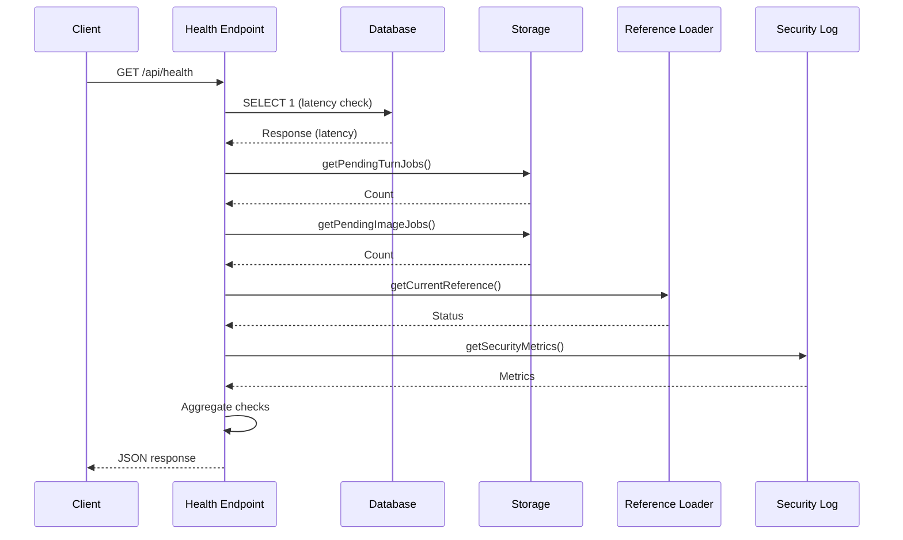
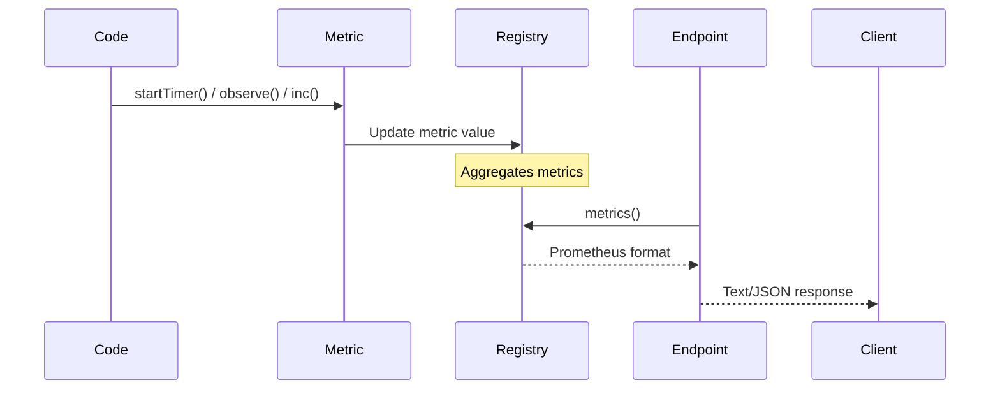

# Telemetry System Documentation

**Last Updated:** 2025-01-27 UTC  
**Target Audience:** Architects and Game Mechanics Specialists

---

## Context & Overview

### What is the Telemetry System?

The Quest to Uranus telemetry system is a comprehensive observability infrastructure that provides real-time visibility into game execution performance, system health, and operational metrics. It serves as the primary diagnostic and monitoring tool for understanding system behavior, identifying bottlenecks, and ensuring optimal player experience.

### Why It Exists

The telemetry system addresses several critical operational needs:

1. **Performance Monitoring**: Track execution times across all game subsystems (turn processing, image generation, LLM calls, database operations)
2. **System Health**: Monitor queue depths, memory usage, database latency, and security events
3. **Debugging & Diagnostics**: Provide detailed timing breakdowns for individual game turns, enabling root cause analysis
4. **Capacity Planning**: Understand system load patterns and resource utilization
5. **Security Monitoring**: Track rate limiting, CSRF failures, and suspicious request patterns

### Purpose Within the Larger System

The telemetry system integrates with the **Maintenance & Observability Agent** (see `AGENTS.md`), which is responsible for:
- Exposing metrics via Prometheus-compatible endpoints
- Aggregating health check data for monitoring systems
- Providing real-time dashboards for operators
- Enabling game-specific telemetry analysis for debugging

The system operates at multiple layers:
- **Application Metrics**: Prometheus histograms, counters, and gauges tracking execution times and counts
- **Health Checks**: Aggregated system status for load balancers and monitoring tools
- **Game Telemetry**: Detailed per-turn execution manifests stored in the database
- **Security Events**: In-memory security event logging for threat detection

---

## Technical Details

### Components & Architecture

The telemetry system consists of four primary components:

#### 1. Metrics Registry (`server/metrics.ts`)

The central Prometheus metrics registry that defines and exports all application metrics.

**Key Metrics Categories:**

**Job Execution Metrics:**
- `turn_job_duration_ms` (Histogram): Duration of turn job processing
- `image_job_duration_ms` (Histogram): Duration of image generation jobs
- `image_jobs_completed` (Counter): Total completed image jobs
- `image_jobs_failed` (Counter): Total failed image jobs

**Queue Metrics:**
- `queue_depth_image` (Gauge): Pending image jobs
- `queue_depth_turn` (Gauge): Pending turn jobs
- `queue_pending` (Gauge): Jobs pending per queue (labeled)
- `queue_in_progress` (Gauge): Jobs currently leased (labeled)
- `queue_completed_total` (Counter): Total completed jobs per queue
- `queue_failed_total` (Counter): Total failed jobs per queue
- `queue_dead_letter_total` (Counter): Dead-lettered jobs
- `queue_lease_timeout_total` (Counter): Lease timeouts
- `queue_attempts_histogram` (Histogram): Distribution of job retry attempts
- `queue_latency_histogram` (Histogram): Time from job creation to completion

**Cache Metrics:**
- `image_cache_hits_total` (Counter): Image cache hits
- `image_cache_misses_total` (Counter): Image cache misses

**Resource Metrics:**
- `nodejs_memory_usage_bytes` (Gauge): Memory usage by type (rss, heapTotal, heapUsed, external)

**PCE Pipeline Metrics:**
- `pce_stage_duration_ms` (Histogram): PCE stage durations (labeled by stage: master|narrative|image|actions, status: success|failure)
- `template_load_duration_ms` (Histogram): Template loading times (labeled by template, cache: hit|miss)
- `prompt_build_duration_ms` (Histogram): Prompt building operations (labeled by stage)
- `variable_build_duration_ms` (Histogram): Variable building operations (labeled by stage)

**LLM & AI Metrics:**
- `llm_call_duration_ms` (Histogram): LLM API call durations (labeled by model, stage, cache: hit|miss|na)
- `image_model_call_duration_ms` (Histogram): Image model API calls (labeled by model, provider, cache: hit|miss)

**Worker Phase Metrics:**
- `turn_precompute_phase_duration_ms` (Histogram): Precompute phase durations (labeled by phase: compute_checks|generate_content|generate_actions|prepare_image|total)
- `turn_apply_phase_duration_ms` (Histogram): Apply phase durations (labeled by phase: transaction|process_logic|process_image|total)
- `image_processing_duration_ms` (Histogram): Image processing operations (labeled by operation: cache_lookup|generation|storage|total, cache: hit|miss)

**Database Metrics:**
- `db_operation_duration_ms` (Histogram): Database operation durations (labeled by operation: transaction|query|update, table)

**End-to-End Metrics:**
- `e2e_latency_ms` (Histogram): End-to-end latency from request to completion (labeled by operation: turn|image|game_init)

**Implementation:**
```1:225:server/metrics.ts
import { Registry, Histogram, Counter, Gauge } from 'prom-client';

export const metricsRegister = new Registry();

export const turnJobDuration = new Histogram({
  name: 'turn_job_duration_ms',
  help: 'Duration of turn jobs in milliseconds',
  buckets: [50, 100, 250, 500, 1000, 2000, 5000]
});

export const imageJobDuration = new Histogram({
  name: 'image_job_duration_ms',
  help: 'Duration of image jobs in milliseconds',
  buckets: [200, 500, 1000, 3000, 7000, 15000, 30000]
});

export const imageJobsCompleted = new Counter({
  name: 'image_jobs_completed',
  help: 'Number of completed image jobs'
});

export const imageJobsFailed = new Counter({
  name: 'image_jobs_failed',
  help: 'Number of failed image jobs'
});

export const queueDepthImage = new Gauge({
  name: 'queue_depth_image',
  help: 'Approximate pending image jobs'
});

export const queueDepthTurn = new Gauge({
  name: 'queue_depth_turn',
  help: 'Approximate pending turn jobs'
});

export const imageCacheHits = new Counter({
  name: 'image_cache_hits_total',
  help: 'Number of image cache hits'
});

export const imageCacheMisses = new Counter({
  name: 'image_cache_misses_total',
  help: 'Number of image cache misses'
});

export const memoryUsage = new Gauge({
  name: 'nodejs_memory_usage_bytes',
  help: 'Node.js memory usage in bytes',
  labelNames: ['type'] // 'rss', 'heapTotal', 'heapUsed', 'external'
});

// Orchestrator metrics
export const queuePending = new Gauge({
  name: 'queue_pending',
  help: 'Number of pending jobs in queue',
  labelNames: ['queue']
});

export const queueInProgress = new Gauge({
  name: 'queue_in_progress',
  help: 'Number of in-progress (leased) jobs in queue',
  labelNames: ['queue']
});

export const queueCompletedTotal = new Counter({
  name: 'queue_completed_total',
  help: 'Total number of completed jobs',
  labelNames: ['queue']
});

export const queueFailedTotal = new Counter({
  name: 'queue_failed_total',
  help: 'Total number of failed jobs',
  labelNames: ['queue']
});

export const queueDeadLetterTotal = new Counter({
  name: 'queue_dead_letter_total',
  help: 'Total number of dead-letter jobs',
  labelNames: ['queue']
});

export const queueLeaseTimeoutTotal = new Counter({
  name: 'queue_lease_timeout_total',
  help: 'Total number of lease timeouts',
  labelNames: ['queue']
});

export const queueAttemptsHistogram = new Histogram({
  name: 'queue_attempts_histogram',
  help: 'Distribution of job attempts before completion',
  labelNames: ['queue'],
  buckets: [1, 2, 3, 4, 5, 10]
});

export const queueLatencyHistogram = new Histogram({
  name: 'queue_latency_histogram',
  help: 'Time from job creation to completion',
  labelNames: ['queue'],
  buckets: [100, 500, 1000, 2000, 5000, 10000, 30000, 60000]
});

metricsRegister.registerMetric(turnJobDuration);
metricsRegister.registerMetric(imageJobDuration);
metricsRegister.registerMetric(imageJobsCompleted);
metricsRegister.registerMetric(imageJobsFailed);
metricsRegister.registerMetric(queueDepthImage);
metricsRegister.registerMetric(queueDepthTurn);
metricsRegister.registerMetric(imageCacheHits);
metricsRegister.registerMetric(imageCacheMisses);
metricsRegister.registerMetric(memoryUsage);

// Orchestrator metrics
metricsRegister.registerMetric(queuePending);
metricsRegister.registerMetric(queueInProgress);
metricsRegister.registerMetric(queueCompletedTotal);
metricsRegister.registerMetric(queueFailedTotal);
metricsRegister.registerMetric(queueDeadLetterTotal);
metricsRegister.registerMetric(queueLeaseTimeoutTotal);
metricsRegister.registerMetric(queueAttemptsHistogram);
metricsRegister.registerMetric(queueLatencyHistogram);

// PCE Pipeline Metrics
export const pceStageDuration = new Histogram({
  name: 'pce_stage_duration_ms',
  help: 'Duration of PCE pipeline stages in milliseconds',
  labelNames: ['stage', 'status'], // stage: master|narrative|image|actions, status: success|failure
  buckets: [50, 100, 250, 500, 1000, 2000, 5000, 10000]
});

// LLM Call Metrics
export const llmCallDuration = new Histogram({
  name: 'llm_call_duration_ms',
  help: 'Duration of LLM API calls in milliseconds',
  labelNames: ['model', 'stage', 'cache'], // cache: hit|miss|na
  buckets: [100, 500, 1000, 2000, 5000, 10000, 30000]
});

// Image Model Call Metrics
export const imageModelCallDuration = new Histogram({
  name: 'image_model_call_duration_ms',
  help: 'Duration of image model API calls in milliseconds',
  labelNames: ['model', 'provider', 'cache'], // cache: hit|miss
  buckets: [100, 500, 1000, 2000, 5000, 10000, 15000, 30000, 60000]
});

// Template Loading Metrics
export const templateLoadDuration = new Histogram({
  name: 'template_load_duration_ms',
  help: 'Duration of template loading operations in milliseconds',
  labelNames: ['template', 'cache'], // cache: hit|miss
  buckets: [1, 5, 10, 50, 100, 500, 1000]
});

// Prompt Building Metrics
export const promptBuildDuration = new Histogram({
  name: 'prompt_build_duration_ms',
  help: 'Duration of prompt building operations in milliseconds',
  labelNames: ['stage'],
  buckets: [1, 5, 10, 50, 100, 500, 1000]
});

// Variable Building Metrics
export const variableBuildDuration = new Histogram({
  name: 'variable_build_duration_ms',
  help: 'Duration of prompt variable building in milliseconds',
  labelNames: ['stage'],
  buckets: [1, 5, 10, 50, 100, 500, 1000]
});

// Turn Precompute Phase Metrics
export const turnPrecomputePhaseDuration = new Histogram({
  name: 'turn_precompute_phase_duration_ms',
  help: 'Duration of turn precompute phases in milliseconds',
  labelNames: ['phase'], // phase: compute_checks|generate_content|generate_actions|prepare_image|total
  buckets: [10, 50, 100, 250, 500, 1000, 2000, 5000, 10000]
});

// Turn Apply Phase Metrics
export const turnApplyPhaseDuration = new Histogram({
  name: 'turn_apply_phase_duration_ms',
  help: 'Duration of turn apply phases in milliseconds',
  labelNames: ['phase'], // phase: transaction|process_logic|process_image|total
  buckets: [1, 5, 10, 50, 100, 250, 500, 1000]
});

// Image Processing Metrics
export const imageProcessingDuration = new Histogram({
  name: 'image_processing_duration_ms',
  help: 'Duration of image processing operations in milliseconds',
  labelNames: ['operation', 'cache'], // operation: cache_lookup|generation|storage|total, cache: hit|miss
  buckets: [10, 50, 100, 500, 1000, 3000, 7000, 15000, 30000]
});

// Database Operation Metrics
export const dbOperationDuration = new Histogram({
  name: 'db_operation_duration_ms',
  help: 'Duration of database operations in milliseconds',
  labelNames: ['operation', 'table'], // operation: transaction|query|update
  buckets: [1, 5, 10, 50, 100, 250, 500, 1000, 2000]
});

// End-to-End Latency Metrics
export const e2eLatency = new Histogram({
  name: 'e2e_latency_ms',
  help: 'End-to-end latency from request to completion',
  labelNames: ['operation'], // operation: turn|image|game_init
  buckets: [100, 500, 1000, 2000, 5000, 10000, 30000, 60000]
});

// Register new metrics
metricsRegister.registerMetric(pceStageDuration);
metricsRegister.registerMetric(llmCallDuration);
metricsRegister.registerMetric(imageModelCallDuration);
metricsRegister.registerMetric(templateLoadDuration);
metricsRegister.registerMetric(promptBuildDuration);
metricsRegister.registerMetric(variableBuildDuration);
metricsRegister.registerMetric(turnPrecomputePhaseDuration);
metricsRegister.registerMetric(turnApplyPhaseDuration);
metricsRegister.registerMetric(imageProcessingDuration);
metricsRegister.registerMetric(dbOperationDuration);
metricsRegister.registerMetric(e2eLatency);
```

#### 2. Health Check Endpoint (`server/index.ts`)

The `/api/health` endpoint provides aggregated system health status for monitoring systems and load balancers.

**Implementation:**
```167:223:server/index.ts
// Enhanced health endpoint
app.get("/api/health", async (_req, res) => {
  try {
    // Database check with latency measurement
    const dbStart = Date.now();
    await pool.query("SELECT 1");
    const dbLatency = Date.now() - dbStart;
    
    // Queue depth checks
    const pendingTurnJobs = await storage.getPendingTurnJobs(1000);
    const pendingImageJobs = await storage.getPendingImageJobs(1000);
    
    // Reference check
    let referenceStatus = 'ok';
    try {
      const { getCurrentReference } = await import('./reference/referenceLoader');
      await getCurrentReference();
    } catch (error) {
      referenceStatus = 'error';
    }
    
    // Memory check
    const memory = process.memoryUsage();
    const memoryPct = (memory.heapUsed / memory.heapTotal) * 100;
    
    // Security metrics
    const securityMetrics = getSecurityMetrics();
    
    res.json({
      status: 'healthy',
      timestamp: new Date().toISOString(),
      checks: {
        database: { status: 'ok', latencyMs: dbLatency },
        reference: { status: referenceStatus },
        queues: {
          turnJobs: pendingTurnJobs.length,
          imageJobs: pendingImageJobs.length
        },
        memory: {
          rss: memory.rss,
          heapUsed: memory.heapUsed,
          heapTotal: memory.heapTotal,
          heapUsedPercent: memoryPct.toFixed(1)
        },
        security: {
          rateLimitEnabled,
          csrfEnabled,
          eventsLastHour: securityMetrics.eventsLastHour,
          rateLimitHits: securityMetrics.rateLimitHits,
          csrfFailures: securityMetrics.csrfFailures,
          suspiciousRequests: securityMetrics.suspiciousRequests
        }
      }
    });
  } catch (error) {
    res.status(500).json({ status: 'unhealthy', error: String(error) });
  }
});
```

**Response Structure:**
- `status`: `'healthy'` or `'unhealthy'`
- `timestamp`: ISO 8601 timestamp
- `checks.database`: Database connectivity and latency
- `checks.reference`: Reference data loader status
- `checks.queues`: Pending job counts
- `checks.memory`: Node.js memory usage statistics
- `checks.security`: Security event counters

#### 3. Prometheus Metrics Endpoint (`server/index.ts`)

The `/metrics` endpoint exports all registered metrics in Prometheus text format.

**Implementation:**
```225:233:server/index.ts
// Prometheus metrics endpoint
app.get("/metrics", async (_req, res) => {
  try {
    res.setHeader('Content-Type', metricsRegister.contentType);
    res.end(await metricsRegister.metrics());
  } catch (err) {
    res.status(500).end(String(err));
  }
});
```

**Memory Monitoring:**
Memory metrics are updated every 15 seconds:
```361:367:server/index.ts
  // Start memory monitoring
  setInterval(() => {
    const mem = process.memoryUsage();
    memoryMetric.set({ type: 'rss' }, mem.rss);
    memoryMetric.set({ type: 'heapTotal' }, mem.heapTotal);
    memoryMetric.set({ type: 'heapUsed' }, mem.heapUsed);
    memoryMetric.set({ type: 'external' }, mem.external);
  }, 15000); // Update every 15 seconds
```

#### 4. Telemetry API Endpoints (`server/routes.ts`)

**Admin Telemetry Metrics Endpoint:**
```809:927:server/routes.ts
  // Telemetry metrics endpoint (returns JSON for dashboard)
  app.get("/api/admin/telemetry/metrics", requireAdmin, async (req, res) => {
    try {
      const metricsText = await metricsRegister.metrics();
      const metrics: Record<string, any> = {};
      
      // Parse Prometheus format into structured JSON
      // Handle both simple metrics and histograms (which have _bucket, _sum, _count suffixes)
      const lines = metricsText.split('\n');
      
      for (const line of lines) {
        if (line.trim() === '' || line.startsWith('#')) continue;
        
        // Match metric format: metric_name{labels} value or metric_name value
        // Also handle histogram buckets: metric_name_bucket{le="value"} count
        const metricMatch = line.match(/^([a-zA-Z_:][a-zA-Z0-9_:]*)\s*({[^}]*})?\s+([\d.]+)$/);
        if (metricMatch) {
          const [, name, labelsStr, value] = metricMatch;
          const labels: Record<string, string> = {};
          
          if (labelsStr) {
            // Parse labels: {label1="value1",label2="value2"}
            const labelPattern = /([a-zA-Z_][a-zA-Z0-9_]*)=["']([^"']+)["']/g;
            let match;
            while ((match = labelPattern.exec(labelsStr)) !== null) {
              labels[match[1]] = match[2];
            }
          }
          
          // Skip histogram buckets for now - we'll aggregate them
          if (name.endsWith('_bucket')) {
            const baseName = name.replace('_bucket', '');
            if (!metrics[baseName]) {
              metrics[baseName] = { buckets: [], sum: 0, count: 0 };
            }
            const le = labels.le ? parseFloat(labels.le) : null;
            if (le !== null) {
              metrics[baseName].buckets.push({
                le,
                count: parseFloat(value),
                labels: Object.fromEntries(Object.entries(labels).filter(([k]) => k !== 'le'))
              });
            }
            continue;
          }
          
          if (name.endsWith('_sum')) {
            const baseName = name.replace('_sum', '');
            if (!metrics[baseName]) {
              metrics[baseName] = { buckets: [], sum: 0, count: 0 };
            }
            metrics[baseName].sum = parseFloat(value);
            continue;
          }
          
          if (name.endsWith('_count')) {
            const baseName = name.replace('_count', '');
            if (!metrics[baseName]) {
              metrics[baseName] = { buckets: [], sum: 0, count: 0 };
            }
            metrics[baseName].count = parseFloat(value);
            continue;
          }
          
          // Regular metric
          if (!metrics[name]) {
            metrics[name] = [];
          }
          metrics[name].push({
            labels,
            value: parseFloat(value)
          });
        }
      }
      
      // Calculate percentiles from histograms
      for (const [metricName, data] of Object.entries(metrics)) {
        if (data && typeof data === 'object' && 'buckets' in data) {
          const histogram = data as { buckets: Array<{ le: number; count: number; labels: Record<string, string> }>; sum: number; count: number };
          // Group buckets by labels (excluding 'le')
          const byLabels: Record<string, Array<{ le: number; count: number }>> = {};
          histogram.buckets.forEach(bucket => {
            const labelKey = JSON.stringify(bucket.labels);
            if (!byLabels[labelKey]) {
              byLabels[labelKey] = [];
            }
            byLabels[labelKey].push({ le: bucket.le, count: bucket.count });
          });
          
          // Calculate percentiles for each label group
          const calculated: Array<{ labels: Record<string, string>; p50: number; p95: number; p99: number; avg: number }> = [];
          Object.entries(byLabels).forEach(([labelKey, buckets]) => {
            const labels = JSON.parse(labelKey);
            const sorted = buckets.sort((a, b) => a.le - b.le);
            const total = histogram.count;
            if (total > 0) {
              const p50Bucket = sorted.find(b => b.count >= total * 0.5) || sorted[sorted.length - 1];
              const p95Bucket = sorted.find(b => b.count >= total * 0.95) || sorted[sorted.length - 1];
              const p99Bucket = sorted.find(b => b.count >= total * 0.99) || sorted[sorted.length - 1];
              calculated.push({
                labels,
                p50: p50Bucket.le,
                p95: p95Bucket.le,
                p99: p99Bucket.le,
                avg: histogram.sum / total
              });
            }
          });
          
          metrics[metricName] = calculated.length > 0 ? calculated : [{ labels: {}, p50: 0, p95: 0, p99: 0, avg: 0 }];
        }
      }
      
      res.json(metrics);
    } catch (error) {
      console.error("Error getting telemetry metrics:", error);
      res.status(500).json({ error: "Failed to get telemetry metrics" });
    }
  });
```

**Game Telemetry Endpoint:**
```929:1062:server/routes.ts
  // Game telemetry endpoint (returns manifest timing data for a specific game)
  app.get("/api/admin/telemetry/game/:gameId", requireAdmin, async (req, res) => {
    try {
      const gameId = req.params.gameId;
      const limit = req.query.limit ? parseInt(String(req.query.limit), 10) : undefined;
      
      // Verify game exists
      const gameState = await storage.getGameState(gameId);
      if (!gameState) {
        return res.status(404).json({ error: "Game not found" });
      }
      
      // Get all manifests for this game with queue entry creation times
      const manifests = await storage.getGameManifests(gameId, limit);
      const { pool } = await import("./db");
      
      // Transform manifests into telemetry data with timing breakdown
      const telemetry = await Promise.all(manifests.map(async (m) => {
        const manifest = m.manifest as any;
        const job = manifest.job || {};
        const precompute = manifest.precompute || {};
        const apply = manifest.apply || {};
        
        // Get queue entry creation time (when job was actually enqueued)
        let queueEntryCreatedAt: Date | null = null;
        try {
          const queueEntryResult = await pool.query(
            'SELECT created_at FROM queue_entries WHERE id = $1',
            [m.queueEntryId]
          );
          if (queueEntryResult.rows.length > 0) {
            queueEntryCreatedAt = queueEntryResult.rows[0].created_at;
          }
        } catch (error) {
          console.warn(`Failed to get queue entry creation time for ${m.queueEntryId}:`, error);
        }
        
        // Calculate timing breakdown
        const timings: any = {
          turnNumber: m.turnNumber,
          createdAt: queueEntryCreatedAt?.toISOString() || m.createdAt.toISOString(),
          totalDurationMs: 0,
          queueWaitMs: 0,
          precomputeMs: 0,
          precomputeDeterministicMs: 0,
          precomputeLlmMs: 0,
          applyMs: 0,
          llmCalls: [],
        };
        
        // Queue wait time (from queue entry creation to claim)
        if (job.claimedAt && queueEntryCreatedAt) {
          const claimedAt = new Date(job.claimedAt).getTime();
          const queueCreatedAt = queueEntryCreatedAt.getTime();
          timings.queueWaitMs = Math.max(0, claimedAt - queueCreatedAt);
        } else if (job.claimedAt && precompute.startedAt) {
          // Fallback: use precompute start time if queue entry not available
          const claimedAt = new Date(job.claimedAt).getTime();
          const startedAt = new Date(precompute.startedAt).getTime();
          timings.queueWaitMs = Math.max(0, startedAt - claimedAt);
        }
        
        // Precompute duration (total)
        if (precompute.durationMs) {
          timings.precomputeMs = precompute.durationMs;
        } else if (precompute.startedAt && precompute.completedAt) {
          const started = new Date(precompute.startedAt).getTime();
          const completed = new Date(precompute.completedAt).getTime();
          timings.precomputeMs = completed - started;
        }
        
        // Precompute deterministic duration (excludes LLM calls)
        if (precompute.deterministicDurationMs !== undefined) {
          timings.precomputeDeterministicMs = precompute.deterministicDurationMs;
        }
        
        // Precompute LLM duration (sum of all LLM calls)
        if (precompute.llmDurationMs !== undefined) {
          timings.precomputeLlmMs = precompute.llmDurationMs;
        } else if (Array.isArray(precompute.llmCalls)) {
          // Fallback: calculate from individual LLM call latencies
          timings.precomputeLlmMs = precompute.llmCalls.reduce((sum: number, call: any) => sum + (call.latencyMs || 0), 0);
        }
        
        // Apply duration
        if (apply.durationMs) {
          timings.applyMs = apply.durationMs;
        } else if (apply.startedAt && apply.completedAt) {
          const started = new Date(apply.startedAt).getTime();
          const completed = new Date(apply.completedAt).getTime();
          timings.applyMs = completed - started;
        }
        
        // LLM call details
        if (Array.isArray(precompute.llmCalls)) {
          timings.llmCalls = precompute.llmCalls.map((call: any) => ({
            model: call.model,
            template: call.promptTemplate,
            latencyMs: call.latencyMs,
            cache: call.cache,
          }));
        }
        
        // Total duration (from queue entry creation to completion)
        if (apply.completedAt && queueEntryCreatedAt) {
          const completed = new Date(apply.completedAt).getTime();
          const created = queueEntryCreatedAt.getTime();
          timings.totalDurationMs = completed - created;
        } else if (precompute.completedAt && queueEntryCreatedAt) {
          const completed = new Date(precompute.completedAt).getTime();
          const created = queueEntryCreatedAt.getTime();
          timings.totalDurationMs = completed - created;
        } else if (apply.completedAt && precompute.startedAt) {
          // Fallback: use precompute start to apply end if queue entry not available
          const completed = new Date(apply.completedAt).getTime();
          const started = new Date(precompute.startedAt).getTime();
          timings.totalDurationMs = completed - started + timings.queueWaitMs;
        }
        
        return timings;
      }));
      
      res.json({
        gameId,
        username: gameState.username,
        turnNumber: gameState.turnNumber,
        totalTurns: telemetry.length,
        turns: telemetry,
      });
    } catch (error) {
      console.error("Error getting game telemetry:", error);
      res.status(500).json({ error: "Failed to get game telemetry" });
    }
  });
```

#### 5. Security Event Logging (`server/middleware/securityLogging.ts`)

Tracks security-related events in memory for monitoring and alerting.

**Event Types:**
- `rate_limit`: Rate limit violations
- `csrf_failure`: CSRF token validation failures
- `large_payload`: Requests exceeding size thresholds
- `auth_failure`: Authentication failures
- `suspicious_request`: Suspicious patterns detected (bot user agents, path traversal, SQL injection attempts)

**Implementation:**
```1:204:server/middleware/securityLogging.ts
import { Request, Response, NextFunction } from 'express';

interface SecurityEvent {
  timestamp: string;
  type: 'rate_limit' | 'csrf_failure' | 'large_payload' | 'auth_failure' | 'suspicious_request';
  ip: string;
  userAgent: string;
  path: string;
  method: string;
  details: Record<string, any>;
}

// In-memory store for security events (in production, use a proper logging service)
const securityEvents: SecurityEvent[] = [];
const MAX_EVENTS = 1000; // Keep last 1000 events

function logSecurityEvent(event: Omit<SecurityEvent, 'timestamp'>) {
  const securityEvent: SecurityEvent = {
    ...event,
    timestamp: new Date().toISOString()
  };
  
  securityEvents.push(securityEvent);
  
  // Keep only the last MAX_EVENTS
  if (securityEvents.length > MAX_EVENTS) {
    securityEvents.splice(0, securityEvents.length - MAX_EVENTS);
  }
  
  // Log to console with structured format
  console.log(`[SECURITY] ${securityEvent.type.toUpperCase()}: ${JSON.stringify(securityEvent)}`);
}

// Rate limit hit logging
export function logRateLimitHit(req: Request, res: Response, limitType: string) {
  logSecurityEvent({
    type: 'rate_limit',
    ip: req.ip || 'unknown',
    userAgent: req.get('User-Agent') || 'unknown',
    path: req.path,
    method: req.method,
    details: {
      limitType,
      sessionId: req.sessionID,
      headers: {
        'x-forwarded-for': req.get('x-forwarded-for'),
        'x-real-ip': req.get('x-real-ip')
      }
    }
  });
}

// CSRF failure logging
export function logCSRFFailure(req: Request, res: Response, reason: string) {
  logSecurityEvent({
    type: 'csrf_failure',
    ip: req.ip || 'unknown',
    userAgent: req.get('User-Agent') || 'unknown',
    path: req.path,
    method: req.method,
    details: {
      reason,
      sessionId: req.sessionID,
      csrfToken: req.body._csrf || req.query._csrf || 'missing',
      headers: {
        'x-forwarded-for': req.get('x-forwarded-for'),
        'x-real-ip': req.get('x-real-ip')
      }
    }
  });
}

// Large payload logging
export function logLargePayload(req: Request, res: Response, size: number, limit: number) {
  logSecurityEvent({
    type: 'large_payload',
    ip: req.ip || 'unknown',
    userAgent: req.get('User-Agent') || 'unknown',
    path: req.path,
    method: req.method,
    details: {
      payloadSize: size,
      limit,
      sessionId: req.sessionID,
      contentType: req.get('Content-Type')
    }
  });
}

// Authentication failure logging
export function logAuthFailure(req: Request, res: Response, reason: string, endpoint?: string) {
  logSecurityEvent({
    type: 'auth_failure',
    ip: req.ip || 'unknown',
    userAgent: req.get('User-Agent') || 'unknown',
    path: req.path,
    method: req.method,
    details: {
      reason,
      endpoint,
      sessionId: req.sessionID,
      apiKey: req.headers['x-test-api-key'] ? 'present' : 'missing'
    }
  });
}

// Suspicious request logging
export function logSuspiciousRequest(req: Request, res: Response, reason: string, details: Record<string, any> = {}) {
  logSecurityEvent({
    type: 'suspicious_request',
    ip: req.ip || 'unknown',
    userAgent: req.get('User-Agent') || 'unknown',
    path: req.path,
    method: req.method,
    details: {
      reason,
      sessionId: req.sessionID,
      ...details
    }
  });
}

// Middleware to detect suspicious patterns
export function suspiciousRequestDetection(req: Request, res: Response, next: NextFunction) {
  // Check for suspicious user agents
  const userAgent = req.get('User-Agent') || '';
  const suspiciousPatterns = [
    /bot/i,
    /crawler/i,
    /spider/i,
    /scraper/i,
    /curl/i,
    /wget/i,
    /python/i,
    /java/i
  ];
  
  if (suspiciousPatterns.some(pattern => pattern.test(userAgent))) {
    logSuspiciousRequest(req, res, 'Suspicious user agent', { userAgent });
  }
  
  // Check for unusual request patterns
  if (req.path.includes('..') || req.path.includes('//')) {
    logSuspiciousRequest(req, res, 'Path traversal attempt', { path: req.path });
  }
  
  // Check for SQL injection patterns in query params
  const sqlPatterns = [
    /union/i,
    /select/i,
    /insert/i,
    /delete/i,
    /drop/i,
    /update/i,
    /script/i,
    /javascript/i
  ];
  
  const queryString = req.url.split('?')[1] || '';
  if (sqlPatterns.some(pattern => pattern.test(queryString))) {
    logSuspiciousRequest(req, res, 'Potential SQL injection attempt', { queryString });
  }
  
  next();
}

// Get recent security events (for monitoring)
export function getRecentSecurityEvents(limit: number = 100): SecurityEvent[] {
  return securityEvents.slice(-limit);
}

// Get security events by type
export function getSecurityEventsByType(type: SecurityEvent['type'], limit: number = 100): SecurityEvent[] {
  return securityEvents
    .filter(event => event.type === type)
    .slice(-limit);
}

// Get security events by IP
export function getSecurityEventsByIP(ip: string, limit: number = 100): SecurityEvent[] {
  return securityEvents
    .filter(event => event.ip === ip)
    .slice(-limit);
}

// Security metrics for Prometheus
export function getSecurityMetrics() {
  const now = Date.now();
  const lastHour = now - (60 * 60 * 1000);
  
  const recentEvents = securityEvents.filter(event => 
    new Date(event.timestamp).getTime() > lastHour
  );
  
  return {
    totalEvents: securityEvents.length,
    eventsLastHour: recentEvents.length,
    rateLimitHits: recentEvents.filter(e => e.type === 'rate_limit').length,
    csrfFailures: recentEvents.filter(e => e.type === 'csrf_failure').length,
    largePayloads: recentEvents.filter(e => e.type === 'large_payload').length,
    authFailures: recentEvents.filter(e => e.type === 'auth_failure').length,
    suspiciousRequests: recentEvents.filter(e => e.type === 'suspicious_request').length
  };
}
```

#### 6. Client Telemetry UI (`client/src/pages/devtools/TelemetryTab.tsx` & `GameTelemetryTab.tsx`)

Admin dashboard components that visualize telemetry data:

- **TelemetryTab**: Displays aggregated execution time metrics organized by category (PCE Pipeline, Workers, LLM Calls, Database, End-to-End)
- **GameTelemetryTab**: Shows detailed per-turn timing breakdowns for a specific game, including waterfall visualizations

### Technologies & Frameworks

- **Prometheus Client (`prom-client`)**: Metrics collection and export
- **Express.js**: HTTP endpoints for metrics and health checks
- **PostgreSQL**: Storage for turn execution manifests
- **React Query (`@tanstack/react-query`)**: Client-side data fetching and caching
- **TypeScript**: Type-safe metric definitions and API contracts

### Relationships & Interactions

**Data Flow:**

1. **Metric Collection**: Application code records metrics using the Prometheus client during execution
2. **Metric Export**: Metrics are aggregated in the registry and exported via `/metrics` endpoint
3. **Health Aggregation**: Health endpoint queries various subsystems and aggregates status
4. **Manifest Storage**: Turn execution manifests are stored in `turn_execution_manifests` table during processing
5. **Telemetry Query**: Admin endpoints query manifests and transform them into telemetry data

**Component Interactions:**

```
┌─────────────────┐
│  Application    │
│     Code        │───┐
└─────────────────┘   │
                       │ Records metrics
                       ▼
┌─────────────────┐   ┌──────────────────┐
│  Metrics        │◄──│  Prometheus     │
│  Registry       │   │  Client         │
└─────────────────┘   └──────────────────┘
         │                      │
         │                      │ Exports
         │                      ▼
         │              ┌──────────────────┐
         │              │  /metrics        │
         │              │  endpoint        │
         │              └──────────────────┘
         │
         │ Aggregates
         ▼
┌─────────────────┐
│  /api/health    │
│  endpoint        │
└─────────────────┘
         │
         │ Queries
         ▼
┌─────────────────┐   ┌──────────────────┐
│  Database       │   │  Security        │
│  (Postgres)     │   │  Events          │
└─────────────────┘   └──────────────────┘
         │                      │
         │                      │
         ▼                      ▼
┌─────────────────┐   ┌──────────────────┐
│  Manifests      │   │  Event Logs      │
│  Table          │   │  (In-Memory)     │
└─────────────────┘   └──────────────────┘
         │
         │ Queried by
         ▼
┌─────────────────┐
│  Game           │
│  Telemetry      │
│  Endpoint       │
└─────────────────┘
```

### Configurations & Parameters

**Metric Bucket Configuration:**

Histogram buckets are configured per metric type to optimize for expected value ranges:

- **Turn Jobs**: `[50, 100, 250, 500, 1000, 2000, 5000]` ms
- **Image Jobs**: `[200, 500, 1000, 3000, 7000, 15000, 30000]` ms
- **LLM Calls**: `[100, 500, 1000, 2000, 5000, 10000, 30000]` ms
- **Database Operations**: `[1, 5, 10, 50, 100, 250, 500, 1000, 2000]` ms
- **Queue Latency**: `[100, 500, 1000, 2000, 5000, 10000, 30000, 60000]` ms

**Memory Monitoring Interval:**

- Update frequency: 15 seconds (configurable via the interval in `server/index.ts`)

**Security Event Retention:**

- Maximum events stored: 1000 (configurable via `MAX_EVENTS` in `server/middleware/securityLogging.ts`)
- Event window for metrics: Last 1 hour

**Database Schema:**

The `turn_execution_manifests` table stores execution manifests:

```sql
CREATE TABLE turn_execution_manifests (
  id UUID PRIMARY KEY,
  game_id UUID NOT NULL,
  turn_number INTEGER NOT NULL,
  queue_entry_id UUID NOT NULL,
  attempt INTEGER NOT NULL,
  version TEXT NOT NULL,
  manifest JSONB NOT NULL,
  manifest_hash BYTEA NOT NULL,
  precompute_hash BYTEA NOT NULL,
  trace_id TEXT,
  request_id TEXT,
  created_at TIMESTAMP NOT NULL,
  updated_at TIMESTAMP NOT NULL
);
```

---

## Practical Guidance

### Step-by-Step Usage

#### 1. Accessing Prometheus Metrics

**For Infrastructure Monitoring:**

```bash
# Scrape metrics endpoint (typically done by Prometheus server)
curl http://localhost:5001/metrics
```

**For Admin Dashboard:**

```bash
# Get JSON-formatted metrics (requires admin authentication)
curl -H "Cookie: session=..." http://localhost:5001/api/admin/telemetry/metrics
```

#### 2. Checking System Health

```bash
# Health check endpoint
curl http://localhost:5001/api/health

# Example response:
{
  "status": "healthy",
  "timestamp": "2025-01-27T12:00:00.000Z",
  "checks": {
    "database": { "status": "ok", "latencyMs": 9 },
    "reference": { "status": "ok" },
    "queues": { "turnJobs": 0, "imageJobs": 0 },
    "memory": {
      "rss": 21585920,
      "heapUsed": 10485760,
      "heapTotal": 20971520,
      "heapUsedPercent": "50.0"
    },
    "security": {
      "rateLimitEnabled": true,
      "csrfEnabled": true,
      "eventsLastHour": 3,
      "rateLimitHits": 0,
      "csrfFailures": 0,
      "suspiciousRequests": 0
    }
  }
}
```

#### 3. Viewing Game Telemetry

**Via API:**

```bash
# Get telemetry for a specific game
curl -H "Cookie: session=..." \
  http://localhost:5001/api/admin/telemetry/game/{gameId}?limit=50
```

**Via Admin UI:**

1. Navigate to DevTools → Game Telemetry tab
2. Enter game ID (UUID)
3. View turn-by-turn timing breakdown with waterfall visualization

#### 4. Recording Metrics in Code

**Example: Recording a histogram duration:**

```typescript
import { dbOperationDuration } from './metrics';

async function performDatabaseOperation() {
  const timer = dbOperationDuration.startTimer({ 
    operation: 'query', 
    table: 'games' 
  });
  
  try {
    // ... database operation ...
    timer(); // Records the duration
  } catch (error) {
    timer(); // Still record on error
    throw error;
  }
}
```

**Example: Incrementing a counter:**

```typescript
import { imageCacheHits, imageCacheMisses } from './metrics';

if (cached) {
  imageCacheHits.inc();
} else {
  imageCacheMisses.inc();
}
```

**Example: Setting a gauge:**

```typescript
import { queueDepthTurn } from './metrics';

const pendingJobs = await storage.getPendingTurnJobs(1000);
queueDepthTurn.set(pendingJobs.length);
```

### Code Examples & Usage Patterns

#### Metric Recording Best Practices

1. **Always use labeled metrics for dimensional data:**
```typescript
// Good: Labeled metric allows filtering by stage
turnPrecomputePhaseDuration.observe({ phase: 'generate_content' }, durationMs);

// Avoid: Unlabeled metrics lose context
turnPrecomputePhaseDuration.observe(durationMs);
```

2. **Use appropriate bucket ranges:**
```typescript
// Histogram buckets should cover expected value ranges
// Too narrow: May lose precision for outliers
// Too wide: May lose precision for normal values
llmCallDuration.observe({ model: 'gpt-4', cache: 'miss' }, 2500);
```

3. **Record metrics even on errors:**
```typescript
const timer = imageJobDuration.startTimer();
try {
  await processImage();
  timer(); // Record success duration
} catch (error) {
  imageJobsFailed.inc();
  timer(); // Still record duration (shows failure latency)
  throw error;
}
```

4. **Update gauges periodically, not on every operation:**
```typescript
// Good: Update periodically (e.g., every 15 seconds)
setInterval(() => {
  const mem = process.memoryUsage();
  memoryUsage.set({ type: 'heapUsed' }, mem.heapUsed);
}, 15000);

// Avoid: Updating on every memory allocation
```

### Best Practices & Guidelines

#### Metric Naming

- Use descriptive names: `turn_job_duration_ms` not `tj_dur`
- Include units in name: `_ms` for milliseconds, `_bytes` for bytes
- Use snake_case for consistency
- Suffix counters with `_total`: `image_jobs_completed_total`

#### Label Selection

- Use labels for dimensions that enable useful queries:
  - `model`, `stage`, `cache` for LLM calls
  - `operation`, `table` for database operations
  - `queue` for queue metrics
- Avoid high-cardinality labels (user IDs, request IDs) that create too many time series

#### Performance Considerations

- Metric collection is lightweight but avoid recording in tight loops
- Use histograms for distributions, not individual observations
- Batch gauge updates when possible

#### Security

- `/metrics` endpoint should be protected by infrastructure (firewall, auth proxy)
- `/api/admin/telemetry/*` endpoints require admin authentication
- `/api/health` is typically public but may be firewalled

---

## Troubleshooting & Support

### Common Issues

#### 1. Metrics Endpoint Returns Empty

**Symptoms:** `/metrics` returns only comments, no metric values

**Causes:**
- No operations have occurred yet (metrics are only recorded during execution)
- Metrics registry not properly initialized

**Solutions:**
- Verify metrics are being recorded: Check application logs for metric recording calls
- Ensure `metricsRegister` is imported and metrics are registered:
  ```typescript
  import { metricsRegister } from './metrics';
  // All metrics should be registered here
  ```

#### 2. Health Check Shows "unhealthy"

**Symptoms:** `/api/health` returns `{ "status": "unhealthy", "error": "..." }`

**Common Causes:**
- Database connectivity issues
- Reference loader failure
- Memory exhaustion

**Solutions:**
- Check database connection: Verify `DATABASE_URL` is correct
- Check reference directory: Ensure `releases/current/` exists and is valid
- Monitor memory usage: Check `checks.memory.heapUsedPercent` in previous health checks
- Review application logs for detailed error messages

#### 3. Game Telemetry Returns Empty Turns

**Symptoms:** Game telemetry endpoint returns `{ turns: [] }` for a valid game

**Causes:**
- No manifests exist for the game (turns not yet processed)
- Manifest storage failed during turn processing

**Solutions:**
- Verify game has completed turns: Check `turn_number` in game state
- Check database for manifests:
  ```sql
  SELECT * FROM turn_execution_manifests 
  WHERE game_id = '{gameId}' 
  ORDER BY turn_number;
  ```
- Review worker logs for manifest creation errors

#### 4. High Queue Depths

**Symptoms:** `checks.queues.turnJobs` or `checks.queues.imageJobs` show high values

**Causes:**
- Worker processes not running
- Workers processing slower than job arrival rate
- Database connection issues preventing job claims

**Solutions:**
- Verify workers are running: Check process list, logs
- Check worker lease times: Jobs may be stuck in "in_progress" state
- Review queue metrics: `queue_in_progress` vs `queue_pending`
- Check for stuck jobs: Review `queue_lease_timeout_total` counter

#### 5. Memory Usage Growing Unbounded

**Symptoms:** `checks.memory.heapUsedPercent` continuously increases

**Causes:**
- Memory leak in application code
- Security event buffer growing (capped at 1000 events)
- Large manifest objects retained in memory

**Solutions:**
- Monitor memory over time: Graph `nodejs_memory_usage_bytes{type="heapUsed"}`
- Check for memory leaks: Use Node.js heap profiler
- Review security event retention: Events are capped but may indicate attack
- Check manifest sizes: Large manifests may indicate issues with turn processing

### Error Messages & Meanings

#### Database Errors

```
"checks.database.status": "error"
```
- Database connectivity issue or query timeout
- Check `DATABASE_URL` environment variable
- Verify database server is running and accessible

#### Reference Loader Errors

```
"checks.reference.status": "error"
```
- Reference data directory missing or invalid
- Check `releases/current/` directory exists
- Verify `manifest.json` and data files are present

#### Security Event Thresholds

**High `eventsLastHour`:**
- Indicates potential attack or misconfigured rate limits
- Review `rateLimitHits`, `csrfFailures`, `suspiciousRequests` breakdowns
- Check client behavior and rate limit configuration

### Debugging Tips & Strategies

#### 1. Using Prometheus Queries

**Find slow operations:**
```promql
# P95 latency for turn jobs
histogram_quantile(0.95, turn_job_duration_ms_bucket)

# Average queue wait time
avg(queue_latency_histogram_sum / queue_latency_histogram_count)
```

**Identify bottlenecks:**
```promql
# Compare LLM call durations by cache status
avg(llm_call_duration_ms_sum / llm_call_duration_ms_count) by (cache)

# Database operation times by table
avg(db_operation_duration_ms_sum / db_operation_duration_ms_count) by (table)
```

#### 2. Analyzing Game Telemetry

**Identify slow turns:**
1. Query game telemetry for problematic game
2. Sort turns by `totalDurationMs`
3. Examine `precomputeMs` vs `applyMs` breakdown
4. Review `llmCalls` array for slow LLM calls
5. Check `queueWaitMs` for queue congestion

**Compare cache effectiveness:**
```typescript
// From game telemetry data
const cacheHitRate = turns.reduce((sum, t) => 
  sum + t.llmCalls.filter(c => c.cache === 'hit').length, 0
) / turns.reduce((sum, t) => sum + t.llmCalls.length, 0);
```

#### 3. Monitoring Queue Health

**Key indicators:**
- `queue_pending`: Should be near zero under normal load
- `queue_in_progress`: Should match number of active workers
- `queue_latency_histogram`: Should show low latency (under 5 seconds)
- `queue_lease_timeout_total`: Should be zero (indicates stuck jobs)

**Alert conditions:**
- `queue_pending > 100`: Backlog building
- `queue_latency_histogram p95 > 30000`: Jobs taking too long
- `queue_lease_timeout_total` increasing: Workers not processing

#### 4. Security Event Analysis

**Review security events:**
```typescript
// In application code or via admin endpoint
import { getSecurityEventsByType } from './middleware/securityLogging';

const recentFailures = getSecurityEventsByType('csrf_failure', 50);
// Analyze IP addresses, user agents, paths
```

**Common patterns:**
- Repeated `rate_limit` from same IP: Potential abuse
- `suspicious_request` with SQL patterns: Potential injection attempt
- `large_payload` events: Potential DoS attempt

---

## Standards & Processes

### Quality Requirements & Criteria

#### Metric Accuracy

- **Timing metrics must use `startTimer()` pattern** for accurate duration measurement
- **Counters must be incremented atomically** (Prometheus client handles this)
- **Gauges must reflect current state** (not historical maximums)

#### Data Retention

- **Prometheus metrics**: Retained according to Prometheus server configuration (typically 15-30 days)
- **Turn execution manifests**: Stored in database indefinitely (may be archived by operations)
- **Security events**: In-memory buffer of last 1000 events (consider external logging for production)

#### Health Check Reliability

- Health endpoint must respond within 1 second
- Database latency check should timeout after 5 seconds
- All subsystem checks must handle errors gracefully (return error status, not crash)

### Security Considerations

#### Endpoint Protection

- `/metrics`: Public endpoint, protect at infrastructure level (firewall, reverse proxy auth)
- `/api/health`: Typically public for load balancers, but may be firewalled
- `/api/admin/telemetry/*`: **Require admin authentication** (see `requireAdmin` middleware)

#### Data Privacy

- **Game telemetry**: Contains game state and timing data
  - Only accessible to admins
  - Consider redacting sensitive game content in manifests
- **Security events**: Contain IP addresses and user agents
  - Store according to data retention policies
  - Consider GDPR/privacy regulations

#### Metric Cardinality

- **Avoid high-cardinality labels** that create excessive time series
- **Do not include user IDs or request IDs** as labels
- **Use trace IDs for correlation** instead of metric labels

### Performance Implications

#### Metric Collection Overhead

- **Histogram observations**: ~0.1ms overhead per observation
- **Counter increments**: Negligible (<0.01ms)
- **Gauge updates**: Negligible (<0.01ms)

**Impact:**
- Metric collection adds minimal overhead (<1% CPU for typical workloads)
- Avoid recording metrics in tight loops (>1000 observations/second)

#### Database Query Impact

- **Health check**: Queries `queue_entries` and `turn_execution_manifests` tables
- **Game telemetry**: Queries manifests with join to `queue_entries`
- **Indexes**: Ensure indexes exist on `game_id`, `turn_number`, `queue_entry_id`

**Optimization:**
- Limit query results (use `LIMIT` parameter)
- Use indexes for common queries
- Consider caching for frequently accessed game telemetry

#### Memory Usage

- **Security events**: ~1KB per event, max 1000 events = ~1MB
- **Metrics registry**: ~10MB for full metric set
- **Manifest storage**: Database-backed, no in-memory cache

### Testing & Validation Approaches

#### Unit Testing Metrics

```typescript
import { metricsRegister } from './metrics';
import { getMetrics } from 'prom-client';

test('metrics are registered', async () => {
  const metrics = await metricsRegister.metrics();
  expect(metrics).toContain('turn_job_duration_ms');
  expect(metrics).toContain('image_job_duration_ms');
});
```

#### Integration Testing Health Checks

```typescript
test('health endpoint returns healthy', async () => {
  const response = await request(app).get('/api/health');
  expect(response.status).toBe(200);
  expect(response.body.status).toBe('healthy');
  expect(response.body.checks.database.status).toBe('ok');
});
```

#### End-to-End Telemetry Validation

1. **Create test game and process turns**
2. **Query game telemetry endpoint**
3. **Verify timing data matches expected ranges**
4. **Check manifest structure is valid JSON**

#### Performance Testing

- **Load test metric collection**: Verify overhead remains acceptable under load
- **Stress test health endpoint**: Ensure it responds within SLA under load
- **Validate queue metrics**: Verify queue depth metrics match actual queue state

---

## Visual Aids

### Recommended Diagrams

#### 1. Telemetry System Architecture

```
┌─────────────────────────────────────────────────────────────┐
│                    Application Code                          │
│  ┌──────────┐  ┌──────────┐  ┌──────────┐  ┌──────────┐  │
│  │ Turn     │  │ Image    │  │ LLM      │  │ Database │  │
│  │ Processor│  │ Processor│  │ Service  │  │ Storage  │  │
│  └────┬─────┘  └────┬─────┘  └────┬─────┘  └────┬─────┘  │
│       │             │             │             │          │
│       └─────────────┴─────────────┴─────────────┘          │
│                      │ Record Metrics                       │
└──────────────────────┼──────────────────────────────────────┘
                       │
                       ▼
         ┌─────────────────────────┐
         │   Prometheus Registry   │
         │  (metricsRegister)      │
         └─────────────┬───────────┘
                       │
         ┌─────────────┴─────────────┐
         │                           │
         ▼                           ▼
┌──────────────┐          ┌──────────────────┐
│ /metrics     │          │ /api/health      │
│ (Prometheus) │          │ (Health Check)   │
└──────────────┘          └──────────────────┘
         │                           │
         │                           │ Queries
         │                           ▼
         │                  ┌──────────────────┐
         │                  │  Subsystems       │
         │                  │  - Database     │
         │                  │  - Queues       │
         │                  │  - Reference    │
         │                  │  - Security     │
         │                  └──────────────────┘
         │
         ▼
┌─────────────────────────┐
│  Admin Dashboard         │
│  /api/admin/telemetry/*  │
└─────────────────────────┘
```

#### 2. Turn Execution Telemetry Flow

```
Player Action
    │
    ▼
┌─────────────────┐
│ Enqueue Job     │───► Queue Entry Created (timestamp)
└─────────────────┘
    │
    ▼
┌─────────────────┐
│ Worker Claims    │───► Queue Wait Time = Claim - Enqueue
└─────────────────┘
    │
    ▼
┌─────────────────┐
│ Precompute      │───► Precompute Duration
│  - Checks       │     ├─ Deterministic Time
│  - LLM Calls    │     └─ LLM Time (sum of calls)
│  - Actions      │
└─────────────────┘
    │
    ▼
┌─────────────────┐
│ Store Manifest  │───► Manifest in Database
└─────────────────┘
    │
    ▼
┌─────────────────┐
│ Apply           │───► Apply Duration
│  - Transaction  │
│  - Logic        │
│  - Image        │
└─────────────────┘
    │
    ▼
┌─────────────────┐
│ Complete        │───► Total Duration = Complete - Enqueue
└─────────────────┘
```

#### 3. Metric Types & Use Cases

```
┌────────────────────────────────────────────────────────┐
│                    Metric Types                        │
├────────────────────────────────────────────────────────┤
│                                                        │
│  Counter:  Cumulative count (e.g., jobs completed)    │
│    ┌───┐                                               │
│    │ ▲ │  Always increasing                            │
│    └───┘                                               │
│                                                        │
│  Gauge:  Current value (e.g., queue depth)            │
│    ┌───┐                                               │
│    │ ╱╲│  Can go up or down                           │
│    └───┘                                               │
│                                                        │
│  Histogram:  Distribution (e.g., duration)            │
│    ┌───┐                                               │
│    │ ▁▃█│  Buckets for percentiles                    │
│    └───┘                                               │
│                                                        │
└────────────────────────────────────────────────────────┘
```

### Sequence Diagrams

#### Health Check Flow



#### Metric Recording Flow



---

## Cross-References

### Related Documentation

- **[AGENTS.md](../AGENTS.md)**: Maintenance & Observability Agent responsibilities
- **[SYSTEM_OVERVIEW.md](SYSTEM_OVERVIEW.md)**: Overall system architecture
- **[API_GUIDE.md](API_GUIDE.md)**: API endpoint documentation
- **[ORCHESTRATOR_IMPLEMENTATION_PLAYBOOK_SIMPLIFIED.md](ORCHESTRATOR_IMPLEMENTATION_PLAYBOOK_SIMPLIFIED.md)**: Job orchestrator details
- **[SPEC_JOB_ORCHESTRATOR_AND_MANIFEST.md](SPEC_JOB_ORCHESTRATOR_AND_MANIFEST.md)**: Manifest storage specification

### Key Modules

- **`server/metrics.ts`**: Metric definitions and registry
- **`server/index.ts`**: Health and metrics endpoints
- **`server/routes.ts`**: Admin telemetry endpoints
- **`server/middleware/securityLogging.ts`**: Security event tracking
- **`server/storage.ts`**: Manifest storage and retrieval
- **`client/src/pages/devtools/TelemetryTab.tsx`**: Admin dashboard UI
- **`client/src/pages/devtools/GameTelemetryTab.tsx`**: Game-specific telemetry UI

### Dependencies

- **Prometheus Client**: `prom-client` package for metrics collection
- **PostgreSQL**: Database for manifest storage
- **Express**: HTTP server for endpoints
- **React Query**: Client-side data fetching

---

## Summary

The Quest to Uranus telemetry system provides comprehensive observability across all game subsystems. It combines Prometheus metrics for aggregate performance monitoring, health checks for system status, and detailed game telemetry for debugging. The system is designed to be lightweight, scalable, and secure, with proper separation between public monitoring endpoints and admin-only detailed telemetry.

Key takeaways:
- **Metrics**: Prometheus-compatible metrics for all major operations
- **Health**: Aggregated system health for load balancers and monitoring
- **Game Telemetry**: Detailed per-turn execution manifests for debugging
- **Security**: Event logging for threat detection and monitoring
- **UI**: Admin dashboards for visualizing telemetry data

For implementation details, refer to the module-specific documentation listed in the cross-references section.

